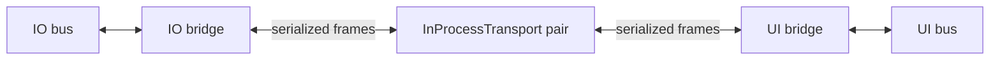

# ProtoMate Control

Control software running on the robot controller of the ProtoMate SCARA Robot.

## Current hardware: NUCLEO-H755ZI-Q

**M4 runs `io::Application`; M7 runs `ui::Application`.** Each firmware has its
own main, ThreadX kernel, C++ runtime, heap, TLS and threads. Both use the same
runtime implementation and HAL interfaces. No application object, mutex or
scheduler is shared between cores.

Use `h755-debug` to build both applications, or `h755-io-debug` and
`h755-ui-debug` individually. Each also has a `-release` variant.
[Build, flash, memory and peripheral ownership](docs/nucleo-h755ziq/README.md)
are documented together. Both images must be flashed. The
[CubeMX project](external/CubeMX/CubeMX.ioc) assigns peripherals to their cores.

Both applications always own a private message bus, coroutine context and ICC
bridge. **ICC runs over shared SRAM4 and HSEM notifications**, with transport
workers on both cores. The bridges perform their handshake and exchange
heartbeats. IO publishes logs on a bounded background topic; UI displays them
from a separate log worker alongside its CLI. Planning, GUI and motion message
routes remain under development.
No external wiring is needed. Both runtimes include filesystem support (no
mounted media yet), RTC and hardware randomness. M7 owns the ST-Link serial
console and user button. M4 exposes STEP/DIR/enable, reference switches,
DM542T/TMC2209 drivers and feedback through HAL. On startup, IO constructs its
motion controller with all motors disabled; driver initialization and motion
commands are explicit. See the [motor pin table](docs/nucleo-h755ziq/README.md#motor-peripheral-wiring-and-construction),
including the new **PE2 DM542T ALM assignment**. The bare-metal LED samples retain their separate
`h755-led-*` presets.

## Application layout

| Directory | Responsibility |
| --- | --- |
| `src/common/` | Shared contracts, motion profiles, application lifecycle concept, ICC bridge and transports |
| `src/io/` | M4 entry point, IO application, motor ownership and motion execution |
| `src/ui/` | M7 entry point, UI application and CLI; future planning and GUI |

Each firmware compiles only its own application target, `proto::io` or
`proto::ui`. Both use `proto::common`. These are compiled static libraries;
their nested `INTERFACE` targets collect sources privately into the owning
library. Tests and examples link the compiled libraries so implementation files
are compiled once per build. Public include paths start at `src/`, for example
`common/icc/bridge/Bridge.hpp` and `io/app/Application.hpp`. The Linux entry point in
`src/main.cpp` retains the in-process paired transport for host development and
lifecycle tests. It is not compiled into either H755 image.

The [application concept](src/common/app/Application.hpp) enforces `void start()`,
`void requestStop()` and `void join()` without inheritance. Construction initializes
logging; application workers launch in `start()`. `start()` is one-shot;
`requestStop()` is an idempotent thread-safe notification; `join()` waits for
completion. Destruction requests a stop and joins. Call start/join/destruction
from the lifecycle owner, outside workers.

`runtime::thread::Definition` annotations in each `app/Application.hpp` declare
its threads; `app/Application.cpp` defines their entries.
[ThreadGroup](platform/runtime/ThreadGroup.hpp) creates all workers before
releasing them. The ICC worker runs the context; the application worker waits
for a stop request, then drains the bridge before stopping its context. Peer
shutdown or link failure wakes the application worker. Each application requires
a transport; the bridge is a concrete member with no optional execution path.

[`io::motion::Controller`](src/io/motion/Controller.hpp) owns three `StepperMotor`
instances, their shared STEP generator and enable output. Drivers and feedback
belong to each motor. `initializeDrivers()` configures the drivers and starts the
idle timebase; `enable()` verifies readiness before energizing the motors.
Controller move/reference methods preserve independent axis execution and
buffering. `stop(id)` stops one motor, `stop()` stops all while retaining torque,
and `disable()` also removes enable and invalidates references. Driver faults
immediately drop shared enable; a diagnostic worker cancels and joins all motion.
Recovery requires explicit initialization and enabling. IO shutdown disables the
motors before draining ICC. Motor settings live in `io/app/Application.cpp`:
1.8° full steps, 16 microsteps and placeholder 135° shaft reference coordinates.

`src/ui/cli/` contains the annotation-based parser, filesystem and utility
commands, Linux terminal frontend, and an empty `motor` module. Registration
uses `ui::cli::register_commands` and `ui::cli::registry()`; command callbacks
have no dependency on the IO controller. The motor module currently registers
no commands; connecting it through ICC is the next stage.

M7 exposes the CLI through ST-Link VCP at **115200 baud, 8N1**. Use `help` or
`help <command>`. Available commands are `pwd`, `cd`, `ls`, `touch`, `mkdir`,
`rmdir`, `rm`, `cp`, `mv`, `cat`, `echo`, `grep`, `time`, `stack` and `heap`.
Quoting, wildcard expansion, pipes and `>`/`>>` redirection are supported.
For example, `echo "hello world" | grep world` and `time "heap"`.
`stack`, `heap` and `time` describe the local UI runtime. Filesystem commands
use the host filesystem on Linux and FileX on M7; no embedded volume is mounted
yet, so file operations can report unavailable storage.

Linux uses ncursesw with separate logs, line editing and command history when
attached to a terminal. Redirected input/output, `TERM=dumb`, or
`SIMPLCITY_CLI_PLAIN=1` select the plain frontend. Console EOF, Ctrl-C, or Ctrl-D
on an empty interactive line shuts down the application pair. Application or
peer shutdown also interrupts an idle CLI. Plain/serial lines are limited to
4096 bytes; oversized lines are rejected. M7 receives bytes into a bounded IRQ
buffer while commands execute; input errors stop the console instead of
executing truncated input. The serial frontend echoes input, so disable local
echo in the PC terminal.

The shared message catalogs live in `src/common/icc/catalog/`:

- [topics.hpp](src/common/icc/catalog/topics.hpp): `Topics`, with `TopicPublisher` annotations.
- [services.hpp](src/common/icc/catalog/services.hpp): `Services`, with `ServiceProvider` annotations.
- [actions.hpp](src/common/icc/catalog/actions.hpp): `Actions`, with `ActionProvider` annotations.

Both applications register all three catalogs in their constructors using their
own IO/UI role. `Topics::io_logs` carries IO log text to UI. Services and actions
are empty until their application functionality is implemented.

IO's Pneumo sink publishes already formatted records on `io/logs`; UI adds an
`[IO]` prefix and writes them directly to the console without logging them again.
Original timestamps and levels remain intact. Each record is limited to 384 bytes
(longer records end with `[truncated]`), and both the outgoing bridge subscription
and UI subscriber retain the newest 16 records. Overflow counters are available
through bridge/subscriber statistics; the sink separately counts truncations.
Console output runs on a notification-driven UI worker, never in ICC callbacks.
On Linux it uses the console broker, including buffering before ncurses starts.

UI installs its own Pneumo sink for all levels before its first startup log.
It prefixes local records with `[UI]` and calls `cli::writeLog`, the same output
function used by the IO subscriber. Received IO records retain `[IO]` and bypass
the local sink. The CLI frontend does not replace either logging route.

The M4 entrypoint installs this sink as Pneumo's default for all levels. The motion
controller also passes it explicitly to its motors, so Linux's IO logs use the same
ICC path while UI retains its separate console routing in the shared process.
Shutdown closes the IO sink before stopping ICC and wakes/joins UI's log worker.
Logs are best effort and may be discarded at shutdown. These bounds apply to the
ICC path; Pneumo's existing asynchronous logger queue is separate. Logging remains
a thread-context operation, not an ISR-safe or allocation-free API.

| Thread in each H755 image | ThreadX priority (lower is higher) | Stack |
| --- | --- | --- |
| ThreadX timer worker | 0 | Port default |
| `io.iccThread` | 2 | 32 KiB |
| `intercore.notify` | 3 | 8 KiB |
| `ui.iccThread` | 4 | 32 KiB |
| `ui.cliThread` | 5 | 16 KiB (64 KiB on Linux) |
| `io.applicationThread` / `ui.applicationThread` | 14 | 16 KiB |
| Runtime main/application entry | 15 | 8 KiB |
| M4 motion diagnostics | 18 | 8 KiB |
| `ui.logThread` | 20 | 8 KiB |
| Runtime cleanup/reaper | 31 | 2 KiB |

Priorities belong to separate schedulers; M7 priorities do not preempt M4 work.
ICC is a required part of both applications. The portable bridge and the
HAL/runtime transport adapter are separate targets. Reset both
cores together; independent core reconnection remains future work.

The [application archive](backups/application/README.md) preserves the earlier
control/CLI implementation for incremental reimplementation. Retired hardware,
bench programs and wiring are preserved under `backups/`; they are not build targets.

## Setup and compilers

```sh
git clone --recurse-submodules <this-repository>
# For an existing checkout:
git submodule update --init --recursive
```

Install CMake 3.22 or newer (3.24 or newer for `--fresh`), Ninja, GCC 16,
Arm GCC 16.1 or 16.2 with Newlib, OpenOCD, Arm GDB, Python 3, Git, and `patch`.
Linux CLI builds also require ncursesw headers and libraries (`ncurses` on Arch).
The project uses C++26 and the verified GCC 16 libstdc++ integration snapshot.
Unknown compiler majors and unverified Arm libstdc++ snapshots are rejected.
Linux tests download the pinned GoogleTest 1.17.0 source archive.

The VS Code devcontainer uses Arch Linux and checks that both compiler major
versions remain 16. Rebuild it after changing its Dockerfile. It exposes USB
and uses a development user with serial permissions. Host flashing and serial
capture also require access to the ST-Link USB and serial devices.

## Build and run

```sh
cmake --preset h755-debug
cmake --build --preset h755-debug
cmake --preset debug-linux
cmake --build --preset debug-linux
./build/debug-linux/Application
```

The combined preset's default target is `controllers`. It builds both firmware
images using the existing per-core presets and output directories, including
both memory reports. It does not flash the board. Use `--target io-controller`
or `--target ui-controller` to build just one through the combined project.

Runtime and HAL source implementations are shared; each core compiles and links
its own copy with its own CPU flags, ThreadX port and private runtime state.

`h755-release` and `release-linux` provide optimized builds. After a
compiler upgrade use `cmake --preset <preset> --fresh` and rebuild cleanly.
Use `-DBUILD_TESTING=OFF` when configuring Linux to build the template without
fetching or building test dependencies.

All project C/C++ sources in `src/` and `platform/`, including tests, compile
with `-Wall -Wextra -Wpedantic` in both Debug and Release builds. Directory
settings apply these flags to new module targets as well.
Embedded Debug builds retain debug information and use `-Og` for IO, UI and ICC.
Both applications' composition and log sink files use `-Os`, as does the UI
entrypoint, to fit the catalog and logger templates in each 1 MiB flash bank.
Motor and other UI code keep `-Og`.

H755 builds produce `io-controller` or `ui-controller` ELF/HEX/BIN/MAP files.
Use the [combined flash command](docs/nucleo-h755ziq/README.md#flash-and-test).

Every default hardware build prints used bytes, region capacity and percentages,
including builds where the ELF is already up to date. The `memory-usage` target
can also be invoked explicitly. These are linker allocations: the stack region
is fully reserved, and RAM includes the minimum heap reservation, not measured
runtime stack or heap usage.

Linux simulates the HAL and uses the ThreadX Linux port. Standard Linux file
I/O uses the host filesystem; explicit FileX tests use simulated media images.
The application runs both ICC endpoints and the UI CLI. Redirecting a command
script into `build/debug-linux/Application` executes it and exits at EOF.

## Linux sanitizer checks

Build and run the complete Linux test suite with AddressSanitizer,
UndefinedBehaviorSanitizer and leak detection:

```sh
cmake --preset sanitize-linux
cmake --build --preset sanitize-linux
ctest --preset sanitize-linux
```

The test preset sets `ASAN_OPTIONS=use_sigaltstack=0` because the ThreadX Linux
port owns its threads' alternate signal stacks. Instrumented builds also reserve
at least 1 MiB of native stack per simulated thread for sanitizer overhead;
firmware stack sizes are unchanged. Memory and leak checking remain enabled.
LeakSanitizer needs permission to inspect process threads; run these tests outside
a ptrace-restricted sandbox. These checks exercise simulated
hardware; STM32 behavior requires separate hardware validation.

## Application, HAL and runtime linting

Run the configured readability, naming, bug-prone, modernization, performance,
static-analyzer and Core Guidelines checks on production code in **`src/`,
`platform/hal/` and `platform/runtime/`**, including both Linux and STM32
implementations, with:

```sh
cmake --preset debug-linux
cmake --build --preset debug-linux --target clang-tidy
```

Alternatively, `cmake --preset clang-tidy-linux` followed by
`cmake --build --preset clang-tidy-linux` prepares a separate analysis directory.
These are explicit analysis targets; normal builds still use GCC without linting.

The runner requires Docker, Python 3, CMake/Ninja, the project's GCC 16 Arm
toolchain (including newlib/libstdc++ headers), and host ncurses development
headers. It uses a pinned Pneumo devcontainer image with matching
Clang/P2996, clang-tidy and reflection headers. If the image is not already
installed, pull it once:

```sh
docker pull ghcr.io/daleondev/pneumo-devcontainer@sha256:1c10d580f47f4fa402da038896027629ded2d94de4ddd0f382f8a63830fae3e7
```

The container runs without network access, with project sources mounted read-only.
Analysis copies of the compilation databases select Clang and reflection flags.
Linux analysis uses the image's libstdc++. STM32 analysis uses
`--target=arm-none-eabi`, the selected Cortex-M4/M7 and FPU settings and the real Arm
toolchain's libstdc++/newlib headers, mounted read-only. Real host ncurses headers
are copied into the report directory. Firmware build flags,
dependency declarations and application sources are not rewritten.

The runner configures private STM32 CMake directories under
`<build-directory>/clang-tidy/configurations/stm32-io/` and `stm32-ui/` to obtain the HAL and runtime's
actual includes and definitions without building or flashing anything. Separate analysis
databases preserve Linux, M4 and M7 contexts for shared sources. Every active production
HAL/runtime C/C++ source must have a compilation command; retained unbuilt board
implementations are excluded from that inventory; setup fails if a newly
added file is missing from these configurations. Runtime C sources use Clang's C
driver without C++ reflection flags. The shared `runtime/startup.cpp` hook uses
the main `Application` target's configuration, excluding its duplicate test and
example compilation commands.

All `test/` and `tests/` directories, including unit tests, test helpers, model
tests and hardware bench programs, are excluded from source selection, header
diagnostics and reports. No test configurations are prepared for linting.
External dependencies and copied sources in `vendor/` directories, including the
runtime's GCC source snapshot, are also excluded. Their real headers are still
parsed when required by a production source. Static analysis does not replace GCC
builds or hardware tests.

The runner generates `reflection-include/` from the pinned Clang `<meta>` and
consteval-type-trait headers. Only their library includes, namespace wrappers and
library-specific declaration macros are adapted for libstdc++; the reflection
implementations and compiler intrinsics are preserved. No lint-specific HAL,
ThreadX or callback stubs are used. STM32 sources are checked against the real
hardware headers in their ARM context.
Pneumo selects its existing Clang reflection workaround by the
reflection header instead of the surrounding standard library. Updating the image
requires revalidating this adaptation; missing expected header markers fail setup.

The runner invokes clang-tidy directly for each source, without a separate syntax
precheck. Each invocation's raw output is printed as it finishes, keeping the
diagnostics together during parallel runs. The console includes clang-tidy's
source excerpts, notes and check names; custom progress lines, summaries and
deduplicated findings are omitted.

CLI registration uses explicit command namespace reflections, and thread
annotations use reflection operations supported by both compilers. Stack and heap
tables in `cli/utilities.cpp`
use `std::vformat_to` to avoid Clang/libstdc++'s compile-time dynamic-width checking
incompatibility. These table formats are checked at runtime; other format strings
retain compile-time checking. Blocking compiler errors cannot be disabled with
clang-tidy check filters. See the [clang-tidy documentation](https://clang.llvm.org/extra/clang-tidy/).

Reports are saved separately in `<build-directory>/clang-tidy/`:

- `findings.txt`: deduplicated `src/`, `platform/hal/` and `platform/runtime/`
  diagnostics from fully parsed files.
- `partial-findings.txt`: review-only diagnostics if clang-tidy fails to parse
  a file; normally empty.
- `summary.txt` and `report.json`: coverage, blocked files and their errors.
- Per-context directories containing per-source `.log` and `.yaml` files: full
  diagnostics and suggested replacements. `analysis.json` lists the selected
  commands and their databases; the JSON report records each invocation's context
  and duration.
  Replacements are **never applied automatically**.

Exit status is `1` for findings in fully parsed files, and `2` for tool failures or
when no file can be fully checked. Partial coverage is accepted by default;
compiler errors remain visible in the raw output and saved coverage report.
To require complete coverage:

```sh
python3 scripts/clang_tidy.py --build-dir build/debug-linux --strict
```

The naming rules live in `.clang-tidy`. Clang 21 uses `GlobalConstant` for global
constants including constexpr, and `PublicMember` for public fields including
ordinary struct fields. `tooling.clang_tidy` tests diagnostic classification,
source/test/vendor filtering, HAL/runtime inventory, C/C++ commands, target contexts
and failure handling without Docker.

Keep explicit default member initializers in aggregate configuration types,
including `{}` for class-type members. The
[`readability-redundant-member-init`](https://clang.llvm.org/extra/clang-tidy/checks/readability/redundant-member-init.html)
check is disabled because removing those defaults conflicts with GCC's
`-Wmissing-field-initializers` under `-Wextra`. The compiler warning remains
enabled; lint fixes must preserve a warning-free GCC build.

Cognitive-complexity checks count application control flow, excluding macro
expansions. Compiler-generated coroutine diagnostics have narrowly named,
commented `NOLINT` markers; the remaining check families stay enabled.

## HAL architecture

The HAL provides peripheral access and device behavior. Robot motion planning,
homing policy, gearing, kinematics and CLI commands belong to the application
modules being rebuilt in `src/io`, `src/ui` and `src/common`. Thread scheduling, the C++ runtime and filesystem integration belong
to `platform/runtime`.

### Layers and responsibilities

Paths in this table are relative to [`platform/hal`](platform/hal).

| Location | Responsibility | Dependencies within the HAL |
| --- | --- | --- |
| `drivers/itf` | Peripheral capability interfaces (`ISpi`, `IUart`, `IDigitalInput`, etc.) and their configuration/value types | Other driver contracts and common `util` |
| `drivers/impl/stm32`, `drivers/impl/linux` | Concrete classes implementing those interfaces using the selected platform | Driver contracts, driver helpers and platform support |
| `drivers/impl` | Shared step-generator/output algorithms | Driver contracts, helpers and the internal `StepHardware` backend boundary |
| `drivers/factory` | Select a backend, validate a supported resource/route, claim ownership and return its interface | Driver implementations and other driver factories |
| `devices/itf` | Device capabilities such as `IMotorFeedback`, `IStepperDriver`, `IButton` and `ILed` | Device/driver contracts and common `util` |
| `devices/impl` | Device behavior and protocols: TMC2209, DM542T, LAN9253, feedback, button and LED adapters | Injected driver interfaces and device helpers |
| `devices/factory` | Construction that differs by platform, currently TMC2209 transport/model composition | Driver factories and the selected device model |
| `board/board.hpp`, `board/nucleo_h755ziq/board.cpp`, `board/linux/board.cpp` | Translate robot/board roles into pins, peripherals, driver addresses and device compositions | Public factories and portable device implementations |
| `core` | Expose resources belonging to the executing processor (`M4`, `M7`, or `Host`); select its status LED and runtime timer | Board factories and capability contracts |
| `hal.hpp/.cpp`, `stm32`, `linux` | Platform startup, console, panic handling, interrupt dispatch and platform synchronization | Selected platform/vendor facilities |
| `util`, `drivers/util`, `devices/util` | Common result types or helpers private to their respective layer | Same-layer or lower-level contracts; never board/application policy |

Each compiled layer has its own target. The public dependency chain is:

```text
platform::hal → hal::core → hal::board → hal::devices → hal::drivers
```

Each target compiles only its own sources; CMake selects the STM32 or Linux
backend. H755 provides onboard resources plus M4 motor timers/DMA, USART2,
reference/diagnostic inputs and feedback.
The Linux board composition supplies virtual resources for device regression
tests; it does not define H755 motor wiring. The Linux step and encoder workers are compiled as `hal_linux_services`
objects using the runtime's C++ ABI and included in `hal_drivers`. Their opaque
service objects keep that ABI boundary out of public interfaces.

Interfaces and public factory headers contain no vendor handles, platform
headers or board wiring. Configuration types live beside the interface, so an
implementation never needs a factory header to obtain its own types.
[`GpioTypes.hpp`](platform/hal/drivers/itf/GpioTypes.hpp) contains GPIO values and
configuration; the actual input/output interfaces are separate.

Concrete classes are declared in `.hpp` files and implemented in matching `.cpp`
files. Coherent families can share a pair, as `GpioInput` and `GpioOutput` do in
`Gpio.hpp/.cpp`. Shared algorithms stay in the common implementation directory;
platform models stay in `impl/linux`. Small inline methods and template helpers
remain in headers. Helper directories and namespaces consistently use **`util`**:
`hal::util` for common/driver helpers and `hal::device::util` for device helpers.

Device behavior uses injected interfaces and contains no peripheral selection
or MCU register access. The explicit platform exception is synchronization:
`InterruptGuard`, `Mutex` and `ThreadMutex` protect callbacks and shared state.
TMC2209 and LAN9253 protocol classes can be concrete portable classes; capability
interfaces are introduced where callers need interchangeable implementations.
`IConfigurableStepperDriver` extends `IStepperDriver` with optional configuration.

The board layer defines wiring and composes those objects. It contains no host
simulation registry or simulated register behavior. The Linux TMC2209 device
factory attaches `Tmc2209Model` to a generic UART; tests can instead construct
and inject their own model/transport. Generic SPI/UART drivers contain no motor
or EtherCAT protocol. `hal.hpp` is the startup/vendor bridge and is not a header
for ordinary device implementations or public contracts.

Application entry points and runtime counter setup use `hal::core`:

```cpp
auto led = hal::core::create_status_led();
auto timer = hal::core::create_runtime_timer();
constexpr auto processor = hal::core::id(); // Id::M4, Id::M7, or Id::Host
```

`hal::core` uses `util::executing_core()` to select the compile-time construction
catalog in [`core/Catalog.hpp`](platform/hal/core/Catalog.hpp). Each annotated
entry lists the available roles and the board factories that create them:

```cpp
[[= util::Core::M4]] static constexpr Devices m4{
    .status_led = [] { return board::create_led(board::LedId::Green); },
    .runtime_timer = [] { return board::create_timer(timer::Peripheral::Tim5); },
    .rtc = board::create_rtc,
    .rng = board::create_rng,
    .intercore_channel = board::create_intercore_channel,
};
```

Omitted roles are unavailable: their core factory returns `nullptr` (or an
array of null pointers for the driver set). Reflection
selects the entry at compile time and rejects missing or duplicate assignments
for the selected processor. No device is constructed by reading the catalog.
M4 uses green/PB0 and TIM5; M7 uses yellow/PE1 and TIM12, plus red/PB14 and
the user button/PC13. Both entries explicitly include shared RTC/RNG and their
local inter-core endpoint. M4 also lists all motor factories; M7 has none.
IO/UI are application names, not HAL identities.

`hal::board` only describes physical wiring and construction. It has no core
parameter, core identity include or ownership policy. For example,
`board::create_led(LedId::Red)` is available independently of the caller.
GPIO and timer factories likewise select hardware without consulting core
assignments. Application/runtime code uses `hal::core` to respect the catalog;
direct board/driver access is intentionally unrestricted and must not operate a
resource concurrently owned by another processor. Existing per-image resource
leases and cross-core synchronization for shared devices remain in place.

Timer factories expose initialized TIM5 and TIM12 to either image. They wrap
the peripheral without resetting it; CubeMX/platform startup still initializes
the hardware once. Changing a catalog assignment that moves peripheral
initialization or interrupts also requires updating that startup configuration.
Motor wiring and startup behavior are documented in the
[H755 setup](docs/nucleo-h755ziq/README.md#motor-peripheral-wiring-and-construction).
External storage and EtherCAT wiring remain unassigned.

Host tests retain virtual board devices. `Core::Host` selects its own runtime
timer, RTC/RNG, error LED and button, with no status LED or hardware peer channel.
The board can still construct its virtual LEDs independently of those roles.

### Factories and resource selection

Configurable factories take a typed `Configuration` describing hardware resources.
GPIO selects pins; buses select a peripheral; PWM/encoder configurations select a
peripheral and its pin/channel route. Device roles and wiring choices belong to
`hal::board`, not to the transport drivers.

```cpp
auto spi = hal::spi::create({ .peripheral = hal::spi::Peripheral::Spi5 });
auto uart = hal::uart::create({
    .peripheral = hal::uart::Peripheral::Usart2,
    .transport = { .local_echo = true, .settle_time = std::chrono::milliseconds{1} }
});
auto timer = hal::timer::create({ .peripheral = hal::timer::Peripheral::Tim5 });
auto pwm = hal::pwm::create({
    .timer = hal::timer::Peripheral::Tim1,
    .channel = hal::timer::Channel::Channel1,
    .pin = { hal::gpio::Port::E, 9 }
});
auto encoder = hal::encoder::create({
    .timer = hal::timer::Peripheral::Tim3,
    .a = { hal::gpio::Port::B, 4 }, .b = { hal::gpio::Port::B, 5 }
});
```

These examples describe the retained factory contracts. On current hardware,
onboard GPIO, per-core timers, serialized RTC/RNG access and the inter-core
channel are available. M4 owns TIM5; M7 owns TIM12 and the console UART.
RTC and RNG are shared through hardware-semaphore protection. Motor peripherals
use TIM2/TIM3/TIM6/TIM7, DMA1 and USART2 on M4. The generic SPI/PWM, Ethernet
and storage backends still require H755 assignments; the console uses dedicated
onboard USART3 initialization.

Linux provides virtual peripheral resources and device models for regression
tests. Its board composition does not claim physical wiring. Construction never
starts motion; owners must explicitly start devices and manage their callbacks.
Bus exclusivity and device-level transaction serialization remain separate
responsibilities.

Operations report failures using `hal::util::Result` and `std::error_code`.
The STM32 HAL-status conversion lives in `stm32/HalResult.hpp`; Linux failures
use standard error codes or the host's `errno`. Callback context and permitted
operations are specified on each interface. STM32 interrupt callbacks must be
short and nonblocking; callers must respect callback lifetime and unregister/
stop requirements before releasing their dependencies.

### Checking the structure

[`verify_hal_architecture.py`](cmake/tests/verify_hal_architecture.py) checks
production includes, helper naming, interface/factory boundaries, selected
platform sources and CMake source ownership. It is registered as
`hal.architecture` in the Linux CTest suite. Both platform selections can be checked
explicitly after configuring them:

```sh
python3 cmake/tests/verify_hal_architecture.py --source . --build build/debug-linux
python3 cmake/tests/verify_hal_architecture.py --source . --build build/h755-io-debug --platform stm32
python3 cmake/tests/verify_hal_architecture.py --source . --build build/h755-ui-debug --platform stm32
ctest --test-dir build/debug-linux --output-on-failure
```

Host device tests verify software behavior. Electrical timing and peripheral
ownership require separate hardware validation as each subsystem is ported.

## Processor-to-processor messaging

The ICC implementation in `proto::common` supports serialized topics, services
and actions, with peer readiness, connection health and state-change callbacks.
The bridge is independent of hardware; the common library also includes the
HAL/runtime inter-core adapter and, on Linux, the in-process transport.
The [two-bus examples](src/common/icc/examples/README.md), including the
[action example](src/common/icc/examples/actions.cpp), also run independently.

The implementation separates message routing from byte transport:

| Location | Responsibility |
| --- | --- |
| [bridge/Bridge](src/common/icc/bridge/Bridge.hpp) | Public registration API, lifecycle, send/receive loops, fair scheduling and failure handling |
| [bridge/TopicBridge](src/common/icc/bridge/TopicBridge.hpp) | Reflected topic registration, subscriptions, bounded FIFO/latest-value delivery, drop statistics and incoming publications |
| [bridge/ServiceBridge](src/common/icc/bridge/ServiceBridge.hpp) | Reflected service registration, deferred proxies, call IDs, replies, cancellation, deadlines and cleanup |
| [bridge/ActionBridge](src/common/icc/bridge/ActionBridge.hpp) | Reflected action registration, deferred admission, feedback, cancellation, acknowledged terminal results and cleanup |
| [bridge/ConnectionHealth](src/common/icc/bridge/ConnectionHealth.hpp) | Handshake, acknowledged heartbeats, deadlines and connection state notifications |
| [bridge/Frame](src/common/icc/bridge/Frame.hpp), [bridge/OutgoingWakeup](src/common/icc/bridge/OutgoingWakeup.hpp) | Shared wire encoding and coalesced readiness signals per lane |
| [transport/](src/common/icc/transport/ITransport.hpp) | Transport interface and paired in-process transport; transfers bytes without interpreting messages |

`Bridge` owns its routing and connection helpers by value and serializes registration against startup.
The helpers run on its coroutine context and cannot call back into `Bridge` or
access the transport. Shutdown first drains actions while communication continues,
then closes services and disconnects topic subscriptions after its six transport
loops and health timer loop finish. The caller owns the context and runner thread;
the previous application thread glue is archived with `system_threads`.



The standalone topic example owns two independent buses and two bridges. Both bridges run on one
coroutine context on a dedicated p2p thread. Each has a send and receive coroutine per lane, all on the same context.
They suspend while waiting and yield after each frame so normal traffic cannot
monopolize the context. Application subscriptions dispatch on
their caller's thread. The application shells already use separate contexts and
runners, matching the intended ownership of the future core applications.

[Topics.hpp](src/common/icc/examples/Topics.hpp) specifies the forwarded topics using
`pnm::msg::Topic<T>` fields annotated with a publisher. No catalog
instance is constructed. Register the shared catalog once per bridge, identifying
the local publisher:

```cpp
io_bridge.registerTopics<Topics>(TopicPublisher::IO);
ui_bridge.registerTopics<Topics>(TopicPublisher::UI);

// Infer the payload type and topic name from the annotated field.
io_bus.topic<^^Topics::demo_io_state>().publish("idle");
```

Matching publisher annotations become outgoing topics; the peer's publications
become incoming. The application-defined enum must declare exactly two distinct
values. Annotation order is irrelevant; unrelated annotations are ignored.
Fields without the publisher annotation stay local. Forwarded fields require one
publisher. Names default to the field identifier with every `_` replaced by `/`:
`demo_io_state` becomes `demo/io/state`. One optional nonempty narrow `FixedString`
annotation overrides the name verbatim. Multiple name annotations and annotated
static declarations are rejected. Registration uses catalogs only. Register before
`start()`; names must be unique across both directions on each bridge.

The service API uses a separate application-defined `ServiceProvider { IO, UI }`
enum and annotated nonstatic `pnm::msg::Service<Request, Response>` fields.
`registerServices<Services>(ServiceProvider::IO)` identifies the IO side;
`bus.service<^^Services::demo_io_echo>()` derives the name and both payload types from
the field. No catalog object is constructed. Names and provider annotations
follow the same validation and ordering rules as topic names and publishers;
fields without the provider annotation stay local.
Matching provider annotations accept incoming requests for local handlers; the
peer's services forward outgoing requests. Replies return automatically.
[Services.hpp](src/common/icc/examples/Services.hpp) illustrates the catalog and
[services.cpp](src/common/icc/examples/services.cpp) runs an echo service. Applications
own and dispatch their handlers using the native or coroutine pneumo API. Bridge
proxies use deferred replies; they never execute application handlers or block
waiting for a result on the p2p context. Native readiness notifications and
deadline timers wake the bridge. No waiting thread is created per call.

The lane enum, priority order and background frame limit are defined once in
[`platform/communication/Lanes.hpp`](platform/communication/Lanes.hpp), exposed by
the header-only `platform::communication` target. It depends only on standard
headers; both HAL and ICC use this contract without depending on each other.
`icc::Lane` and `hal::IInterCoreChannel::Lane` are aliases of the same type.

`ITransport` asynchronously sends and receives complete frames using borrowed
spans. Its `Lane::Urgent`, `Lane::Normal` and `Lane::Background` queues have independent
capacity, waiters and sender/receiver coroutines. `InProcessTransport::pair()`
reserves eight frame slots per lane and direction (six queues). Normal and urgent
frames may use 2048 bytes; background frames are limited to 512 bytes including
header and topic name. A full background queue cannot block normal or urgent
traffic. Each lane preserves FIFO order. At each receive boundary, queued urgent
frames take precedence over normal, which take precedence over background. An
already consumed frame is not preempted. Independent rings can enqueue concurrently;
priority applies when consuming frames. Both peers must service all lanes in use.
Sustained higher-priority traffic may starve background delivery. Urgent traffic remains bounded and can itself back up.
It does not preempt a running handler or rescue a stalled context. Cancellation and `close()` wake waiting operations; closing either
endpoint disconnects the pair. Reconnection requires a new pair.

The frame has a 16-byte header: version (currently 7), frame kind, 16-bit name
length, 64-bit call ID and 32-bit remaining timeout in milliseconds. Integers are
little endian. Name bytes and serialized payload follow, with a 2048-byte total
limit. Topics, service requests and action goals identify their destination by
name. Replies and action lifecycle frames use correlation IDs; services and
actions have separate ID spaces. Topics use zero call ID and timeout. Action
result payloads start with an explicit one-byte status; errors have explicit
one-byte codes independent of native enum layouts.
Payloads use pneumo serialization. `std::string` sends its characters, not its
native object layout. Compound types need explicit serialization adapters with
portable field widths and byte order before use between different targets.

Each bridge accepts up to 16 topics, 16 services and 16 actions. Topics default to
normal-lane, latest-only delivery. Optional catalog annotations choose a lane and
bounded FIFO delivery, independently:

```cpp
struct Topics {
    [[= TopicPublisher::IO, = icc::Lane::Background,
      = pnm::msg::SubscriptionOptions{ .capacity = 16 }]]
    pnm::msg::Topic<std::string> io_logs;
};
```

`SubscriptionOptions` accepts 1–64 queued records; the default overflow policy
is `DropOldest`, with `DropNewest` available to preserve the oldest queued records.
The bridge dispatches one record per turn using Pneumo's `Subscription::pollSome()`.
Readiness notifications wake the appropriate lane. Publication never waits for
transport space; a blocked background send suspends only its own coroutine while
the bounded subscription handles overflow. At most one additional topic frame per
lane is in flight, plus the transport's reserved slots. `topicStatistics("io/logs")`
returns pending subscription records and cumulative dropped records; it excludes
transport/in-flight frames and returns `nullopt` after cleanup or for an unknown
or incoming topic. Overflow is counted, and oversized background records are also
dropped and counted instead of failing the control connection. Consumers should
likewise use bounded subscriptions and dispatch UART output on their own worker.
The application's IO sink and UI subscriber use this path for `Topics::io_logs`.

Background is best effort: shutdown cancels blocked sends without draining logs,
and no delivery acknowledgement or replay is promised. Services and actions stay
on the control lanes. Operational faults must be conveyed separately from their
background log text.
Service requests are never coalesced. There are eight forwarded calls per
lane and direction, eight queued/pending requests per local proxy, and eight queued
rejection replies per lane. Normal traffic cannot consume urgent service slots. Excess calls report `Busy`; a peer overrunning the rejection
queue fails the connection rather than growing memory without bounds.
Completed replies are retained until queued into the transport or shutdown.
The normal sender rotates between ready action, service and topic traffic; the
urgent sender rotates between action cancellation/ACKs and service traffic.

Service caller timeouts and cancellation terminate the local wait and forward a
best-effort cancellation to the peer. Remaining timeout budgets are rounded up
to milliseconds and capped at `UINT32_MAX` milliseconds. They are not synchronized
cross-core deadlines and do not subtract time spent inside the transport.
Cancellation/timeout does not prove that a handler's side effects stopped.
Late replies are ignored by the caller, but release the reserved bridge slot.
Cancelled calls retain that slot until the peer responds or the connection closes,
bounding cancellations that overtake requests. Call IDs are never reused within a bridge.
Transport failure completes pending service calls with `TransportError`; explicit
local service shutdown uses `Cancelled`. Neither result proves that remote hardware stopped.
Stop both bridges while the context still runs, then stop and join its runner.
New connections require fresh bridge/transport instances. No command is replayed
or resumed automatically. Full session identities and stale-frame protection
across independently restarted cores remain future work.

Actions use `registerActions<Actions>(ActionProvider::IO)` and reflected
`bus.action<^^Actions::member>()` handles on both native and coroutine buses.
Their catalogs follow the same optional name and provider rules as services.
[Action usage](src/common/icc/examples/actions.md) explains the provider and caller roles.
The bridge forwards acceptance only after the real provider accepts. Feedback is
latest-only; terminal results are retained until acknowledged by the peer. Each
direction admits eight forwarded goals; each proxy admits eight native goals.
Eight rejection slots and sixteen acknowledgement slots have independent bounds.
Excess work reports `Busy`; malformed framing or peer capacity abuse fails the link.

Action cancellation requests cleanup and does not finish the goal. A goal
cancelled before forwarding can complete locally because no remote work exists.
Once forwarded, only a terminal response confirms the outcome. Admission timeouts
apply until acceptance, not throughout execution. Timed-out/abandoned callers still
retain bridge records until the remote terminal result or connection closure.
No submitted goal is automatically replayed.

`stop(grace)` stops action admission and requests cancellation, keeping workers
and communication running until results are delivered. The default grace is
500 ms. If it expires, `failure()` records the timeout and unfinished callers get
`TransportError`, not a fabricated `Cancelled` outcome. Provider cleanup must
continue independently after a communication failure. Native caller callbacks
run when the application polls its handle, never on the bridge's context thread.
The p2p application thread and runtime-backed example runners use a 32 KiB stack
for nested Debug serialization; the portable bridge does not configure threads.

Cancellation and action terminal acknowledgements always use the urgent lane.
A cancellation may arrive before its normal request/goal; bounded records ensure
the later command never reaches an application provider. Action results and
feedback retain their normal-lane ordering. A cancellation request still does not
confirm that already-running work has stopped; its terminal response may wait for
normal capacity. Service cancellation carries one byte identifying the original
request lane (0=normal, 1=urgent).

Services may explicitly reserve the urgent lane in their shared catalog:

```cpp
struct Services
{
    [[= ServiceProvider::IO, = p2p::Lane::Urgent]]
    pnm::msg::Service<StopRequest, StopResponse> stop;
};
```

The annotation applies to requests and replies, and both peers must agree. Other
services default to normal; topics, goals, action acceptance/feedback/results use
normal. Keep urgent service handlers short or defer work to an IO worker. The
control catalog uses this lane for Stop and Disable.
Connection management uses that same urgent lane ahead of application traffic.

A bridge starts in `Stopped`, then reports `Connecting` and exchanges Hello/Ready
frames before forwarding application data. Calls queued during this handshake
remain local and retain their native timeout. `Connected` means both peers have
completed the version-compatible handshake; it does not validate application
catalogs, motor configuration or physical hardware readiness.

Connection monitoring defaults to a 100 ms heartbeat and a 500 ms deadline;
pass `ConnectionOptions{.heartbeat = 100ms, .timeout = 500ms}` as the fourth
constructor argument to configure them. Only a fresh acknowledgement of the
outstanding heartbeat refreshes the deadline. Incoming publications, peer
heartbeats and repeated old acknowledgements cannot conceal a broken outgoing
path. One outstanding challenge and one coalesced reply bound control storage.
Management kinds are Hello (13), Ready (14), Heartbeat (15), HeartbeatAck (16)
and Goodbye (17). Their name, timeout and payload are empty; only the heartbeat
frames carry a nonzero challenge ID.
The health coroutine has its own timer and wakeup, so its deadline still expires
when either transport sender is blocked. Deadlines are checked before dispatch,
including after a stalled context resumes.

Register a connection callback before `start()` and read the current snapshot
with `connectionStatus()`. For example, publish the notification to a **local**
application topic that an IO worker consumes:

```cpp
auto connectionEvents = io_bus.topic<p2p::ConnectionStatus>("local/p2p/connection");
io_bridge.setConnectionCallback([connectionEvents](p2p::ConnectionStatus status) {
    connectionEvents.publish(status);
});
```

The callback runs on the p2p context outside internal locks. Keep it short: notify
or enqueue work; do not block, join workers, call `stop()`, or destroy the bridge
inside it. Captures must outlive the bridge. No notification is emitted at
registration; `Connecting` is the first event. State changes are emitted once,
not on every heartbeat. Callback exceptions fail the connection while preserving
teardown. The callback and all pending transport operations finish before
`stop()` returns.

`Failed` is latched, with an explicit reason such as `HandshakeTimeout`,
`HeartbeatTimeout`, `PeerRestarted`, `TransportError`, `ProtocolError`, or
`ShutdownTimeout`. Outstanding service/action handles receive `TransportError`,
local provider cancellations are requested, and bridge-owned queued work is
invalidated. An accepted action still needs application cleanup: link failure
never confirms a physical stop. A fresh Hello on an established link requires
explicit recovery; this detects an announced restart, not every possible stale
frame from an earlier boot.

An orderly local shutdown reports `Stopping` then `Stopped`, after action draining
and an urgent Goodbye. A peer Goodbye with no outstanding actions also reports
`Stopped`, with reason `PeerStopped`; if actions are still outstanding it fails
with that reason. Treat every departure from `Connected` as unavailable for new
control commands. Every failure requires deliberate reconstruction/recovery;
there is no automatic reconnection or motion replay.

All monitoring runs on the p2p context. If that entire context or processor
freezes, its local timer cannot run: an independent IO/hardware watchdog is still
needed when integrating motion control. Callback consumers own the local stop,
holding-torque policy, latched robot fault and explicit recovery. Those robot
policies are not implemented inside the portable bridge.

The archived [control message catalogs](backups/application/control/Messages.hpp),
[client](backups/application/control/ControllerClient.hpp) and
[server](backups/application/control/ControllerServer.hpp) are reference material
for rebuilding the execution boundary. They are not part of the current normal build.

STM32 Debug compiles the portable p2p library with `-Og` while retaining debug information.

Build and test the bridge independently:

```sh
cmake --build --preset debug-linux --target application_p2p_example application_p2p_service_example application_p2p_action_example application_p2p_transport_tests application_p2p_service_tests application_p2p_action_tests application_p2p_urgent_tests application_p2p_connection_tests
./build/debug-linux/src/common/icc/examples/application_p2p_example
./build/debug-linux/src/common/icc/examples/application_p2p_service_example
./build/debug-linux/src/common/icc/examples/application_p2p_action_example
ctest --test-dir build/debug-linux -R '^application\.p2p\.' --output-on-failure
```

## Planned migration to STM32H747XIH6 (Arduino GIGA R1 WiFi)

**Status: planned robot architecture.** The current NUCLEO-H755ZI-Q already runs
separate M4/IO and M7/UI applications with shared-memory ICC. The remaining robot
integration, GUI and GIGA board port are future work. The external-flash layout
below is a migration target; current H755 images execute from internal flash.

### Controller responsibilities

Use the STM32H747XIH6 as two controllers with separate firmware images and
separate application state. **M7 plans robot motion; M4 owns its execution and
can stop it independently.**

| Responsibility | IO controller: Cortex-M4, 240 MHz | UI and planning controller: Cortex-M7, 480 MHz |
| --- | --- | --- |
| Hardware | Motor drivers, STEP/DIR/ENABLE, encoders, INDEX and switches | Display, touch and console |
| Motion execution | `MotionController`, `StepperMotor`, trajectory execution and timer/DMA scheduling | Submit planned motions |
| Robot model | Enforce axis constraints and apply configured motor/axis conversions | `Robot`, kinematics and Cartesian/joint conversions |
| Motion planning | Local homing and stopping profiles | Paths, coordinated profiles, blending and lookahead |
| State | Authoritative motor/axis positions, velocities, reference state, configuration and faults | Consume snapshots; calculate and present robot state |
| Fault handling | React immediately, stop affected motion and invalidate commands/references as required | Report faults and request recovery |
| EtherCAT (future robot integration) | ESC transport, cyclic exchange, communication watchdog and command ownership | Plan high-level robot requests when needed |

M7 runs the planner in its own worker, independently of TouchGFX rendering and
CLI processing. GUI and CLI use the same application/control services; neither
frontend owns the physical `StepperMotor` objects. Display and console activity
must not prevent the planner from meeting the trajectory queue's refill deadline.

M7's processing speed, caches and double-precision FPU suit the current
`double`-based motion calculations. Graphics acceleration can reduce rendering
work, but planner throughput must still be measured under GUI load. See the
[H747 datasheet](https://www.st.com/resource/en/datasheet/stm32h747xi.pdf) and
[TouchGFX hardware guidance](https://support.touchgfx.com/docs/development/hardware-selection/hardware-components/hardware-selection-mcu).

### Planning and execution boundary

Separate three stages:

1. **M7 planning:** calculate the path and acceleration/deceleration/jerk profile,
   then produce synchronized joint trajectory segments.
2. **M4 trajectory execution:** validate and consume the segments, track progress
   and prepare upcoming integer step timings with bounded computation.
3. **M4 pulse generation:** timers and DMA generate the STEP edges. Segment
   reception and GUI scheduling do not determine individual edge timing.

The coordinated-motion contracts describe complete bounded profiles; bridging
those contracts is pending. A later planning step is a stream of buffered trajectory segments describing
selected joints over defined intervals. Segment duration, queue capacity and
refill/braking reserves require implementation and timing validation. The M4 evaluator must preserve step-count accuracy and synchronization
while meeting the DMA refill deadlines. Expensive planning and blocking work
must stay outside interrupt handlers.

In the archived implementation, `StepperMotor` creates
profiles and blends commands, and `StepGenerator::fill()` invokes
`Sequence::generate()` to evaluate profiles while preparing DMA data. Moving
`Robot` and profile creation to M7 alone would leave profile evaluation on M4.
Extract planning from execution and benchmark the remaining evaluator explicitly.

Commands identify their affected axes. Independent axis operations remain
supported; coordinated commands explicitly group axes and use one agreed
execution timeline. A stalled segment stream for a coordinated move must trigger
the group's defined stopping behavior rather than let its axes diverge.

M4 owns motor/axis configuration, including direction, microsteps, conversions
and execution limits. M7 plans against versioned snapshots of that configuration
and the commanded execution state. Encoder/INDEX feedback retains its source and
validity information when reported to M7; planned positions do not replace
measured or estimated feedback.

### Local stopping and recovery

M4 must handle a stalled or restarted M7 without waiting for further messages:

- Execute homing locally and react directly to reference switches and driver
  faults.
- Validate reference state, axis limits, configuration and execution ownership
  before accepting motion.
- Maintain a local stopping mechanism and enough trajectory/braking reserve to
  start deceleration before an input queue runs empty. Queue exhaustion must not
  first be discovered when the next pulse is already due.
- Define when a fault requires immediate pulse inhibition or driver disable
  instead of a controlled stop. The local stop path has priority over queued work.
- Invalidate affected queued segments after a stop, fault, reset or configuration
  change. Resuming requires explicit admission of a valid command.

Completing an already accepted finite motion or stopping on loss of M7 is an
explicit execution policy. Continued operation must never depend on an unbounded
wait for the planner. Required reserve and stop behavior must be validated at the
maximum planned velocity for each axis and coordinated group.

### Shared-memory command interface

`ControllerClient` and `ControllerServer` are the intended execution boundary;
their integration with the ICC bridge is pending. H755 already uses shared-SRAM
rings and HSEM notifications; `InProcessTransport` remains the Linux transport.
Carry the hardware transport, linker reservations, cache attributes and memory
ordering into the H747 port, and verify reset/session coordination on that board.

Use two bounded, single-producer/single-consumer queues in shared RAM:

| Queue | Payloads |
| --- | --- |
| M7 to M4 | Trajectory segments, execution commands, jog/home, configuration and status requests |
| M4 to M7 | Acceptance/rejection, completion, faults, queue capacity and versioned state/configuration snapshots |

Each controller has one communication worker that owns its outgoing queue and
consumes its incoming queue. GUI/CLI requests and IO events from other local
threads or callbacks are serialized through that worker. Hardware interrupt
handlers notify local workers rather than execute commands or become additional
producers of the shared queue.

Commands carry correlation IDs. Acceptance means a command was admitted;
completion or failure is a separate response. GUI and CLI can therefore track
asynchronous operations independently. M4 performs the authoritative state,
limit and parameter checks, regardless of validation performed by M7.

Plans identify the configuration revision and starting execution state used by
the planner, or an agreed endpoint of an already accepted queued motion. M4
rejects stale plans instead of silently executing them from a different origin.
Segment sequence numbers, axis/group identity and execution timing must be
explicit. Timing uses the M4 execution clock or an agreed conversion to it; message
arrival time does not define the motion start.

Messages contain explicitly defined data: message type, protocol version,
session/command IDs, payload length, numeric values with defined units, and
status/error codes. Specify field widths and numeric representation rather
than copying compiler-dependent object layouts. Do not send pointers, virtual
objects, `std::string`, callbacks or futures between firmware images. Each
controller may build local C++ abstractions around received messages.

The transport must provide these behaviours:

- Bound queue capacity and message size. Report backpressure explicitly; never
  silently discard commands, command results or fault events. M4 must not wait
  indefinitely for M7 to consume messages. Report the buffered execution horizon
  so M7 can refill before the local stopping reserve is reached.
- Coalesce frequent position/velocity updates into the latest status rather
  than letting telemetry exhaust capacity needed for command results.
- Give stop requests a dedicated urgent path, such as a latched shared request
  with its own notification and acknowledgement, so ordinary queue congestion
  cannot delay their delivery. IO continues to handle hardware faults and
  reference inputs locally.
- Establish a versioned startup handshake and session identity. Detect a peer
  restart, invalidate stale pending requests and do not replay motion commands
  from an earlier session. Define link-loss behaviour, including expiry of
  continuously commanded jogging, before enabling remote motion. Stops and
  recovery must also invalidate pending commands in the M7 planner/client.

### EtherCAT ownership

Assign the LAN9255 ESC SPI transport and the EtherCAT worker to M4. Cyclic joint
commands and feedback use the local motion execution interface without requiring
a round trip through M7 on every EtherCAT cycle. High-level Cartesian requests
can be forwarded to M7's `Robot`/planner and return as admitted trajectories.

M4 arbitrates control ownership between EtherCAT and local GUI/CLI requests.
Only one command source may control an axis or coordinated group at a time;
ownership changes require a defined handover and invalidate stale queued work.
Fault and stop handling remain local regardless of the active source. A missed
EtherCAT deadline or communication watchdog event invokes the configured local
stop policy. Robot-facing EtherCAT modes, PDOs and synchronization remain future
work; the standalone echo example does not implement them.

### Memory and notification rules

Reserve a dedicated shared region, initially targeting **SRAM4**, in both
linker scripts. Exclude it from private heaps, stacks and independent startup
clearing. Coordinate initialization so one core cannot erase live queues when
it boots or restarts. Configure the region as non-cacheable on M7.
Use aligned indices plus explicit inter-core memory ordering: finish writing
the payload before publishing it, and finish reading it before releasing its slot.
Neither `volatile` nor disabling interrupts on one core is sufficient for
cross-core synchronization.

Use **HSEM notifications** to wake the receiving controller's local worker.
Notifications may coalesce: the queue is the source of truth, and the receiver
drains it and uses a recheck-before-sleep protocol to avoid lost wakeups. HSEM
provides the notification; queue correctness still depends on publication and
consumption ordering. Size trajectory storage from the measured execution reserve;
SRAM4 is the initial candidate, not an assumption that every motion buffer fits
there. ST documents shared SRAM, MPU/cache handling and HSEM
notifications in [AN5617](https://www.st.com/resource/en/application_note/an5617-stm32h745755-and-stm32h747757-lines-interprocessor-communications-stmicroelectronics.pdf).

Do not share a normal ThreadX queue, semaphore or mutex between the two kernel
instances. Each firmware owns its RTOS objects; the shared transport uses a
defined inter-core protocol. Separate CPU execution does not isolate the
shared buses, clocks or peripherals, so assign resource ownership and validate
motion timing under graphics and communication load.

### External-flash application storage and execution

**Planned GIGA layout:** keep startup and recovery in internal flash and store
both complete application images in external flash. The GIGA provides **16 MB
of QSPI NOR flash** and **8 MB of SDRAM** in addition to the MCU's internal memory.
The H747 supports memory-mapped QSPI code execution from both cores, so most
application code can execute in place (XIP) without copying the entire images
into RAM. See the [GIGA datasheet](https://docs.arduino.cc/resources/datasheets/ABX00063-datasheet.pdf)
and [H747 datasheet](https://www.st.com/resource/en/datasheet/stm32h747xi.pdf).

| Memory | Planned contents |
| --- | --- |
| Internal flash | Per-core boot entry points, QSPI initialization, image validation and recovery/update support |
| External QSPI flash | Separate M4 and M7 application images, including the load images of RAM-resident code/data; GUI assets and other reserved storage |
| Internal RAM | Private runtime state and selected timing-critical code/data, plus the separately reserved shared ICC region |
| External SDRAM | Primarily GUI framebuffers and larger UI data buffers; exact allocation remains to be measured |

M7 owns QSPI initialization and operating-mode changes. Boot proceeds as follows:

1. Start through internal-flash entry points, keeping M4 waiting in internal code
   until the shared external memory is ready. Keep motor outputs disabled.
2. M7 initializes QSPI, enables memory-mapped reads and validates both application
   images and their compatibility. Invalid images stay in internal recovery code.
3. Prepare each core's runtime memory, copy RAM-resident sections and establish
   its vector table and applicable MPU/cache settings before enabling interrupts.
4. Hand off to each core's separately linked application entry point. M4 must
   not reinitialize QSPI while M7 is executing from it. ICC establishes the normal
   session before application commands are accepted.

External flash is shared: instruction-cache misses and simultaneous code/asset
reads can delay either core. STEP edges remain timer/DMA generated, but DMA
refill, feedback and stop paths still have CPU deadlines. Place the required
critical routines, interrupt vectors/handlers and their transitive code/data
dependencies in suitable internal executable RAM. Measure which paths need this
placement; relocating only an ISR while its callees or constants remain external
does not isolate it from QSPI delays. RAM-resident code is still stored in the
external application image and copied at startup.

Use explicit flash partitions and linker load/run addresses for both images.
Reserve space for assets, update metadata and any retained Arduino Wi-Fi firmware
or certificates; do not assume all 16 MB is available for application code.
Decide how the custom boot flow coexists with or replaces the Arduino bootloader.
Provide an external-flash programming/debug procedure and an internal recovery
path that works even when external images are missing or corrupt.

Flash updates are a coordinated maintenance operation: stop motion, disable the
drivers and move both cores to internal code before leaving memory-mapped mode
or erasing/programming QSPI flash. The update path, interrupts and data accesses
must have no dependency on that flash during the operation. Validate the image
pair before activating it, and handle interrupted updates through recovery rather
than booting an incomplete or incompatible pair.

Before adopting this layout, verify debugger-free cold boot, corrupt/missing
image recovery, interrupted updates and simultaneous execution on both cores.
Measure pulse counts, DMA refill headroom, feedback and stop latency under maximum
GUI/asset, planning and ICC load, including cold-cache conditions. This requires
new linker/startup and programming support; it is not enabled by increasing a
CMake flash-size setting. No external-flash execution is implemented or verified
on hardware yet.

### Migration work and validation

The H747 provides the timer capabilities needed to retain TIM2 channels 1/3/4
for STEP, channel 2 for the internal deadline, TIM3 for quadrature feedback,
TIM5 for runtime timekeeping, TIM6 for encoder sampling and TIM7 for completion
monitoring. Assign these peripherals and their interrupts to the M4 IO core.
Give the M7 runtime its own timebase; M7 initialization must not reconfigure
IO timers or shared clocks after robot control starts. The GIGA pin map,
display-dependent pin conflicts and peripheral interrupt routing still need
their own CubeMX configuration; the archived wiring is not a GIGA assignment. See the [H747 datasheet](https://www.st.com/resource/en/datasheet/stm32h747xi.pdf)
and [GIGA pinout](https://docs.arduino.cc/resources/pinouts/ABX00063-full-pinout.pdf).

Migration includes board-specific startup/clocks, core boot coordination,
memory partitioning for both images and any bootloader, DMA/MPU configuration,
SWD debugging, the UI console, storage/network adapters and updated KiCad
connections. Retain CMake/GCC, the HAL and the IO runtime; using the GIGA does
not require adopting the Arduino application framework. Integrate the M7's
TouchGFX runtime and board drivers separately.

Validate the split in this order:

1. Extract the execution interface and planning responsibilities on the current
   Nucleo. Preserve independent moves, coordinated timing, homing, blending,
   cancellation and feedback semantics with local interface tests.
2. Establish both firmware images, resource ownership, boot coordination and the
   shared-memory protocol. Test ordering, saturation, lost/coalesced notifications,
   configuration revisions and rejection of stale commands across peer restarts.
3. Benchmark M7 trajectory production under GUI/CLI load and M4 evaluation/DMA
   refill for three active axes. Establish segment format, queue capacity and
   minimum stopping reserve from measured worst-case headroom.
4. Repeat pulse-count, synchronization, feedback, homing and fault tests on the
   GIGA. Deliberately stall/reset M7 and exhaust the trajectory input; verify M4's
   stopping policy and that obsolete commands cannot resume motion.
5. Integrate EtherCAT robot control, then test cyclic deadlines, command-source
   handover, watchdog behavior and recovery under simultaneous graphics and
   communication load.

The final display, segment representation, queue sizes, update rates and memory
allocation remain implementation decisions to establish by these checks.
No GIGA hardware verification is claimed by this plan.
