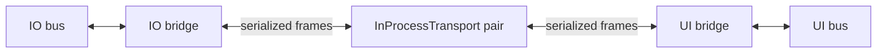

# ProtoMate Control

Control software running on the robot controller of the ProtoMate SCARA Robot.

## Current target: Arduino GIGA R1 WiFi

**M4 runs `io::Application`; M7 runs `ui::Application`.** Each independently
linked image owns its main, ThreadX kernel, C++ runtime, heap, TLS, threads,
message bus, coroutine context and ICC bridge. Common implementations are
compiled separately for each core. ICC uses bounded shared-SRAM queues with
urgent, normal and background lanes; M7 writes the physical USB-C CDC console.

The STM32H747 CubeMX, HAL, external-flash bootstrap and build port are implemented.
**Factory backup and SWD access are verified; application bring-up is pending.**
The factory firmware remains installed. [Wiring, memory, backup/flash/debug commands and acceptance gates](#arduino-giga-hardware-boot-and-bring-up)
are documented below. Linux keeps the paired in-process transport for tests.

M4 exposes STEP/DIR/enable, switches, DM542T/TMC2209 drivers, feedback and the
future EtherCAT SPI connection. M7 owns the RGB LED, user button, display/touch
and console. Both runtimes include filesystem support with no mounted medium.
Motor construction leaves all drivers disabled; initialization, enabling and
motion are explicit CLI operations. Display/touch bring-up uses `display`
commands; TouchGFX and robot planning remain future work.

## Application layout

| Directory | Responsibility |
| --- | --- |
| `src/common/` | Shared contracts, motion profiles, application lifecycle concept, ICC bridge and transports |
| `src/io/` | M4 entry point, IO application, motor ownership and motion execution |
| `src/ui/` | M7 entry point, UI application and CLI; future planning and GUI |

Each firmware compiles only its own application target, `proto::io` or
`proto::ui`. Both use `proto::common`. These are compiled static libraries;
their nested `INTERFACE` targets collect sources privately into the owning
library. Tests and examples link the compiled libraries so implementation files
are compiled once per build. Public include paths start at `src/`, for example
`common/icc/bridge/Bridge.hpp` and `io/app/Application.hpp`. The Linux entry point in
`src/main.cpp` retains the in-process paired transport for host development and
lifecycle tests. It is not compiled into either GIGA image.

The [application concept](src/common/app/Application.hpp) enforces `void start()`,
`void requestStop()` and `void join()` without inheritance. Construction initializes
logging; application workers launch in `start()`. `start()` is one-shot;
`requestStop()` is an idempotent thread-safe notification; `join()` waits for
completion. Destruction requests a stop and joins. Call start/join/destruction
from the lifecycle owner, outside workers.

`runtime::thread::Definition` annotations in each `app/Application.hpp` declare
its threads; `app/Application.cpp` defines their entries.
[ThreadGroup](platform/runtime/ThreadGroup.hpp) creates all workers before
releasing them. The ICC worker runs the context; the application worker waits
for a stop request, then drains the bridge before stopping its context. Peer
shutdown or link failure wakes the application worker. Each application requires
a transport; the bridge is a concrete member with no optional execution path.

[`io::motion::Controller`](src/io/motion/Controller.hpp) owns three `StepperMotor`
instances, their shared STEP generator and enable output. Drivers and feedback
belong to each motor. `initializeDrivers()` configures the drivers and starts the
idle timebase; `enable()` verifies readiness before energizing the motors.
Controller move/reference methods preserve independent axis execution and
buffering. `stop(id)` stops one motor, `stop()` stops all while retaining torque,
and `disable()` also removes enable and invalidates references. Driver faults
immediately drop shared enable; a diagnostic worker cancels and joins all motion.
Recovery requires explicit initialization and enabling. IO shutdown disables the
motors before draining ICC. Motor settings live in `io/app/Application.cpp`:
1.8° full steps, 16 microsteps and placeholder 135° shaft reference coordinates.

`src/ui/cli/` contains the annotation-based parser, filesystem and utility
commands, Linux terminal frontend and direct motor commands. Registration uses
`ui::cli::register_commands` with a parser owned by the CLI thread. Each command
module has its own per-parser `std::call_once` guard. Motor callbacks use the
application-owned `ui::motion::Client`; only IO owns the physical controller.

M7 exposes the CLI through **USB-C CDC** (no UART bridge). Use `help` or
`help <command>`. Available commands are `pwd`, `cd`, `ls`, `touch`, `mkdir`,
`rmdir`, `rm`, `cp`, `mv`, `cat`, `echo`, `grep`, `time`, `stack`, `heap` and `motor`.
Quoting, wildcard expansion, pipes and `>`/`>>` redirection are supported.
For example, `echo "hello world" | grep world` and `time "heap io"`.
`heap ui` / `stack ui` inspect UI locally; `heap io` / `stack io` request IO's
memory diagnostics through the `io/memory` ICC service. The controller argument
is required. `time` measures execution on UI, including any remote round-trip wait.
Filesystem commands
use the host filesystem on Linux and FileX on M7; no embedded volume is mounted
yet, so file operations can report unavailable storage.

Motor commands use **motor-shaft degrees and rpm for all three motors**, including
M3. `motor` prints a guide; `help motor move` lists annotated options.

```text
motor driver init
motor enable
motor move m1 -90 --speed 5
motor jobs
motor status m1
motor stop m1
motor disable
```

- `motor status [m1|m2|m3|all]` shows commanded position/velocity, feedback and reference state.
- `motor driver status [motor|all]` shows driver readiness, alarms and latched faults.
- `motor driver init` initializes/recover drivers and the STEP timebase while disabled.
- `motor enable` / `motor disable` operate the shared enable; disabling stops work and invalidates references.
- `motor move <motor> <degrees> --speed <rpm>` submits a relative move.
- `motor moveto <motor> <degrees> --speed <rpm>` requires successful homing.
- `motor home <motor> [--seek 5] [--latch 0.5] [--timeout 30]` seeks, releases and slowly re-latches the reference switch.
- `motor speed <motor> <rpm>` replans the uncommitted remainder of an active move. It can be rejected once all remaining pulses are already scheduled.
- `motor defaults <motor> [--accel <deg/s²>] [--decel <deg/s²>] [--jerk <deg/s³>]` reads/updates idle motor defaults in RAM.
- `motor stop [motor|all]` aborts the selected motor and its buffered successor while retaining holding torque. Other motors continue.
- `motor jobs [id]` reports the most recent 32 jobs. Returning from a CLI command does not cancel its job.

Moves accept `--accel`, `--decel`, `--jerk` (zero selects the motor default),
`--timeout` (seconds, zero means unlimited) and `--buffer` (`aborting`, `buffered`,
`blending-low`, `blending-previous`, `blending-next`, `blending-high`). A motor can
have one queued successor. A configured default jerk of zero selects a trapezoid.
`accepted` includes queued/executing work; only a terminal result confirms its outcome.
INDEX feedback is labelled as a pseudo measurement of driver phase.
No mechanical axis conversions, kinematics or synchronized moves are exposed.

Linux uses ncursesw with separate logs, line editing and command history when
attached to a terminal. Redirected input/output, `TERM=dumb`, or
`SIMPLCITY_CLI_PLAIN=1` select the plain frontend. Console EOF, Ctrl-C, or Ctrl-D
on an empty interactive line shuts down the application pair. Application or
peer shutdown also interrupts an idle CLI. Plain/serial lines are limited to
4096 bytes; oversized lines are rejected. M7 receives bytes into a bounded IRQ
buffer while commands execute; input errors stop the console instead of
executing truncated input. The serial frontend echoes input, so disable local
echo in the PC terminal.

The shared message catalogs live in `src/common/icc/catalog/`:

- [topics.hpp](src/common/icc/catalog/topics.hpp): `Topics`, with `TopicPublisher` annotations.
- [services.hpp](src/common/icc/catalog/services.hpp): `Services`, with `ServiceProvider` annotations.
- [actions.hpp](src/common/icc/catalog/actions.hpp): `Actions`, with `ActionProvider` annotations.

Both applications register all three catalogs in their constructors using their
own IO/UI role. `Topics::io_logs` carries IO log text to UI. `Topics::io_motor_state`
publishes all three motor states at up to 50 Hz, including while idle or disabled.
Both the bridge and UI subscription use latest-only delivery. `Services::io_memory`
provides memory diagnostics. `Services::io_motor` carries initialization,
enable, speed and default-setting requests. `Services::io_motor_stop` reserves
urgent transport capacity for stop/disable. `Actions::io_motor_motion` carries
individual moves and homing, with periodic feedback and terminal results. Shared
motor payloads live in `src/common/motion/Motor.hpp` and serialize through Pneumo.

`motor status` and `motor driver status` read UI's latest snapshot without a
service request. Missing telemetry, disconnection and samples older than 500 ms
produce explicit errors. Freshness uses UI's local receive clock; the snapshot's
IO timestamp is informational, and its increasing sequence rejects duplicate or
out-of-order samples. The worker waits 20 ms after publishing; blocking IO or ICC
processing can extend the interval. It does not catch up missed publications in
a tight loop that would starve diagnostics and logging. Command replies contain the outcome, `commandGeneration`
and operation-specific values (motion defaults or the scheduled speed-change
pulse), without copying motor states. Actions still report acceptance and terminal
results independently of telemetry.

IO's application worker drives `io::motion::Server`; blocking driver operations
and joins stay outside the ICC context. Controller completion callbacks only
wake this worker. UI's application worker caches telemetry and dispatches action callbacks for
`ui::motion::Client`, retaining its job handles until completion. Services and
action admission time out after three seconds; execution uses the requested
motion timeout. No request is automatically retried. `commandGeneration`
rejects submissions overtaken by a stop, disable or initialization. Acknowledgements
update UI's generation immediately, so subsequent moves do not wait for telemetry;
older snapshots cannot roll it back. IO validates admission against its current
state rather than trusting UI's cache. Link shutdown
drains IO motion and disables the shared enable before closing its bridge. UI
reports uncertain communication outcomes as unknown rather than claiming a stop.

Diagnostic snapshots and collection live in `src/common/diagnostics/`. IO's
`io::diagnostics::Server` collects them on a dedicated worker; the CLI formats
both local and remote results using the same tables. Remote requests have a
two-second timeout, participate in UI shutdown cancellation and never fall back
to UI measurements on failure. At most two requests are outstanding at the IO
provider. Each response fits one ICC frame and includes up to 32 thread records
with names limited to 31 characters; omitted threads and shortened names are
identified in the output. Stack usage is sampled/saved usage and a recorded
high-water mark, not a continuous measurement. The collection copies thread
records under the local ThreadX interrupt lock, without allocation or formatting.
On Linux both controllers share the process allocator and ThreadX kernel; the
output explicitly labels that scope even when the request travels through ICC.

IO's Pneumo sink publishes already formatted records on `io/logs`; UI adds an
`[IO]` prefix and writes them directly to the console without logging them again.
Original timestamps and levels remain intact. Each record is limited to 384 bytes
(longer records end with `[truncated]`), and both the outgoing bridge subscription
and UI subscriber retain the newest 16 records. Overflow counters are available
through bridge/subscriber statistics; the sink separately counts truncations.
Console output runs on a notification-driven UI worker, never in ICC callbacks.
On Linux it uses the console broker, including buffering before ncurses starts.

UI installs its own Pneumo sink for all levels before its first startup log.
It prefixes local records with `[UI]` and calls `cli::writeLog`, the same output
function used by the IO subscriber. Received IO records retain `[IO]` and bypass
the local sink. The CLI frontend does not replace either logging route.

The M4 entrypoint installs this sink as Pneumo's default for all levels. The motion
controller also passes it explicitly to its motors, so Linux's IO logs use the same
ICC path while UI retains its separate console routing in the shared process.
Shutdown closes the IO sink before stopping ICC and wakes/joins UI's log worker.
Logs are best effort and may be discarded at shutdown. These bounds apply to the
ICC path; Pneumo's existing asynchronous logger queue is separate. Logging remains
a thread-context operation, not an ISR-safe or allocation-free API.

| Thread in each GIGA image | ThreadX priority (lower is higher) | Stack |
| --- | --- | --- |
| ThreadX timer worker | 0 | Port default |
| `io.iccThread` | 2 | 32 KiB |
| `intercore.notify` | 3 | 8 KiB |
| `ui.iccThread` | 4 | 32 KiB |
| `ui.cliThread` | 5 | 16 KiB (64 KiB on Linux) |
| `io.applicationThread` / `ui.applicationThread` | 14 | 16 KiB |
| Runtime main/application entry | 15 | 8 KiB |
| M4 motion diagnostics | 18 | 8 KiB |
| `io.diagnosticThread` (heap/stack service) | 20 | 16 KiB |
| `ui.logThread` | 20 | 8 KiB |
| Runtime cleanup/reaper | 31 | 2 KiB |

Priorities belong to separate schedulers; M7 priorities do not preempt M4 work.
ICC is a required part of both applications. The portable bridge and the
HAL/runtime transport adapter are separate targets. Reset both
cores together; independent core reconnection remains future work.

The [application archive](backups/application/README.md) preserves the earlier
control/CLI implementation for incremental reimplementation. Retired hardware,
bench programs and wiring are preserved under `backups/`; they are not build targets.

## Setup and compilers

```sh
git clone --recurse-submodules <this-repository>
# For an existing checkout:
git submodule update --init --recursive
```

Install CMake 3.22 or newer (3.24 or newer for `--fresh`), Ninja, GCC 16,
Arm GCC 16.1 or 16.2 with Newlib, OpenOCD, Arm GDB, Python 3, Git, and `patch`.
Linux CLI builds also require ncursesw headers and libraries (`ncurses` on Arch).
The project uses C++26 and the verified GCC 16 libstdc++ integration snapshot.
Unknown compiler majors and unverified Arm libstdc++ snapshots are rejected.
Linux tests download the pinned GoogleTest 1.17.0 source archive.

The VS Code devcontainer uses Arch Linux and checks that both compiler major
versions remain 16. Rebuild it after changing its Dockerfile. It exposes USB
and uses a development user with serial permissions. Host flashing and serial
capture also require access to Atmel-ICE, USB CDC and the logic analyzer.

## Build and run

```sh
cmake --preset giga-debug
cmake --build --preset giga-debug
cmake --preset debug-linux
cmake --build --preset debug-linux
./build/debug-linux/Application
```

The combined preset builds `controllers` and the matching `images` bundle by
default, using the per-core presets and output directories, including
both memory reports. It does not flash the board. Use `--target io-controller`
or `--target ui-controller` to build just one through the combined project.

Runtime and HAL source implementations are shared; each core compiles and links
its own copy with its own CPU flags, ThreadX port and private runtime state.

`giga-release` and `release-linux` provide optimized builds. After a
compiler upgrade use `cmake --preset <preset> --fresh` and rebuild cleanly.
Use `-DBUILD_TESTING=OFF` when configuring Linux to build the template without
fetching or building test dependencies.

All project C/C++ sources in `src/` and `platform/`, including tests, compile
with `-Wall -Wextra -Wpedantic` in both Debug and Release builds. Directory
settings apply these flags to new module targets as well.
Embedded Debug builds retain debug information and use `-Os` for IO, UI, ICC
and their entrypoints. Real-time M4 sources use `-Os` or `-O2` in RAM;
the libstdc++ runtime shim uses `-Og` outside the selected fast paths.
Source-level debugging remains available, with optimized stepping in these modules.

GIGA builds produce `io-controller` or `ui-controller` ELF/HEX/BIN/MAP files.
Use the validated combined programming workflow below.

Every default hardware build prints used bytes, region capacity and percentages,
including builds where the ELF is already up to date. The `memory-usage` target
can also be invoked explicitly. These are linker allocations: the stack region
is fully reserved, and RAM includes the minimum heap reservation, not measured
runtime stack or heap usage.

Linux simulates the HAL and uses the ThreadX Linux port. Standard Linux file
I/O uses the host filesystem; explicit FileX tests use simulated media images.
The application runs both ICC endpoints and the UI CLI. Redirecting a command
script into `build/debug-linux/Application` executes it and exits at EOF.

## Linux sanitizer checks

Build and run the complete Linux test suite with AddressSanitizer,
UndefinedBehaviorSanitizer and leak detection:

```sh
cmake --preset sanitize-linux
cmake --build --preset sanitize-linux
ctest --preset sanitize-linux
```

The test preset sets `ASAN_OPTIONS=use_sigaltstack=0` because the ThreadX Linux
port owns its threads' alternate signal stacks. Instrumented builds also reserve
at least 1 MiB of native stack per simulated thread for sanitizer overhead;
firmware stack sizes are unchanged. Memory and leak checking remain enabled.
LeakSanitizer needs permission to inspect process threads; run these tests outside
a ptrace-restricted sandbox. These checks exercise simulated
hardware; STM32 behavior requires separate hardware validation.

## Application, HAL and runtime linting

Run the configured readability, naming, bug-prone, modernization, performance,
static-analyzer and Core Guidelines checks on production code in **`src/`,
`platform/hal/` and `platform/runtime/`**, including both Linux and STM32
implementations, with:

```sh
cmake --preset debug-linux
cmake --build --preset debug-linux --target clang-tidy
```

Alternatively, `cmake --preset clang-tidy-linux` followed by
`cmake --build --preset clang-tidy-linux` prepares a separate analysis directory.
These are explicit analysis targets; normal builds still use GCC without linting.

The runner requires Docker, Python 3, CMake/Ninja, the project's GCC 16 Arm
toolchain (including newlib/libstdc++ headers), and host ncurses development
headers. It uses a pinned Pneumo devcontainer image with matching
Clang/P2996, clang-tidy and reflection headers. If the image is not already
installed, pull it once:

```sh
docker pull ghcr.io/daleondev/pneumo-devcontainer@sha256:1c10d580f47f4fa402da038896027629ded2d94de4ddd0f382f8a63830fae3e7
```

The container runs without network access, with project sources mounted read-only.
Analysis copies of the compilation databases select Clang and reflection flags.
Linux analysis uses the image's libstdc++. STM32 analysis uses
`--target=arm-none-eabi`, the selected Cortex-M4/M7 and FPU settings and the real Arm
toolchain's libstdc++/newlib headers, mounted read-only. Real host ncurses headers
are copied into the report directory. Firmware build flags,
dependency declarations and application sources are not rewritten.

The runner configures private STM32 CMake directories under
`<build-directory>/clang-tidy/configurations/stm32-io/` and `stm32-ui/` to obtain the HAL and runtime's
actual includes and definitions without building or flashing anything. Separate analysis
databases preserve Linux, M4 and M7 contexts for shared sources. Every active production
HAL/runtime C/C++ source must have a compilation command; retained unbuilt board
implementations are excluded from that inventory; setup fails if a newly
added file is missing from these configurations. Runtime C sources use Clang's C
driver without C++ reflection flags. The shared `runtime/startup.cpp` hook uses
the main `Application` target's configuration, excluding its duplicate test and
example compilation commands.

All `test/` and `tests/` directories, including unit tests, test helpers, model
tests and hardware bench programs, are excluded from source selection, header
diagnostics and reports. No test configurations are prepared for linting.
External dependencies and copied sources in `vendor/` directories, including the
runtime's GCC source snapshot, are also excluded. Their real headers are still
parsed when required by a production source. Static analysis does not replace GCC
builds or hardware tests.

The runner generates `reflection-include/` from the pinned Clang `<meta>` and
consteval-type-trait headers. Only their library includes, namespace wrappers and
library-specific declaration macros are adapted for libstdc++; the reflection
implementations and compiler intrinsics are preserved. No lint-specific HAL,
ThreadX or callback stubs are used. STM32 sources are checked against the real
hardware headers in their ARM context.
Pneumo selects its existing Clang reflection workaround by the
reflection header instead of the surrounding standard library. Updating the image
requires revalidating this adaptation; missing expected header markers fail setup.

The runner invokes clang-tidy directly for each source, without a separate syntax
precheck. Each invocation's raw output is printed as it finishes, keeping the
diagnostics together during parallel runs. The console includes clang-tidy's
source excerpts, notes and check names; custom progress lines, summaries and
deduplicated findings are omitted.

CLI registration uses explicit command namespace reflections, and thread
annotations use reflection operations supported by both compilers. Stack and heap
tables in `cli/utilities.cpp`
use `std::vformat_to` to avoid Clang/libstdc++'s compile-time dynamic-width checking
incompatibility. These table formats are checked at runtime; other format strings
retain compile-time checking. Blocking compiler errors cannot be disabled with
clang-tidy check filters. See the [clang-tidy documentation](https://clang.llvm.org/extra/clang-tidy/).

Reports are saved separately in `<build-directory>/clang-tidy/`:

- `findings.txt`: deduplicated `src/`, `platform/hal/` and `platform/runtime/`
  diagnostics from fully parsed files.
- `partial-findings.txt`: review-only diagnostics if clang-tidy fails to parse
  a file; normally empty.
- `summary.txt` and `report.json`: coverage, blocked files and their errors.
- Per-context directories containing per-source `.log` and `.yaml` files: full
  diagnostics and suggested replacements. `analysis.json` lists the selected
  commands and their databases; the JSON report records each invocation's context
  and duration.
  Replacements are **never applied automatically**.

Exit status is `1` for findings in fully parsed files, and `2` for tool failures or
when no file can be fully checked. Partial coverage is accepted by default;
compiler errors remain visible in the raw output and saved coverage report.
To require complete coverage:

```sh
python3 scripts/clang_tidy.py --build-dir build/debug-linux --strict
```

The naming rules live in `.clang-tidy`. Clang 21 uses `GlobalConstant` for global
constants including constexpr, and `PublicMember` for public fields including
ordinary struct fields. `tooling.clang_tidy` tests diagnostic classification,
source/test/vendor filtering, HAL/runtime inventory, C/C++ commands, target contexts
and failure handling without Docker.

Keep explicit default member initializers in aggregate configuration types,
including `{}` for class-type members. The
[`readability-redundant-member-init`](https://clang.llvm.org/extra/clang-tidy/checks/readability/redundant-member-init.html)
check is disabled because removing those defaults conflicts with GCC's
`-Wmissing-field-initializers` under `-Wextra`. The compiler warning remains
enabled; lint fixes must preserve a warning-free GCC build.

Cognitive-complexity checks count application control flow, excluding macro
expansions. Compiler-generated coroutine diagnostics have narrowly named,
commented `NOLINT` markers; the remaining check families stay enabled.

## HAL architecture

The HAL provides peripheral access and device behavior. Robot motion planning,
homing policy, gearing, kinematics and CLI commands belong to the application
modules being rebuilt in `src/io`, `src/ui` and `src/common`. Thread scheduling, the C++ runtime and filesystem integration belong
to `platform/runtime`.

### Layers and responsibilities

Paths in this table are relative to [`platform/hal`](platform/hal).

| Location | Responsibility | Dependencies within the HAL |
| --- | --- | --- |
| `drivers/itf` | Peripheral capability interfaces (`ISpi`, `IUart`, `IDigitalInput`, etc.) and their configuration/value types | Other driver contracts and common `util` |
| `drivers/impl/stm32`, `drivers/impl/linux` | Concrete classes implementing those interfaces using the selected platform | Driver contracts, driver helpers and platform support |
| `drivers/impl` | Shared step-generator/output algorithms | Driver contracts, helpers and the internal `StepHardware` backend boundary |
| `drivers/factory` | Select a backend, validate a supported resource/route, claim ownership and return its interface | Driver implementations and other driver factories |
| `devices/itf` | Device capabilities such as `IMotorFeedback`, `IStepperDriver`, `IButton` and `ILed` | Device/driver contracts and common `util` |
| `devices/impl` | Device behavior and protocols: TMC2209, DM542T, LAN9253, feedback, button and LED adapters | Injected driver interfaces and device helpers |
| `devices/factory` | Construction that differs by platform, currently TMC2209 transport/model composition | Driver factories and the selected device model |
| `board/board.hpp`, `board/arduino_giga/board.cpp`, `board/linux/board.cpp` | Translate robot/board roles into pins, peripherals, driver addresses and device compositions | Public factories and portable device implementations |
| `core` | Expose resources belonging to the executing processor (`M4`, `M7`, or `Host`); select its status LED and runtime timer | Board factories and capability contracts |
| `hal.hpp/.cpp`, `stm32`, `linux` | Platform startup, console, panic handling, interrupt dispatch and platform synchronization | Selected platform/vendor facilities |
| `util`, `drivers/util`, `devices/util` | Common result types or helpers private to their respective layer | Same-layer or lower-level contracts; never board/application policy |

Each compiled layer has its own target. The public dependency chain is:

```text
platform::hal → hal::core → hal::board → hal::devices → hal::drivers
```

Each target compiles only its own sources; CMake selects the STM32 or Linux
backend. GIGA provides onboard resources plus M4 motor timers/DMA, USART2,
reference/diagnostic inputs and feedback.
The Linux board composition supplies virtual resources for device regression
tests; it does not define GIGA motor wiring. The Linux step and encoder workers are compiled as `hal_linux_services`
objects using the runtime's C++ ABI and included in `hal_drivers`. Their opaque
service objects keep that ABI boundary out of public interfaces.

Interfaces and public factory headers contain no vendor handles, platform
headers or board wiring. Configuration types live beside the interface, so an
implementation never needs a factory header to obtain its own types.
[`GpioTypes.hpp`](platform/hal/drivers/itf/GpioTypes.hpp) contains GPIO values and
configuration; the actual input/output interfaces are separate.

Concrete classes are declared in `.hpp` files and implemented in matching `.cpp`
files. Coherent families can share a pair, as `GpioInput` and `GpioOutput` do in
`Gpio.hpp/.cpp`. Shared algorithms stay in the common implementation directory;
platform models stay in `impl/linux`. Small inline methods and template helpers
remain in headers. Helper directories and namespaces consistently use **`util`**:
`hal::util` for common/driver helpers and `hal::device::util` for device helpers.

Device behavior uses injected interfaces and contains no peripheral selection
or MCU register access. The explicit platform exception is synchronization:
`InterruptGuard`, `Mutex` and `ThreadMutex` protect callbacks and shared state.
TMC2209 and LAN9253 protocol classes can be concrete portable classes; capability
interfaces are introduced where callers need interchangeable implementations.
`IConfigurableStepperDriver` extends `IStepperDriver` with optional configuration.

The board layer defines wiring and composes those objects. It contains no host
simulation registry or simulated register behavior. The Linux TMC2209 device
factory attaches `Tmc2209Model` to a generic UART; tests can instead construct
and inject their own model/transport. Generic SPI/UART drivers contain no motor
or EtherCAT protocol. `hal.hpp` is the startup/vendor bridge and is not a header
for ordinary device implementations or public contracts.

Application entry points and runtime counter setup use `hal::core`:

```cpp
auto led = hal::core::create_status_led();
auto timer = hal::core::create_runtime_timer();
constexpr auto processor = hal::core::id(); // Id::M4, Id::M7, or Id::Host
```

`hal::core` uses `util::executing_core()` to select the compile-time construction
catalog in [`core/Catalog.hpp`](platform/hal/core/Catalog.hpp). Each annotated
entry lists the available roles and the board factories that create them:

```cpp
[[= util::Core::M4]] static constexpr Devices m4{
    .runtime_timer = [] { return board::create_timer(timer::Peripheral::Tim5); },
    .rtc = board::create_rtc,
    .rng = board::create_rng,
    .intercore_channel = board::create_intercore_channel,
};
```

Omitted roles are unavailable: their core factory returns `nullptr` (or an
array of null pointers for the driver set). Reflection
selects the entry at compile time and rejects missing or duplicate assignments
for the selected processor. No device is constructed by reading the catalog.
M4 owns TIM5 and has no physical LED/button; M7 owns TIM12, green/PJ13,
red/PI12, blue/PE3 and the user button/PC13. Both entries explicitly include shared RTC/RNG and their
local inter-core endpoint. M4 also lists all motor factories; M7 has none.
IO/UI are application names, not HAL identities.

`hal::board` only describes physical wiring and construction. It has no core
parameter, core identity include or ownership policy. For example,
`board::create_led(LedId::Red)` is available independently of the caller.
GPIO and timer factories likewise select hardware without consulting core
assignments. Application/runtime code uses `hal::core` to respect the catalog;
direct board/driver access is intentionally unrestricted and must not operate a
resource concurrently owned by another processor. Existing per-image resource
leases and cross-core synchronization for shared devices remain in place.

Timer factories expose initialized TIM5 and TIM12 to either image. They wrap
the peripheral without resetting it; CubeMX/platform startup still initializes
the hardware once. Changing a catalog assignment that moves peripheral
initialization or interrupts also requires updating that startup configuration.
Motor wiring and startup behavior are listed in the GIGA table below.
SPI5 is prepared for EtherCAT; external filesystem storage is unassigned.

Host tests retain virtual board devices. `Core::Host` selects its own runtime
timer, RTC/RNG, error LED and button, with no status LED or hardware peer channel.
The board can still construct its virtual LEDs independently of those roles.

### Factories and resource selection

Configurable factories take a typed `Configuration` describing hardware resources.
GPIO selects pins; buses select a peripheral; PWM/encoder configurations select a
peripheral and its pin/channel route. Device roles and wiring choices belong to
`hal::board`, not to the transport drivers.

```cpp
auto spi = hal::spi::create({ .peripheral = hal::spi::Peripheral::Spi5 });
auto uart = hal::uart::create({
    .peripheral = hal::uart::Peripheral::Usart2,
    .transport = { .local_echo = true, .settle_time = std::chrono::milliseconds{1} }
});
auto timer = hal::timer::create({ .peripheral = hal::timer::Peripheral::Tim5 });
auto pwm = hal::pwm::create({
    .timer = hal::timer::Peripheral::Tim1,
    .channel = hal::timer::Channel::Channel1,
    .pin = { hal::gpio::Port::E, 9 }
});
auto encoder = hal::encoder::create({
    .timer = hal::timer::Peripheral::Tim3,
    .a = { hal::gpio::Port::B, 4 }, .b = { hal::gpio::Port::A, 7 }
});
```

These examples describe the retained factory contracts. On current hardware,
onboard GPIO, per-core timers, serialized RTC/RNG access and the inter-core
channel are available. M4 owns TIM5; M7 owns TIM12 and USB CDC.
RTC and RNG are shared through hardware-semaphore protection. Motor peripherals
use TIM2/TIM3/TIM6/TIM7, DMA1 and USART2 on M4. SPI5 is prepared for EtherCAT, and TIM8 drives the display backlight.
Filesystem storage and native Ethernet remain unassigned.

Linux provides virtual peripheral resources and device models for regression
tests. Its board composition does not claim physical wiring. Construction never
starts motion; owners must explicitly start devices and manage their callbacks.
Bus exclusivity and device-level transaction serialization remain separate
responsibilities.

Operations report failures using `hal::util::Result` and `std::error_code`.
The STM32 HAL-status conversion lives in `stm32/HalResult.hpp`; Linux failures
use standard error codes or the host's `errno`. Callback context and permitted
operations are specified on each interface. STM32 interrupt callbacks must be
short and nonblocking; callers must respect callback lifetime and unregister/
stop requirements before releasing their dependencies.

### Checking the structure

[`verify_hal_architecture.py`](cmake/tests/verify_hal_architecture.py) checks
production includes, helper naming, interface/factory boundaries, selected
platform sources and CMake source ownership. It is registered as
`hal.architecture` in the Linux CTest suite. Both platform selections can be checked
explicitly after configuring them:

```sh
python3 cmake/tests/verify_hal_architecture.py --source . --build build/debug-linux
python3 cmake/tests/verify_hal_architecture.py --source . --build build/giga-io-debug --platform stm32
python3 cmake/tests/verify_hal_architecture.py --source . --build build/giga-ui-debug --platform stm32
ctest --test-dir build/debug-linux --output-on-failure
```

Host device tests verify software behavior. Electrical timing and peripheral
ownership require separate hardware validation as each subsystem is ported.

## Processor-to-processor messaging

The ICC implementation in `proto::common` supports serialized topics, services
and actions, with peer readiness, connection health and state-change callbacks.
The bridge is independent of hardware; the common library also includes the
HAL/runtime inter-core adapter and, on Linux, the in-process transport.
The [two-bus examples](src/common/icc/examples/README.md), including the
[action example](src/common/icc/examples/actions.cpp), also run independently.

The implementation separates message routing from byte transport:

| Location | Responsibility |
| --- | --- |
| [bridge/Bridge](src/common/icc/bridge/Bridge.hpp) | Public registration API, lifecycle, send/receive loops, fair scheduling and failure handling |
| [bridge/TopicBridge](src/common/icc/bridge/TopicBridge.hpp) | Reflected topic registration, subscriptions, bounded FIFO/latest-value delivery, drop statistics and incoming publications |
| [bridge/ServiceBridge](src/common/icc/bridge/ServiceBridge.hpp) | Reflected service registration, deferred proxies, call IDs, replies, cancellation, deadlines and cleanup |
| [bridge/ActionBridge](src/common/icc/bridge/ActionBridge.hpp) | Reflected action registration, deferred admission, feedback, cancellation, acknowledged terminal results and cleanup |
| [bridge/ConnectionHealth](src/common/icc/bridge/ConnectionHealth.hpp) | Handshake, acknowledged heartbeats, deadlines and connection state notifications |
| [bridge/Frame](src/common/icc/bridge/Frame.hpp), [bridge/OutgoingWakeup](src/common/icc/bridge/OutgoingWakeup.hpp) | Shared wire encoding and coalesced readiness signals per lane |
| [transport/](src/common/icc/transport/ITransport.hpp) | Transport interface and paired in-process transport; transfers bytes without interpreting messages |

`Bridge` owns its routing and connection helpers by value and serializes registration against startup.
The helpers run on its coroutine context and cannot call back into `Bridge` or
access the transport. Shutdown first drains actions while communication continues,
then closes services and disconnects topic subscriptions after its six transport
loops and health timer loop finish. The caller owns the context and runner thread;
the previous application thread glue is archived with `system_threads`.



The standalone topic example owns two independent buses and two bridges. Both bridges run on one
coroutine context on a dedicated p2p thread. Each has a send and receive coroutine per lane, all on the same context.
They suspend while waiting and yield after each frame so normal traffic cannot
monopolize the context. Application subscriptions dispatch on
their caller's thread. The application shells already use separate contexts and
runners, matching the intended ownership of the future core applications.

[Topics.hpp](src/common/icc/examples/Topics.hpp) specifies the forwarded topics using
`pnm::msg::Topic<T>` fields annotated with a publisher. No catalog
instance is constructed. Register the shared catalog once per bridge, identifying
the local publisher:

```cpp
io_bridge.registerTopics<Topics>(TopicPublisher::IO);
ui_bridge.registerTopics<Topics>(TopicPublisher::UI);

// Infer the payload type and topic name from the annotated field.
io_bus.topic<^^Topics::demo_io_state>().publish("idle");
```

Matching publisher annotations become outgoing topics; the peer's publications
become incoming. The application-defined enum must declare exactly two distinct
values. Annotation order is irrelevant; unrelated annotations are ignored.
Fields without the publisher annotation stay local. Forwarded fields require one
publisher. Names default to the field identifier with every `_` replaced by `/`:
`demo_io_state` becomes `demo/io/state`. One optional nonempty narrow `FixedString`
annotation overrides the name verbatim. Multiple name annotations and annotated
static declarations are rejected. Registration uses catalogs only. Register before
`start()`; names must be unique across both directions on each bridge.

The service API uses a separate application-defined `ServiceProvider { IO, UI }`
enum and annotated nonstatic `pnm::msg::Service<Request, Response>` fields.
`registerServices<Services>(ServiceProvider::IO)` identifies the IO side;
`bus.service<^^Services::demo_io_echo>()` derives the name and both payload types from
the field. No catalog object is constructed. Names and provider annotations
follow the same validation and ordering rules as topic names and publishers;
fields without the provider annotation stay local.
Matching provider annotations accept incoming requests for local handlers; the
peer's services forward outgoing requests. Replies return automatically.
[Services.hpp](src/common/icc/examples/Services.hpp) illustrates the catalog and
[services.cpp](src/common/icc/examples/services.cpp) runs an echo service. Applications
own and dispatch their handlers using the native or coroutine pneumo API. Bridge
proxies use deferred replies; they never execute application handlers or block
waiting for a result on the p2p context. Native readiness notifications and
deadline timers wake the bridge. No waiting thread is created per call.

The lane enum, priority order and background frame limit are defined once in
[`platform/communication/Lanes.hpp`](platform/communication/Lanes.hpp), exposed by
the header-only `platform::communication` target. It depends only on standard
headers; both HAL and ICC use this contract without depending on each other.
`icc::Lane` and `hal::IInterCoreChannel::Lane` are aliases of the same type.

`ITransport` asynchronously sends and receives complete frames using borrowed
spans. Its `Lane::Urgent`, `Lane::Normal` and `Lane::Background` queues have independent
capacity, waiters and sender/receiver coroutines. `InProcessTransport::pair()`
reserves eight frame slots per lane and direction (six queues). Normal and urgent
frames may use 2048 bytes; background frames are limited to 512 bytes including
header and topic name. A full background queue cannot block normal or urgent
traffic. Each lane preserves FIFO order. At each receive boundary, queued urgent
frames take precedence over normal, which take precedence over background. An
already consumed frame is not preempted. Independent rings can enqueue concurrently;
priority applies when consuming frames. Both peers must service all lanes in use.
Sustained higher-priority traffic may starve background delivery. Urgent traffic remains bounded and can itself back up.
It does not preempt a running handler or rescue a stalled context. Cancellation and `close()` wake waiting operations; closing either
endpoint disconnects the pair. Reconnection requires a new pair.

The frame has a 16-byte header: version (currently 7), frame kind, 16-bit name
length, 64-bit call ID and 32-bit remaining timeout in milliseconds. Integers are
little endian. Name bytes and serialized payload follow, with a 2048-byte total
limit. Topics, service requests and action goals identify their destination by
name. Replies and action lifecycle frames use correlation IDs; services and
actions have separate ID spaces. Topics use zero call ID and timeout. Action
result payloads start with an explicit one-byte status; errors have explicit
one-byte codes independent of native enum layouts.
Payloads use pneumo serialization. `std::string` sends its characters, not its
native object layout. Compound types need explicit serialization adapters with
portable field widths and byte order before use between different targets.

Each bridge accepts up to 16 topics, 16 services and 16 actions. Topics default to
normal-lane, latest-only delivery. Optional catalog annotations choose a lane and
bounded FIFO delivery, independently:

```cpp
struct Topics {
    [[= TopicPublisher::IO, = icc::Lane::Background,
      = pnm::msg::SubscriptionOptions{ .capacity = 16 }]]
    pnm::msg::Topic<std::string> io_logs;
};
```

`SubscriptionOptions` accepts 1–64 queued records; the default overflow policy
is `DropOldest`, with `DropNewest` available to preserve the oldest queued records.
The bridge dispatches one record per turn using Pneumo's `Subscription::pollSome()`.
Readiness notifications wake the appropriate lane. Publication never waits for
transport space; a blocked background send suspends only its own coroutine while
the bounded subscription handles overflow. At most one additional topic frame per
lane is in flight, plus the transport's reserved slots. `topicStatistics("io/logs")`
returns pending subscription records and cumulative dropped records; it excludes
transport/in-flight frames and returns `nullopt` after cleanup or for an unknown
or incoming topic. Overflow is counted, and oversized background records are also
dropped and counted instead of failing the control connection. Consumers should
likewise use bounded subscriptions and dispatch UART output on their own worker.
The application's IO sink and UI subscriber use this path for `Topics::io_logs`.

Background is best effort: shutdown cancels blocked sends without draining logs,
and no delivery acknowledgement or replay is promised. Services and actions stay
on the control lanes. Operational faults must be conveyed separately from their
background log text.
Service requests are never coalesced. There are eight forwarded calls per
lane and direction, eight queued/pending requests per local proxy, and eight queued
rejection replies per lane. Normal traffic cannot consume urgent service slots. Excess calls report `Busy`; a peer overrunning the rejection
queue fails the connection rather than growing memory without bounds.
Completed replies are retained until queued into the transport or shutdown.
The normal sender rotates between ready action, service and topic traffic; the
urgent sender rotates between action cancellation/ACKs and service traffic.

Service caller timeouts and cancellation terminate the local wait and forward a
best-effort cancellation to the peer. Remaining timeout budgets are rounded up
to milliseconds and capped at `UINT32_MAX` milliseconds. They are not synchronized
cross-core deadlines and do not subtract time spent inside the transport.
Cancellation/timeout does not prove that a handler's side effects stopped.
Late replies are ignored by the caller, but release the reserved bridge slot.
Cancelled calls retain that slot until the peer responds or the connection closes,
bounding cancellations that overtake requests. Call IDs are never reused within a bridge.
Transport failure completes pending service calls with `TransportError`; explicit
local service shutdown uses `Cancelled`. Neither result proves that remote hardware stopped.
Stop both bridges while the context still runs, then stop and join its runner.
New connections require fresh bridge/transport instances. No command is replayed
or resumed automatically. Full session identities and stale-frame protection
across independently restarted cores remain future work.

Actions use `registerActions<Actions>(ActionProvider::IO)` and reflected
`bus.action<^^Actions::member>()` handles on both native and coroutine buses.
Their catalogs follow the same optional name and provider rules as services.
[Action usage](src/common/icc/examples/actions.md) explains the provider and caller roles.
The bridge forwards acceptance only after the real provider accepts. Feedback is
latest-only; terminal results are retained until acknowledged by the peer. Each
direction admits eight forwarded goals; each proxy admits eight native goals.
Eight rejection slots and sixteen acknowledgement slots have independent bounds.
Excess work reports `Busy`; malformed framing or peer capacity abuse fails the link.

Action cancellation requests cleanup and does not finish the goal. A goal
cancelled before forwarding can complete locally because no remote work exists.
Once forwarded, only a terminal response confirms the outcome. Admission timeouts
apply until acceptance, not throughout execution. Timed-out/abandoned callers still
retain bridge records until the remote terminal result or connection closure.
No submitted goal is automatically replayed.

`stop(grace)` stops action admission and requests cancellation, keeping workers
and communication running until results are delivered. The default grace is
500 ms. If it expires, `failure()` records the timeout and unfinished callers get
`TransportError`, not a fabricated `Cancelled` outcome. Provider cleanup must
continue independently after a communication failure. Native caller callbacks
run when the application polls its handle, never on the bridge's context thread.
The p2p application thread and runtime-backed example runners use a 32 KiB stack
for nested Debug serialization; the portable bridge does not configure threads.

Cancellation and action terminal acknowledgements always use the urgent lane.
A cancellation may arrive before its normal request/goal; bounded records ensure
the later command never reaches an application provider. Action results and
feedback retain their normal-lane ordering. A cancellation request still does not
confirm that already-running work has stopped; its terminal response may wait for
normal capacity. Service cancellation carries one byte identifying the original
request lane (0=normal, 1=urgent).

Services may explicitly reserve the urgent lane in their shared catalog:

```cpp
struct Services
{
    [[= ServiceProvider::IO, = p2p::Lane::Urgent]]
    pnm::msg::Service<StopRequest, StopResponse> stop;
};
```

The annotation applies to requests and replies, and both peers must agree. Other
services default to normal; topics, goals, action acceptance/feedback/results use
normal. Keep urgent service handlers short or defer work to an IO worker. The
control catalog uses this lane for Stop and Disable.
Connection management uses that same urgent lane ahead of application traffic.

A bridge starts in `Stopped`, then reports `Connecting` and exchanges Hello/Ready
frames before forwarding application data. Calls queued during this handshake
remain local and retain their native timeout. `Connected` means both peers have
completed the version-compatible handshake; it does not validate application
catalogs, motor configuration or physical hardware readiness.

Connection monitoring defaults to a 100 ms heartbeat and a 500 ms deadline;
pass `ConnectionOptions{.heartbeat = 100ms, .timeout = 500ms}` as the fourth
constructor argument to configure them. Only a fresh acknowledgement of the
outstanding heartbeat refreshes the deadline. Incoming publications, peer
heartbeats and repeated old acknowledgements cannot conceal a broken outgoing
path. One outstanding challenge and one coalesced reply bound control storage.
Management kinds are Hello (13), Ready (14), Heartbeat (15), HeartbeatAck (16)
and Goodbye (17). Their name, timeout and payload are empty; only the heartbeat
frames carry a nonzero challenge ID.
The health coroutine has its own timer and wakeup, so its deadline still expires
when either transport sender is blocked. Deadlines are checked before dispatch,
including after a stalled context resumes.

Register a connection callback before `start()` and read the current snapshot
with `connectionStatus()`. For example, publish the notification to a **local**
application topic that an IO worker consumes:

```cpp
auto connectionEvents = io_bus.topic<p2p::ConnectionStatus>("local/p2p/connection");
io_bridge.setConnectionCallback([connectionEvents](p2p::ConnectionStatus status) {
    connectionEvents.publish(status);
});
```

The callback runs on the p2p context outside internal locks. Keep it short: notify
or enqueue work; do not block, join workers, call `stop()`, or destroy the bridge
inside it. Captures must outlive the bridge. No notification is emitted at
registration; `Connecting` is the first event. State changes are emitted once,
not on every heartbeat. Callback exceptions fail the connection while preserving
teardown. The callback and all pending transport operations finish before
`stop()` returns.

`Failed` is latched, with an explicit reason such as `HandshakeTimeout`,
`HeartbeatTimeout`, `PeerRestarted`, `TransportError`, `ProtocolError`, or
`ShutdownTimeout`. Outstanding service/action handles receive `TransportError`,
local provider cancellations are requested, and bridge-owned queued work is
invalidated. An accepted action still needs application cleanup: link failure
never confirms a physical stop. A fresh Hello on an established link requires
explicit recovery; this detects an announced restart, not every possible stale
frame from an earlier boot.

An orderly local shutdown reports `Stopping` then `Stopped`, after action draining
and an urgent Goodbye. A peer Goodbye with no outstanding actions also reports
`Stopped`, with reason `PeerStopped`; if actions are still outstanding it fails
with that reason. Treat every departure from `Connected` as unavailable for new
control commands. Every failure requires deliberate reconstruction/recovery;
there is no automatic reconnection or motion replay.

All monitoring runs on the p2p context. If that entire context or processor
freezes, its local timer cannot run: an independent IO/hardware watchdog is still
needed when integrating motion control. Callback consumers own the local stop,
holding-torque policy, latched robot fault and explicit recovery. Those robot
policies are not implemented inside the portable bridge.

The archived [control message catalogs](backups/application/control/Messages.hpp),
[client](backups/application/control/ControllerClient.hpp) and
[server](backups/application/control/ControllerServer.hpp) are reference material
for rebuilding the execution boundary. They are not part of the current normal build.

STM32 Debug compiles the portable ICC library with `-Os` while retaining debug information.

Build and test the bridge independently:

```sh
cmake --build --preset debug-linux --target application_p2p_example application_p2p_service_example application_p2p_action_example application_p2p_transport_tests application_p2p_service_tests application_p2p_action_tests application_p2p_urgent_tests application_p2p_connection_tests
./build/debug-linux/src/common/icc/examples/application_p2p_example
./build/debug-linux/src/common/icc/examples/application_p2p_service_example
./build/debug-linux/src/common/icc/examples/application_p2p_action_example
ctest --test-dir build/debug-linux -R '^application\.p2p\.' --output-on-failure
```

## Arduino GIGA hardware, boot and bring-up

**Software status:** the STM32H747 port, external-flash loader, USB console,
ICC transport, motor peripherals and display/touch bring-up commands are
implemented. Debug, Release, M4 RAM-debug and the isolated bench build as
separate M4/M7 images. Host tests exercise the existing motion/ICC behavior,
STM32 STEP/encoder register models, USB buffering and boot-image validation.
**Verified on the GIGA:** Atmel-ICE SWD access to both cores, QSPI identity
`0x1F8901`, full factory backup, QSPI erase/program/readback, and both internal
bootstraps plus the matched external-flash application pair. Factory images,
original option registers and SHA256 checksums remain in
`backups/hardware/giga-factory/`; the board now runs our firmware. Both reserved
1 MiB QSPI factory regions also verify unchanged after programming.
The complete 8 MiB SDRAM test passes across **10 hardware-reset cycles**. Each run
takes approximately 1.56 s with caches disabled: walking bits, byte/halfword
writes, full-memory address/complement and pseudorandom patterns, 250 ms refresh
retention and final zero verification. Flashing requires this test to pass.

Both ThreadX runtimes start at M7 480 MHz / M4 240 MHz, with vectors relocated to
0x20000000 / 0x10000000. USB CDC enumerates, the ICC handshake completes, and
`help`, `heap ui`, `heap io`, `stack ui`, `stack io` and `motor status` work with
no external peripherals. Drivers remain disabled. Missing/corrupt manifests,
invalid image CRCs and mismatched pair identifiers enter recovery with STEP low
and enable inactive; restoring the valid activation record restores startup.
The M4 RAM-debug pair also passes these commands; a software breakpoint at
`icc::ConnectionHealth::tick` in SDRAM was hit and removed successfully.
The normal Debug pair also starts after a physical USB power cycle with no
debugger session active. Twelve CLI checks passed across three subsequent serial
close/reopen cycles, including heap/stack requests to M4 over ICC.
Hardware logs are in `build/giga-debug/{flash,boot-validation,cold-start-results,cold-start-console}.log`
and `build/giga-ram-debug/{console-check-clean,breakpoint}.log`.
The 24 MHz logic analyzer verifies STEP counts and timing in all nine bench
scenarios: tiny moves, independent starts, 100 kHz, velocity updates, stop/restart,
timer wrap, deliberate underrun, combined load and variable periods. All interval
residuals are below one analyzer sample (41.7 ns) after removing the common clock
offset. The measured frequency differs by about +0.0138% from the analyzer's
reference; neither clock is independently calibrated.

| Measured STEP check | Result |
| --- | --- |
| Three channels at 100 kHz, including combined load | Exactly 100,000 pulses per channel; enable remains inactive |
| Programmed 5 µs HIGH phase | 120–121 analyzer samples (5.000–5.042 µs) |
| Refill interrupts withheld before arming | Hardware guard stops at 512 / 256 / 128 pulses, all outputs LOW |
| Combined-load worst STEP service time | 145,140 cycles / 604.75 µs; 4.23× headroom against the 2.56 ms DMA buffer window |
| Measured individual stop call | 11,781 cycles / 49.09 µs; other channels continue |

**Combined-load acceptance remains open:** pulse timing passes and LTDC reports
zero underruns, but only six validated ICC load packets and six echoes complete
during the one-second motion, below the test's minimum of ten. The bench correctly
reports FAIL for this case; the other eight cases pass. ICC throughput under
simultaneous QSPI/USB/graphics traffic needs further investigation before claiming
complete combined-load validation. Latest-only topic delivery permits coalescing,
but does not waive this acceptance check. Raw captures, console logs, the matching
image manifest and separate timing/overall verdicts are in
`build/giga-step-results/` (`results.json`, `final-run.log`).

These measurements cover the isolated bench, not powered motors or external
feedback/switch inputs. Stop-call duration is not external-input-to-stop latency.
Reset-state verification remains a separate acceptance step: with only the bare
board and analyzer connected, all three STEP inputs read HIGH for approximately
172 ms during a debugger-held reset, while enable reads inactive throughout.
Fit the specified external STEP pull-downs and enable pull-up before repeating
the reset capture; firmware cannot maintain GPIO output drive while reset is
asserted. The capture and transitions are recorded in
`build/giga-step-results/reset-results.json`. Normal Debug firmware is restored;
IO heap/stack services and disabled-motor status work over USB/ICC.
TouchGFX screens, M7 robot planning and EtherCAT robot integration remain future
work. The existing KiCad wiring must be adapted to these GIGA connections before
using it; Nucleo connector numbers do not apply.

### Clocks and ownership

The [CubeMX project](external/CubeMX/CubeMX.ioc) targets STM32H747XIH6 and exports
separate CM4/CM7 CMake peripheral files, preserving user code. Application entry
points and ThreadX remain repository-owned. Do not start the generated
`SystemClock_Config`, FMC or QSPI initialization from an application.

| Resource | Configuration / owner |
| --- | --- |
| Supply / reference | LDO, VOS0, onboard 16 MHz HSE crystal; LSE 32.768 kHz |
| PLL1 | HSE /4 ×240, P2/Q20: M7 480 MHz, USB 48 MHz |
| Bus clocks | HCLK/M4 240 MHz; APB 120 MHz; timer kernels 240 MHz |
| PLL2 | HSE /4 ×100, R2: FMC/QSPI 200 MHz; SDRAM 100 MHz; QSPI 50 MHz |
| PLL3 | HSE /5 ×160, R10: LTDC 51.2 MHz |
| M4 | TIM2 CH1/3/4 STEP, CH2 guard; DMA1 streams 0–3; TIM3 encoder; TIM6 sampling; TIM7 completion; USART2; SPI5 |
| Runtime | M4 TIM5 and M7 TIM12 at 1 MHz; per-core 1 kHz ThreadX/HAL SysTick |
| M7 | USB-C CDC, LED/button, LTDC/DMA2D, TIM8 backlight, I2C4 touch |
| Shared | M7 initializes RTC/RNG once; HAL serializes later access with hardware semaphores; SRAM4/HSEM for ICC |

TIM2 uses PSC=23 for the existing **10 MHz timeline**. STEP interrupt priority
and runtime timer priority remain 5; SysTick priority is 4. DMA generates edges; IRQs refill buffers
and report progress. M4 has no physical LED or console writer. M7 receives IO
logs through ICC's bounded background lane. USB-A host, DSI, wireless, camera
and audio are disabled. The board uses its own crystal: there is no ST-Link MCO
clock setting to change.

### Motor and EtherCAT wiring

**Enable polarity is HIGH = disabled, LOW = enabled**, matching the existing
DM542T transistor stage and TMC2209 EN inputs. Both bootstrap and fault paths
force enable HIGH and STEP LOW. Provide an external enable pull-up and STEP
pull-downs so these levels also hold while reset makes the MCU pins high impedance.
The STEP backend forces OC inactive before switching GPIOs into timer AF mode.

| Signal | Arduino label | STM32 pin / function |
| --- | --- | --- |
| M1 / M2 / M3 STEP | A7 / D3 / D2 | PA0 / PA2 / PA3, TIM2 CH1/3/4 AF1 |
| M1 / M2 / M3 DIR | D4 / D6 / D16 | PJ8 / PD13 / PH13 |
| Shared enable | D15 | PC7, initially HIGH |
| M1 encoder A / B | D7 / D5 | PB4 / PA7, TIM3 CH1/2 AF2 |
| M1 encoder Z | D53 | PG7, EXTI7 |
| M1 / M2 / M3 reference | D49 / D51 / D47 | PE4 / PE5 / PB2, EXTI4/5/2 |
| DM542T ALM | A3 | PB1, EXTI1 |
| M2 / M3 DIAG | A4 / A6 | PC3 / PC0, EXTI3/0 |
| M2 / M3 INDEX | D8 / D9 | PB8 / PB9, EXTI8/9 |
| TMC UART TX / RX | D18 / D19 | PD5 / PD6, USART2 |
| ESC SCK / MISO / MOSI | D13 / D12 / D11 | PH6 / PJ11 / PJ10, SPI5 |
| ESC CS | D10 | PK1, initially HIGH |
| ESC IRQ / SYNC0 | D64 / D63 | PH10 / PH11, EXTI10/11 |
| ESC reset | D65 | PH9, open-drain, released |

Retain the established voltage-conversion circuits and shared TMC UART wiring.
M2/M3 addresses are 0/1, microstepping is 1/16 and stealthChop is the default.
Reference inputs use pull-ups and both edges; LOW is the healthy NC circuit,
HIGH means switch activation or an open cable. ALM is pulled up; DIAG/INDEX are
pulled down. GPIO callbacks and motion-blocking rules retain their existing
polarity. Shared EXTI handlers process only their own core's enabled lines.

SPI5 is initialized for mode 0, 8 bits, MSB first at 937.5 kHz. Board/core
factories expose SPI, CS, reset, IRQ and SYNC0; the portable `Lan9253` adapter
remains available. No EtherCAT stack starts automatically, and DMA2 remains
reserved for future SPI transfers. Connect EVB J3.1=SCK, .5=MISO, .4=MOSI,
.3=CS, .2/.8=GND; TP1=IRQ, J15=SYNC0 and J5.1=RSTn. Use ordinary-SPI straps
and the previously verified ESC configuration.

### Display and console

Smartwin SMMH0701024600S-C20: RGB24 physical bus, **1024×600 RGB565** buffers.
LTDC timing is 1+159+1024+160 horizontal and 1+22+600+12 vertical, totaling
1344×635 at 51.2 MHz (approximately 60 Hz). DE is active high; pixel-clock phase
still requires checking on the actual panel. DSI is disabled.

| Display signal | STM32 pins |
| --- | --- |
| R0–R7 | PG13, PJ0, PJ1, PJ2, PJ3, PJ4, PJ5, PJ6 |
| G0–G7 | PJ7, PE6, PI15, PG10, PH15, PK0, PI11, PK2 |
| B0–B7 | PJ12, PG12, PJ14, PJ15, PK3, PK4, PK5, PK6 |
| CLK / DE / HSYNC / VSYNC | PI14 / PK7 / PI10 / PI13 |
| Backlight / standby / TFT reset | PC6/D68 TIM8_CH1, PI0/D69, PI2/D71 |
| Touch reset / interrupt | PI3/D72, PB12/D74 EXTI12 |
| Touch SCL / SDA | PB6/D101, PH12/D102, I2C4 100 kHz |

Use a separate adequately rated 3.3 V display supply; the specified backlight
alone is roughly 1 A. The RGB connector adapter is a separate hardware task.
The panel remains off at application startup. `display bars` initializes it,
exercises DMA2D, switches framebuffer at vertical blank and sets 10% backlight.
Run it twice to check both buffers. `display backlight 0..100` controls the
1 kHz PWM. `display touch` reports ST1633i firmware/status and up to five points
at address 0x55; absent touch returns a bounded error. Device logic lives above
`IRgbOutput` and `II2c`; the STM32 implementations own the peripherals.

USB-C uses USB_OTG_FS PA11/PA12, device-only CDC with VBUS sensing disabled and
ST USB Device middleware matching Cube H7 V1.13.0. Open the CDC port (`/dev/ttyACM*`
on Linux); nominal baud is immaterial for USB. Startup never waits for a host.
The 4 KiB input and 8 KiB output queues are bounded; dropped output is counted in
`giga_console_dropped_bytes`. Disconnect/overflow clears partial commands;
suspend/resume retains the host's open state. Callbacks notify the console worker,
which owns transmit submission. They never parse CLI commands. Motor fault
shutdown does not depend on USB or log delivery.

### Images, RAM and startup

| QSPI address | Size | Contents |
| --- | ---: | --- |
| 0x90000000 | 1 MiB | Preserved factory reserve |
| 0x90100000 | 3 MiB | M4 executable and RAM load images |
| 0x90400000 | 4 MiB | M7 executable and RAM load images |
| 0x90800000 | 6 MiB | Future GUI assets |
| 0x90E00000 | 1 MiB | Manifest / activation / maintenance |
| 0x90F00000 | 1 MiB | Preserved factory wireless reserve |

The loader verifies AT25SF128A JEDEC 1F8901 and the SFDP signature, preserves
status bits, enables volatile QE, then uses 0x6B quad-output, 24-bit addresses,
eight dummy clocks at 50 MHz. Reserved areas do not imply Arduino filesystem
compatibility. No application filesystem writes to XIP flash.

| RAM / internal flash | Allocation |
| --- | --- |
| 0x08000000 / 0x08100000 | One 128 KiB sector per internal M7/M4 bootstrap |
| 0x10000000 | 2 KiB M4 vectors; remaining 126 KiB D2 SRAM1 instruction alias for fast code/constants |
| 0x30020000 / 0x30046000 | 152 KiB M4 data/DMA; 8 KiB M4 MSP |
| 0x24000000 / 0x24040000 | 256 KiB M7 data/heap; 256 KiB M4 heap |
| 0x00000000 | 64 KiB M7 ITCM, `.itcm` sections |
| 0x20000000 | M7 vectors (2 KiB), `.dtcm`/`.dtcm_bss` working data (110 KiB) |
| 0x2001C000 / 0x2001E000 | 8 KiB bootstrap scratch; 8 KiB M7 MSP |
| 0x38000000 / 0x3800F000 | 60 KiB ICC reservation; 4 KiB boot handoff |
| 0xC0000000 / 0xC0200000 | Two 2 MiB framebuffer slots; each uses 1,228,800 bytes |
| 0xC0400000 | 2 MiB M4 RAM-debug code |
| 0xC0600000 | 2 MiB future large UI buffers |

The onboard SDRAM is 8 MiB AS4C4M16SA-6BIN, bank 1, 16-bit, four banks, **12 row
bits / 8 column bits**, 100 MHz, CAS3; timings 2/7/5/7/3/2/2, refresh count 1542.
This industrial part specifies 4096 refreshes per 64 ms; use the
[industrial datasheet](https://www.alliancememory.com/wp-content/uploads/Alliance_Memory_64M-AS4C4M16SA-CI_v5.0_October_2018.pdf).
FMC initialization enables its GPIO D/E/F/G/H clocks itself, since bootstrap
does not run the application's general GPIO initialization. GPIOH carries
SDRAM clock-enable, chip-select and write-enable.
M4's 0x10000000 code address aliases SRAM1; it is not additional RAM.

MPU is configured before M7 caches: ICC and framebuffers normal/non-cacheable/XN;
QSPI read-only executable; private RAM/heaps XN; UI SDRAM cacheable/XN; M4 debug
SDRAM normal executable. Future DMA users of cacheable UI buffers must clean
before DMA reads and invalidate after DMA writes, with exclusive 32-byte-aligned
cache-line ownership. Current DMA2D framebuffers are non-cacheable and require
only the existing publication barriers. Future ITCM kernels should avoid C++
exceptions across memory regions until their unwind placement has been extended.
Bootstrap enters after hardware reset and invalidates retained cache contents
without cleaning them, preventing old dirty lines from overwriting a newly
downloaded RAM helper. M7 enables caches after memory initialization. M4 inherits
its final MPU setup from the internal stub: disabling the MPU while executing
the RAM-debug image would make SDRAM instruction fetches non-executable.

M7 waits for M4 to park before requesting D2 SRAM clocks; its clock requests
would otherwise keep D2CKRDY asserted. M4 enables SEVONPEND so the HSEM event can
wake its masked-interrupt STOP wait. M7 configures clocks/memories, validates both
images and loads explicit copy/zero records. Application vectors, stack, segment
bounds, image CRCs and matching pair identifiers are checked; invalid pairs stay
in internal recovery with motor outputs disabled. M7 application startup enables
caches, initializes local HAL plus shared RTC/RNG/ICC memory and releases M4.
Each core runs its own constructors, TLS setup and ThreadX exactly once.
Applications do not initialize shared clocks, QSPI, FMC or peer-owned memory.
Generated application clock requests are wrapped by a read-only check against
bootstrap settings; a mismatch fails instead of restarting a shared PLL.
ICC must establish its session before accepting commands.

The linker bounds every region. M4 STEP/refill, sequence evaluation, feedback,
fault handling, scheduler/timekeeping hooks, synchronization, memory copies and allocator hot
paths, and their selected constants are copied to internal RAM.
`scripts/giga_ram_audit.py` checks the linked direct call graph and explicitly
listed callback/virtual targets and writes `ram-audit.json`; new callback types
need reviewing there. Separate Arm exception-unwind tables cover RAM and XIP.
This static audit does not replace latency measurements under bus contention.

### Build, backup, program and debug

```sh
cmake --preset giga-debug
cmake --build --preset giga-debug
# Also available: giga-release, giga-ram-debug, giga-bench-debug.
# Individual applications: giga-io-debug, giga-ui-debug, -release variants,
# and giga-io-ram-debug.
```

Per-core directories contain ELF, BIN, HEX, MAP and separate `.debug` symbols,
internal bootstrap images, memory percentages and M4 RAM audit reports. The M7
build also produces `memory-helper.elf`. Combined builds produce `images/io.bin`,
`ui.bin`, a fixed little-endian `manifest.bin`, and readable `manifest.json`.
The manifest carries lengths, CRC32s, SHA256 pair ID, entry/vector/stack addresses
and at most 16 explicit copy/zero segments per core. The pair ID is also appended
to each image. It binds a pair; this is corruption detection, not secure boot.

Connect Atmel-ICE's **SAM/Cortex** SWD port to GIGA SWDIO, SWCLK, NRST, GND and
3.3 V VTref; power the board separately through USB-C. VTref is not board power.
Keep motor power disconnected during initial validation. One CMSIS-DAP OpenOCD
instance connects under reset at 1 MHz and exposes M7 on GDB 3333 and M4 on
3334. Full factory readback has also been verified at 4 MHz SWD.

```sh
python3 scripts/giga_program.py probe
python3 scripts/giga_program.py backup
python3 scripts/giga_program.py memory-test
python3 scripts/giga_program.py flash --build build/giga-debug
# Equivalent combined target, after the verified backup exists:
cmake --build --preset giga-debug --target flash
```

Backup writes `backups/hardware/giga-factory/`: all 2 MiB internal flash, all
16 MiB external flash, readable option registers, MCU UID and SHA256 metadata.
It verifies repeated reads and refuses to overwrite an existing backup. The
RAM helper needs no valid application images. Backup initializes QSPI alone;
`memory-test` and `flash` additionally initialize SDRAM and run the physical
memory tests described above. Results are in `giga_boot_status` /
`GigaHandoff` at 0x3800F000. Status 0x600D means the requested helper operation
succeeded; `memory_test == 1` additionally confirms SDRAM passed. The maintenance
request is at 0x3800F024 (0 for QSPI only, 1 for SDRAM testing).
The helper prints the failing phase, address, expected/actual data, elapsed
milliseconds and successful coverage in bytes. These six words occupy
0x3800F028–0x3800F03C. Phase 0 means no failing test; phases 1–8 identify walking
ones, walking zeros, byte writes, halfword writes, address patterns, inverted
address patterns, retained pseudorandom data and final zeros, respectively.
Always check status 0x600D and `memory_test == 1` before treating a run as passed.
For complete debug-port reads, the helper maps a 32 MiB address window around
the physical 16 MiB QSPI device, avoiding a bus stall from read-ahead at its end.
The backup remains exactly 16 MiB, and application mappings remain unchanged.
The helper uses ordinary 1-1-1 fast reads (0x0B) so OpenOCD infers the correct
status/program command widths. Application boot uses quad-output reads (0x6B).
Programming runs at 4 MHz SWD after initialization and verifies every image.
No factory flash or nonvolatile QSPI status is changed by backup/memory testing.

Flashing validates the backup UID and exact ELF-derived image contents, halts
both cores, initializes external memory, invalidates activation, programs and
verifies both applications and bootstraps, then writes activation **last**.
Only boot-address/core-enable option bits are changed; protection/watchdog
settings are preserved. BOOT0 high retains the M7 ROM loader. An interrupted
update must be retried through SWD; no automatic mixed-pair activation occurs.
Never program QSPI while either application executes from it. This replaces
the Arduino installation; retaining the backup is required by the flash tool.

For debugging an already programmed pair:

```sh
openocd -f scripts/openocd/arduino_giga.cfg
arm-none-eabi-gdb build/giga-ui-debug/ui-controller.elf
# GDB: target extended-remote :3333
# A second GDB loads the matching io-controller.elf and connects to :3334.
```

Use `monitor giga_halt_both` before reset/maintenance; flash with the script,
not GDB `load`. Ordinary M4 XIP code cannot use FPB hardware breakpoints at
0x90xxxxxx. `giga-ram-debug` stores the image in QSPI but executes its ordinary
code in SDRAM at 0xC0400000, permitting **software** breakpoints after bootstrap
has copied it. Read-only data and exception metadata remain in QSPI: prebuilt
libc/C++ routines can use unaligned reads that FMC does not support
([ES0445 §2.7.3](https://www.st.com/resource/en/errata_sheet/es0445-stm32h745xig-stm32h755xi-stm32h747xig-stm32h757xi-device-errata-stmicroelectronics.pdf)).
Attach after startup; use `set mem inaccessible-by-default off` and
`set breakpoint auto-hw off` before setting software breakpoints. RAM-resident fast
code at 0x10000000 supports hardware breakpoints. The OpenOCD helper workspace
uses upper AXI RAM/M4 SRAM2, never ICC; applications are halted first. M7 planning
can later opt into the reserved ITCM/DTCM sections.

### Acceptance gates and bench

Run these in order. SWD access, factory backup, QSPI readback and the complete
SDRAM test across hardware resets, matched-pair boot, invalid-image recovery,
USB console, basic ICC services and M4 SDRAM software breakpoints are verified.
Use this checklist for subsequent regression and load tests:

1. Probe both cores and verify factory backup. Check clocks, disabled outputs,
   LED/button and debugger-free power cycling with internal recovery/startup.
2. Verify QSPI identity/repeated reads and the complete 8 MiB SDRAM test. Review
   MPU attributes, including executable helper workspace.
3. Boot the matched pair; inspect vectors, constructors, TLS and timers. Exercise
   missing/corrupt/mismatched images and interrupted updates. Test an M4 SDRAM
   software breakpoint with the RAM-debug pair.
4. Check USB open/close/unplug/replug, runtime counter rollover, ICC lanes,
   heartbeat/peer restart and background-log saturation. Reset both cores for
   recovery; stale queued motion must not resume.
5. With motor power off, flash `giga-bench-debug`. Analyzer D0 → A7/PA0,
   D1 → D3/PA2, D2 → D2/PA3, D3 → D15/PC7, GND → GND. Commands 1–9 test small
   exact counts, independent starts, 100 kHz, velocity changes, stop/restart,
   timer wrap, intentional underrun, combined load and variable periods.
   `python3 examples/giga_step_bench/capture.py --port /dev/ttyACM0` runs them
   with the 24 MHz analyzer. Test 8 exercises QSPI reads, USB output, ICC traffic,
   DMA2D fills and LTDC scanout while all STEP channels run. Bench reports worst
   ISR cycles, stop-call cycles and LTDC underruns; 100 kHz tests require at least
   2× DMA-buffer service headroom. Results need confirming with edge captures;
   the cycle counter does not measure external switch-to-stop latency.
6. Flash the normal pair; verify `display bars`, both buffers, RGB ordering,
   DE/clock phasing, underrun counts and `display touch` with the actual panel.
7. Exercise encoder/INDEX, reference and diagnostic edges, then powered motor
   moves and homing → stop → homing. Measure interrupt-entry/stop latency under
   combined load before establishing a supported motion rate.
8. With LAN9255 connected, repeat ordinary-SPI identification/stress and recovery
   using bench command `e` (identification followed by 100,000 BYTE_TEST reads).
   The EVB must already supply valid ESC boot configuration/EEPROM; check 81
   means identification was not ready. This command does not program its EEPROM
   or provide SII emulation. SOES robot control remains subsequent work.

The GIGA schematic/pinout and local MCU/panel references are in
[`docs/arduino_giga_r1_wifi`](docs/arduino_giga_r1_wifi) and
[`docs/display`](docs/display). Shared trajectory planning will later live on
M7; independent motor profile generation remains on M4 for now. Its bounded
execution contract and ICC services/actions/topics remain separate from the
physical transport and the future GUI.
