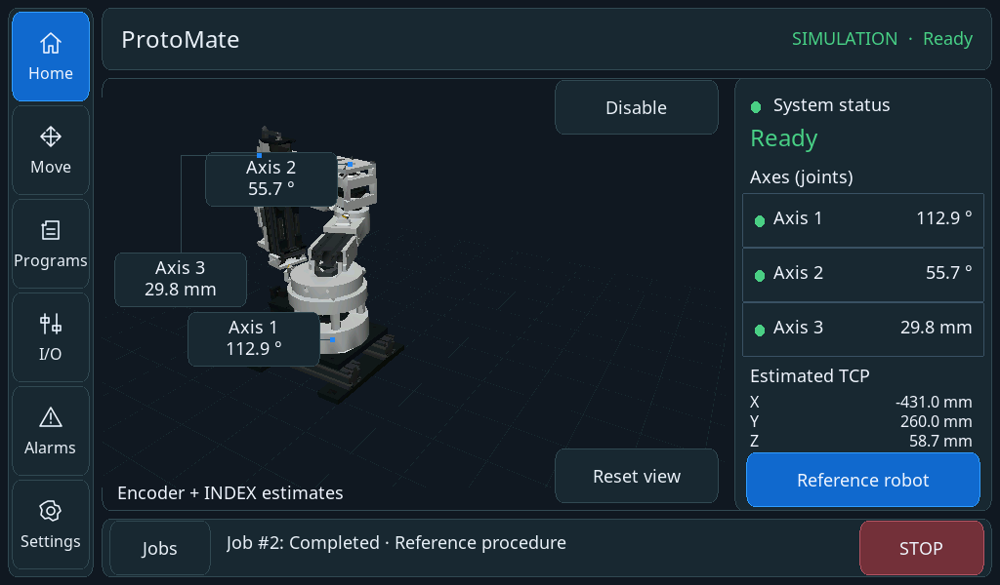
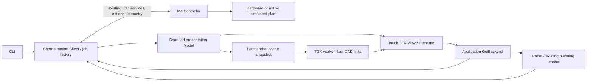

# Robot HMI

The normal UI opens **Home** on Linux and GIGA M7. Both use the same TouchGFX
frontend and application motion client. There is no GUI-specific motion engine
or text-command bridge. M4 still makes authoritative admission and execution
decisions. Physical calibration is deliberately required on the GIGA.



[All revised page examples](screens/modern-overview.png) · [GIGA framebuffer readback](screens/giga-home.png)



## Operating the interface

- **Home:** initialize, then explicitly enable. Reference Robot runs the configured
  homing sequence. Initialization never enables automatically. The scene, joint badges and TCP always use estimated feedback; unavailable feedback stays invalid. Orbit by dragging, zoom with the mouse wheel or two-finger pinch, or reset the camera. Three badges track the joint locations in the displayed image and open the corresponding axis page.
- **Move / Axes:** Axis 1/2 in degrees and Axis 3 in millimetres. Jog, Move To and Settings have separate tabs. Static CAD illustrations show only the two links connected by that axis: the stationary link keeps its original materials and the moving link is highlighted, with a positive-direction guide. Move To selects relative/absolute positioning; editing alone never moves. Step buttons use 0.1/1/10 units. Settings exposes acceleration, deceleration, jerk and timeout; zero chooses the configured default. **Hold is the default jog mode.** Step and Timed remain selectable; Timed defaults to one second. Continuous
  axis jog requires holding its button; its initial speed is 10% of the axis limit.
- **More / Robot move:** relative/absolute joint or Cartesian destinations. Speed is
  a 0–1 factor, initially 0.25. Acceleration/deceleration/jerk factors apply to
  subsequent moves (zero selects 1). Cartesian destination moves interpolate
  joints; their TCP path can curve.
- **Cartesian:** estimated feedback X/Y/Z stays visible in Jog, Move To and Settings. **Step** makes one selected 0.1/1/10 mm point move using joint interpolation. **Timed** and **Hold** execute one smooth, straight Cartesian path with a shared jerk-limited progress profile. Timed requests deceleration on M4 after the selected duration (one second by default); Hold stops on release/input expiry. Each gesture owns one job, with no repeated point-move submissions or intervening stops. Speed is a factor of configured feed, additionally limited by joint dynamics. The path ends at the first certified workspace/joint/singularity or monotone-representation boundary; it never automatically restarts.
- **Cartesian / Move To:** relative or absolute X/Y/Z in millimetres and speed factor; these remain joint-interpolated destination moves. Editing never starts motion. **Settings** supplies acceleration/deceleration/jerk factors, timeout and speed for subsequent movements. Zero dynamics selects configured limits, while speed must be positive. Timed/Hold timeout requests local deceleration; reaching rest can take longer. Hold cancels on navigation or editing; a submitted Timed jog continues until its IO deadline or explicit Stop, like other finite commands. M4 ownership leases remain unchanged.
- **More / Preview:** choose joints, point or straight line, then Calculate preview.
  Preview results have their own tab in Jobs. These buttons never execute a path.
- **More / Raw motors:** shaft degrees/rpm, dynamics, timeout, homing latch speed,
  buffering, active speed change and defaults. Replacing active work in Aborting
  mode requires confirmation. Abort stops immediately and invalidates references.
- **Jobs:** the same bounded execution history as the CLI, plus separately labelled
  previews. Input requests and quantized endpoints are distinguished; endpoints
  are displayed in motor pulse counts. Cancellation requests stopping and does
  not mean the motor is already at rest.
- **I/O:** read-only reference inputs, driver readiness, fault codes/warnings and
  feedback source/validity. Only Digital I/O and Drivers & feedback are shown. Enable is the commanded output state, not a measurement of motor energization.
- **Settings:** General, Robot and Diagnostics tabs. Heap/Stacks are typed, paginated UI/IO snapshots with right-aligned values and usage bars; Graphics shows UI counters. Fetch on entry, selection changes or Refresh. Linux identifies its shared runtime. Motor-default access remains available.
- **Alarms (sidebar):** active condition and eight bounded local messages. Acknowledging the
  history cannot clear a hardware fault.
- **Programs / Presets:** intentional empty pages; no commands are generated.

The numeric keypad edits a form; Apply does not move anything. Alarms has its own sidebar destination; Jobs and Global Stop remain in the bottom strip. Stop is
available even in the keypad and confirmation dialog. Finite jobs continue when
navigating; held jog does not. GUI and CLI obey the same motor/axis/robot exclusion.
**Software Stop is not a physical emergency stop.** Ordinary axis/robot stopping
uses the existing controlled deceleration; raw motor abort remains immediate.

## State, feedback and input supervision

The GUI consumes the existing 20 Hz motor topic. It does not request motor status
on each frame. Configuration is acquired on the planning worker and cached by
boot/configuration identity. Axis/robot commands never use a simulation fixture
as a substitute for missing physical calibration.

M1 encoder feedback is distinct from M2/M3 INDEX phase estimates. Mixed-feedback
TCP is an **estimate**, not a measured mechanical TCP. Missing reference/configuration
shows nominal CAD initially. Invalid or stale live data freezes the last pose;
there is no extrapolation or silent fallback to commanded "actual" position.
Controller readiness in the header is separate from motion readiness in the strip.

A held gesture owns one execution job, including Cartesian Hold. Touch acquisition renews its input deadline only
while the contact remains valid and inside the button. The client worker checks
**200 ms** independently of rendering. Release, drag-out, focus loss, navigation,
shutdown, an additional touch and failure request cancellation, including release before acceptance. Pinching only starts when both contacts begin inside the scene and outside its controls. Ending a pinch requires full release before orbit or badge taps resume. Wheel events retain their coordinates and expire after 100 ms; focus loss and navigation clear them.
The existing M4 ownership lease and stopping behavior are unchanged.

ICC failure latches a read-only fault display; telemetry becomes invalid and
uncertain jobs become Unknown. The UI does not infer a completed stop, reconnect,
replay, or resume. Explicit application shutdown still joins all workers.

## Implementation and bounded resources

- `src/ui/gui/hmi`: backend contract, Model, Presenter, reused page controls,
  keypad and Viewport. Only the GUI worker touches widgets.
- `src/ui/app/GuiBackend`: application composition adapter, sharing the CLI's Client
  and Robot. No additional controller, job registry or waiting thread is created.
- `ClientControls.cpp`: four ordinary deferred controls, a separate disable slot,
  coalesced urgent stop/cancel, native readiness callbacks and gesture deadline.
  Disable discards pending ordinary GUI controls, including queued Enable.
- `src/common/motion/VisualGeometry.hpp`: CAD link registration shared with the
  native simulator. No Assimp/OpenGL/native-process dependency enters M7.
- `scene3d/Robot`: four links in two immutable detail levels: **36,376 triangles**
  when settled and **7,914 triangles** while camera/joints change, both 640×400
  RGB565. `DetailPolicy` requests one full-detail refinement after 500 ms without
  changes. Linux and GIGA use identical meshes and switching; idle views do not
  rerender. This changes visual geometry only, not motion/simulator geometry.
  The renderer retains the existing two image slots and depth buffer in SDRAM.

Interactive rendering has a **10 fps ceiling**, subject to adaptive pacing
and measured rendering cost. Full detail has a 5 fps ceiling. Hidden
viewports pause; a newer pending pose replaces the previous one. Two-dimensional
controls run independently. No lower-resolution fallback is used.
GUI/touch/render priorities and stacks remain 8/16 KiB, 7/8 KiB and 16/16 KiB.
Frontend bookkeeping has fixed internal storage: the Model is in DTCM, and the
24,000-byte engine/widget tree occupies `.gui_internal` in the upper half of ITCM
(`0x00008000`, 32 KiB region with a 24 KiB allocation limit). This CPU-only region
is execute-never; pixel buffers remain in DMA-accessible SDRAM. The lower ITCM
half retains the existing renderer code and its 24 KiB code cap. The image
manifest explicitly zeroes the GUI region before construction, and linker
regions prevent overlap. This frees ordinary AXI SRAM for ICC/runtime allocations
without reducing any worker stack. The explicit motion benchmark retains its
separate all-ITCM-code layout and places these widgets in AXI SRAM.

No additional pixel buffers or worker stacks come from the UI heap.

## Build and verification

```sh
cmake --build --preset debug-linux
./build/debug-linux/Application
ctest --test-dir build/debug-linux -R 'gui\.|application.robot_api|application.lifecycle|simulation.hmi' --output-on-failure
cmake --build --preset giga-release
python3 scripts/giga_program.py flash --build build/giga-release
python3 scripts/hmi_hardware_check.py --seconds 12
```

`simulation.hmi` drives actual SDL mouse events through the GUI, existing ICC
and native simulated plant. It checks initialization without enabling, enable,
homing → stop → homing, coordinated joint moves, independently observed positions,
axis moves, held-jog focus loss, raw CLI/GUI exclusion, numeric cancellation and
shutdown. It also compares GUI commanded/feedback joints and TCP with client
telemetry and independently observed plant state, retaining INDEX's electrical
cycle resolution. The isolated frontend fixture supplies display states only; it is not
used as evidence of motion execution.

`gui.integration` and `gui.pages` capture every page/tab and ready/disabled/busy/unconfigured/stale/
fault variants. `gui.x11` additionally exercises the native SDL/Mesa path.
The reviewed images live in `src/ui/gui/tests/golden`. `gui.screenshots` compares
static pixels, excluding asynchronous renderer completion and changing diagnostic counters; fixed scene controls remain checked. Separate projection, ownership and gesture tests cover frame-matched badges and input. Screenshots from these deterministic
presentation fixtures are labelled accordingly.
`PROTOMATE_HMI_AUTOMATION` is an opt-in Linux-only FIFO for test mouse events and
captures; it is absent from the GIGA firmware and carries no motion commands.
Captures include a bounded, atomically copied presentation snapshot for checking
the actual Model rather than inferring its values from requested destinations.

The hardware comparison uses `display robot-test 5` for full detail and
`display robot-test 10 --interactive` for the lighter mesh,
rotating a synthetic camera without commanding motor movement. `display gui`
returns to normal Home. This diagnostic is explicitly injected camera input.
The script retains counters, heap samples, stack high-water marks, console output
and the firmware manifest. `scripts/hmi_hardware_check.py --observe` measures
health and throughput without treating the FPS ceiling as guaranteed delivery.
`scripts/hmi_output_capture.py` records STEP/enable with
the analyzer; its idle-output check is not a substitute for motion qualification. Physical
ST1633i input is not established by this test.

See [verification status](verification.md) for measured results and remaining
qualification. Physical panel interaction and powered calibrated motion remain
separate work. The [motion review](../../motion-current-state/review.md) records
the resolved ICC allocation defect and overlap regression. No deadline was
relaxed to accommodate the HMI.

The [layout/component guide](layout.md) records exact geometry, text alignment, snapshot ownership, input routing and asset regeneration.

## Continuous Cartesian jogging

M7 certifies the selected base-frame X/Y/Z ray with the existing IK/path planner.
The version-3 trajectory packet carries at most four C2 quintic joint pieces,
shared progress timing and quantized motor endpoints. The complete program fits
in the existing 1536-byte packet. M4 independently validates monotonicity, joins,
position and dynamic bounds; its existing executor inverts those curves for STEP
crossings and uses one shared progress brake. Stop, input expiry and UI loss need
no additional planning message. Geometry is certified before admission; numerical
approximation, endpoint quantization and physical calibration remain separate.

The current fixed-DIR backend stops before a joint reversal or a path requiring
more than four pieces. It does not continue by issuing another job. Step and Move
To retain their documented curved joint-interpolation behavior.

CLI access to the same implementation:

```text
robot jog x+ --speed .1 --duration 2
robot jog z- --speed .1 --continuous
robot stop
```

The nominal profiles retain their geometry in three 3072-byte fixed slots; six
2816-byte slots hold shared-source stopping banks. This adds 768 bytes to the
previous fixed IO pool, without introducing per-pulse allocation. Only path
sampling/inversion and polynomial evaluation join the existing internal-RAM hot
code; admission and geometry validation stay in QSPI.

Verification uses the actual GUI/client/ICC/native-plant workflow, including
single-job X/Y/Z holds, release/focus-loss cancellation, timed stopping, independent
TCP observations and GUI/CLI ownership exclusion. The motor-disconnected GIGA
electrical fixture also passed timed X+ (65/3/0 pulses), timed Y− (111/222/0) and
released Z− (0/0/986). The 24 MHz analyzer verified exact counts, 5 µs STEP highs,
valid low intervals and continuously inactive enable. These are electrical and
simulation results, not powered mechanical qualification.

The ARM command worker measured an 18,496-byte stack high-water mark, so its
budget is now 28 KiB; the final X-jog run used 18,432/28,668 usable bytes. The
planning and execution worker peaks were 18,024/24,572 bytes and 4,976/8,188 bytes
respectively. After that run, UI/IO heaps had 33,208/34,336 bytes available. These measurements cover
the tested cases, not a proof of worst-case usage. Raw captures, console logs and
resource samples are retained in `build/cartesian-continuous-hardware/`.

`reset all` was checked through USB CLI: both controllers returned Ready with ICC
connected, motion disabled and an empty job history. Enable stayed inactive across
the reset. The strict no-STEP-HIGH reset capture **failed**: each analyzer STEP channel
was HIGH for roughly 0.35 ms during GPIO reset. Firmware inhibition before reset
cannot replace external reset-state bias; the user confirmed that the three STEP
pull-downs were not fitted. Rechecking reset waveforms with those resistors fitted
remains a separate hardware task. This result is separate from the passing
motion captures and is retained in the `reset-all` capture directory.

Normal Release image pair `d6c8f63c273bddd91c2a7b584d6a33a21954b359742824ca6ea8bb686bb33c13`
is restored. Both controllers report Ready, ICC Connected, motion disabled and no
jobs; GUI diagnostics report zero LTDC underruns, DMA errors or render failures.
Linux and GIGA Debug/Release builds pass. Targeted motion/CLI suites pass in both
host configurations; the full Release simulator HMI workflow and all 63 reviewed
screenshot/alignment checks pass. No lint or sanitizer campaign was run.
