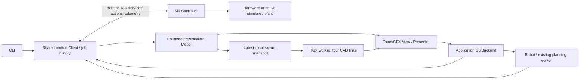

# Robot HMI

The normal UI opens **Home** on Linux and GIGA M7. Both use the same TouchGFX
frontend and application motion client. There is no GUI-specific motion engine
or text-command bridge. M4 still makes authoritative admission and execution
decisions. Physical calibration is deliberately required on the GIGA.




## Operating the interface

- **Home:** initialize, then explicitly enable. Reference Robot runs the configured
  homing sequence. Initialization never enables automatically. Select commanded
  position or feedback, orbit by dragging, zoom, or reset the camera.
- **Move / Axes:** shoulder/elbow in degrees and Z in millimetres. Select relative
  or absolute, edit the value, and press Move. Step buttons use 0.1/1/10 units.
  Dynamics exposes speed, acceleration, deceleration, jerk and timeout; zero
  chooses the configured default. Timed jog defaults to one second. Continuous
  jog requires holding its button; its initial speed is 10% of the axis limit.
- **Move / Robot:** relative/absolute joint or Cartesian destinations. Speed is
  a 0–1 factor, initially 0.25. Acceleration/deceleration/jerk factors apply to
  subsequent moves (zero selects 1). Cartesian destination moves interpolate
  joints; their TCP path can curve.
- **XYZ steps:** discrete Cartesian destination increments. Continuous Cartesian
  jogging is unavailable.
- **Preview:** choose joints, point or straight line, then Calculate preview.
  Preview results have their own tab in Jobs. These buttons never execute a path.
- **Raw motors:** shaft degrees/rpm, dynamics, timeout, homing latch speed,
  buffering, active speed change and defaults. Replacing active work in Aborting
  mode requires confirmation. Abort stops immediately and invalidates references.
- **Jobs:** the same bounded execution history as the CLI, plus separately labelled
  previews. Input requests and quantized endpoints are distinguished; endpoints
  are displayed in motor pulse counts. Cancellation requests stopping and does
  not mean the motor is already at rest.
- **I/O:** read-only reference inputs, driver readiness, fault codes/warnings and
  feedback source/validity. No general-purpose or analog controls are invented.
- **Settings:** brightness, read-only configuration, UI/IO heap and stack queries,
  graphics counters, and access to idle motor defaults.
- **Alarms:** active condition and eight bounded local messages. Acknowledging the
  history cannot clear a hardware fault.
- **Programs / Presets:** intentional empty pages; no commands are generated.

The numeric keypad edits a form; Apply does not move anything. Global Stop is
available even in the keypad and confirmation dialog. Finite jobs continue when
navigating; held jog does not. GUI and CLI obey the same motor/axis/robot exclusion.
**Software Stop is not a physical emergency stop.** Ordinary axis/robot stopping
uses the existing controlled deceleration; raw motor abort remains immediate.

## State, feedback and input supervision

The GUI consumes the existing 20 Hz motor topic. It does not request motor status
on each frame. Configuration is acquired on the planning worker and cached by
boot/configuration identity. Axis/robot commands never use a simulation fixture
as a substitute for missing physical calibration.

M1 encoder feedback is distinct from M2/M3 INDEX phase estimates. Mixed-feedback
TCP is an **estimate**, not a measured mechanical TCP. Missing reference/configuration
shows nominal CAD initially. Invalid or stale live data freezes the last pose;
there is no extrapolation or silent fallback to commanded "actual" position.
Controller readiness in the header is separate from motion readiness in the strip.

A held gesture owns its job. Touch acquisition renews its input deadline only
while the contact remains valid and inside the button. The client worker checks
**200 ms** independently of rendering. Release, drag-out, focus loss, navigation,
shutdown and failure request cancellation, including release before acceptance.
The existing M4 ownership lease and stopping behavior are unchanged.

ICC failure latches a read-only fault display; telemetry becomes invalid and
uncertain jobs become Unknown. The UI does not infer a completed stop, reconnect,
replay, or resume. Explicit application shutdown still joins all workers.

## Implementation and bounded resources

- `src/ui/gui/hmi`: backend contract, Model, Presenter, reused page controls,
  keypad and Viewport. Only the GUI worker touches widgets.
- `src/ui/app/GuiBackend`: application composition adapter, sharing the CLI's Client
  and Robot. No additional controller, job registry or waiting thread is created.
- `ClientControls.cpp`: four ordinary deferred controls, a separate disable slot,
  coalesced urgent stop/cancel, native readiness callbacks and gesture deadline.
  Disable discards pending ordinary GUI controls, including queued Enable.
- `src/common/motion/VisualGeometry.hpp`: CAD link registration shared with the
  native simulator. No Assimp/OpenGL/native-process dependency enters M7.
- `scene3d/Robot`: four links in two immutable detail levels: **36,376 triangles**
  when settled and **7,914 triangles** while camera/joints change, both 640×400
  RGB565. `DetailPolicy` requests one full-detail refinement after 500 ms without
  changes. Linux and GIGA use identical meshes and switching; idle views do not
  rerender. This changes visual geometry only, not motion/simulator geometry.
  The renderer retains the existing two image slots and depth buffer in SDRAM.

Interactive rendering has a **10 fps ceiling**, subject to adaptive pacing
and measured rendering cost. Full detail has a 5 fps ceiling. Hidden
viewports pause; a newer pending pose replaces the previous one. Two-dimensional
controls run independently. No lower-resolution fallback is used.
GUI/touch/render priorities and stacks remain 8/16 KiB, 7/8 KiB and 16/16 KiB.
Frontend bookkeeping has fixed internal storage: the Model is in DTCM, and the
22,944-byte engine/widget tree occupies `.gui_internal` in the upper half of ITCM
(`0x00008000`, 32 KiB region with a 24 KiB allocation limit). This CPU-only region
is execute-never; pixel buffers remain in DMA-accessible SDRAM. The lower ITCM
half retains the existing renderer code and its 24 KiB code cap. The image
manifest explicitly zeroes the GUI region before construction, and linker
regions prevent overlap. This frees ordinary AXI SRAM for ICC/runtime allocations
without reducing any worker stack. The explicit motion benchmark retains its
separate all-ITCM-code layout and places these widgets in AXI SRAM.

No additional pixel buffers or worker stacks come from the UI heap.

## Build and verification

```sh
cmake --build --preset debug-linux
./build/debug-linux/Application
ctest --test-dir build/debug-linux -R 'gui\.|application.robot_api|application.lifecycle|simulation.hmi' --output-on-failure
cmake --build --preset giga-release
python3 scripts/giga_program.py flash --build build/giga-release
python3 scripts/hmi_hardware_check.py --seconds 12
```

`simulation.hmi` drives actual SDL mouse events through the GUI, existing ICC
and native simulated plant. It checks initialization without enabling, enable,
homing → stop → homing, coordinated joint moves, independently observed positions,
axis moves, held-jog focus loss, raw CLI/GUI exclusion, numeric cancellation and
shutdown. It also compares GUI commanded/feedback joints and TCP with client
telemetry and independently observed plant state, retaining INDEX's electrical
cycle resolution. The isolated frontend fixture supplies display states only; it is not
used as evidence of motion execution.

`gui.integration` captures every page and ready/disabled/busy/unconfigured/stale/
fault variants. `gui.x11` additionally exercises the native SDL/Mesa path.
The reviewed images live in `src/ui/gui/tests/golden`. `gui.screenshots` compares
static pixels, excluding asynchronous renderer completion and changing diagnostic
counters; overlays remain checked. Screenshots from these deterministic
presentation fixtures are labelled accordingly.
`PROTOMATE_HMI_AUTOMATION` is an opt-in Linux-only FIFO for test mouse events and
captures; it is absent from the GIGA firmware and carries no motion commands.
Captures include a bounded, atomically copied presentation snapshot for checking
the actual Model rather than inferring its values from requested destinations.

The hardware comparison uses `display robot-test 5` for full detail and
`display robot-test 10 --interactive` for the lighter mesh,
rotating a synthetic camera without commanding motor movement. `display gui`
returns to normal Home. This diagnostic is explicitly injected camera input.
The script retains counters, heap samples, stack high-water marks, console output
and the firmware manifest. `scripts/hmi_hardware_check.py --observe` measures
health and throughput without treating the FPS ceiling as guaranteed delivery.
`scripts/hmi_output_capture.py` records STEP/enable with
the analyzer; its idle-output check is not a substitute for motion qualification. Physical
ST1633i input is not established by this test.

See [verification status](verification.md) for measured results and remaining
qualification. Physical panel interaction and powered calibrated motion remain
separate work. The [motion review](../../motion-current-state/review.md) records
the resolved ICC allocation defect and overlap regression. No deadline was
relaxed to accommodate the HMI.
