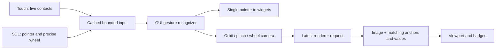

# HMI layout and component contract

Both targets use one 1024×600 frontend. Axis 1/2 are rotary; Axis 3 is linear.
Cartesian coordinates remain X/Y/Z. Internal CAD filenames retain their source
names; those names are not presented as axis labels.

| Region | Geometry |
|---|---|
| Navigation rail | x8 y8, 88×584 |
| Title/status | x104 y8, 912×64 |
| Page area | x104 y80, 912×444 |
| Persistent Jobs / Alarms / notice / Stop | x104 y532, 912×60 |
| Native Home viewport | x104 y100, 640×400 |
| Home status card | x752 y80, 264×444 |
| Axis illustration card | x112 y148, 324×376 |
| Axis controls | x448 y148, 560×376 |

`View` owns the shell, keypad and one reusable collection of controls. Home,
movement and maintenance page builders compose this storage; navigation does
not allocate another widget tree. `Model` has separate page/tab state. `Presenter`
maps intent to the existing backend and owns no motion implementation.

`Theme.hpp` supplies color, spacing and size tokens. Controls have centered
captions; navigation icons and captions are centered together. Labels use actual
font advances, kerning and multiline height. Descriptions stay left-aligned;
table numbers stay right-aligned. Tables retain a 34-pixel header/row height on
the last page, with bounded pagination rather than stretching sparse content.
Temporary labels inside custom draw methods must use paint-only mode: drawing
must never add damage to TouchGFX's active invalidation list.

Page refreshes set each control's **final** style directly. Do not reset and
reapply colors/fonts/geometry every telemetry tick: that needlessly invalidates
unchanged controls. Only changed fields, badges and completed images redraw.

## Scene and input

The TGX renderer projects three CAD joint anchors with the exact camera/world
matrices used for that image. Completed-image metadata includes the projected
anchors, values, revision and timestamp. The viewport places badges from this
metadata, never from a newer telemetry sample. Invalid/off-screen anchors hide;
bounded candidate placement keeps badges inside the viewport, avoids overlap and reserves the top controls and bottom Reset View area.
The status card can show fresher telemetry, with scene age shown when relevant.



Pinch begins only with two contacts starting inside the scene, outside its
buttons. A 12-pixel minimum separation and 2-pixel jitter threshold avoid unstable
ratios. Spreading zooms in. Pinch cancellation requires all contacts to release
before orbit/taps resume. Distance stays within 0.4–2.0 m. Wheel zoom is
logarithmic (12% per step); fractional deltas and flipped direction are retained.
Eight bounded queued wheel events preserve position and timestamp, expire at
100 ms and are consumed once. Overflow/focus loss/navigation cancel input.
No camera gesture submits motion. An extra touch cancels held jog directly in
acquisition, independently of GUI rendering.

## Assets and diagnostics

Noto Sans uses 16/18/24/36-pixel fonts. Source SVG navigation icons and three
304×190 CAD illustrations pass through the existing incremental asset pipeline.
The illustration generator uses the detailed TGX model and registered joint
origins, adds positive-motion guides, and records hashes in
`src/ui/gui/assets/axis-illustrations.json`:

```sh
python3 scripts/prepare_axis_illustrations.py --help
```

Compiled illustrations occupy 346,560 bytes in the M7 QSPI image. No runtime
rendering or additional framebuffer is needed for the axis illustrations.

`GuiBackend` retains one typed memory snapshot. The frontend copies only six
visible rows at a time; it never parses CLI text. Queries run on the existing
application workers. Graphics diagnostics are local to UI; selecting them disables
IO selection. Tables show unavailable/loading/error states and snapshot age.

See [verification](verification.md) for exact images, test coverage and measured
hardware limits. Physical touch/pinch behavior remains a separate panel check.
