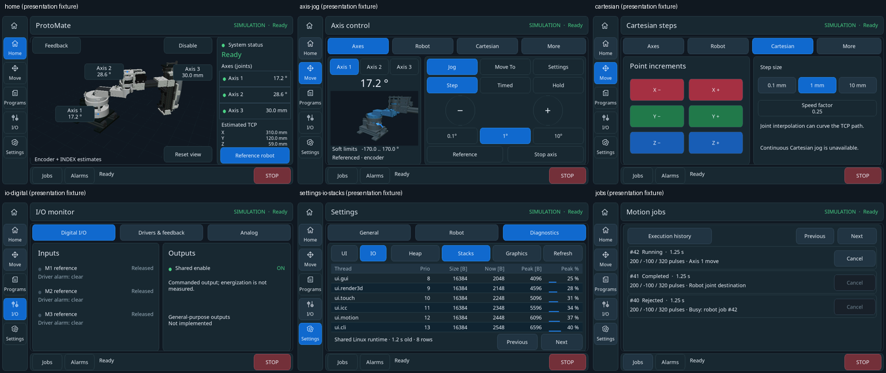

# HMI modernization verification

The normal Linux/GIGA UI uses the revised Home screen, **Axis 1/2/3** naming,
centered controls, focused movement tabs, I/O cards and typed diagnostic tables.
The same 640×400 scene, 7,914-triangle interactive model and 36,376-triangle settled
model run on both platforms. Idle poses do not rerender.



## Software and visual verification

- All **13 GUI suites pass in Linux Debug and Release**: presentation, native
  X11, wheel/letterboxing/focus, pages, screenshots, gestures, graphics, detail
  switching, image ownership, robot rendering and source-asset checks.
- The separate real **simulation.hmi** workflow passes in both builds. It uses
  the actual motion client, ICC and simulated plant: initialize without enable,
  homing → stop → homing, coordinated and individual moves, held-jog cancellation,
  CLI/GUI exclusion, numeric cancellation, observed joint/TCP agreement and shutdown.
- HAL architecture and simulated display-clock checks pass. The timer rollover
  test uses native monotonic time alongside the native simulated counter;
  production timing uses the unchanged runtime clock. Mixing native counter
  time with delayed hosted ThreadX ticks is not a valid rollover reference.
- **52 reviewed screenshots** cover the pages/tabs and ready, disabled, busy,
  unconfigured, stale and fault states. Five additional pixel tests check text
  centering in tabs, large controls, multiline fields and keypad keys.
- Pinch tests cover entry/exit, reordering, near-zero separation, jitter,
  exclusions and cancellation. Bounded wheel tests cover coordinates, fractions,
  age, overflow and exactly-once delivery. Native SDL tests cover ordinary and
  flipped direction, focus loss followed by window exit, and letterboxing.
- Joint badges carry the completed frame's projected anchors and values. Tests
  retain metadata across replaced requests and immutable displayed frames;
  collision tests check bounds/non-overlap. Asynchronous scene pixels and changing
  graphics counter values are excluded narrowly from the static goldens.
- The detailed/interactive asset review retains 36 matched views with minimum
  silhouette IoU **98.358%**. Three static joint illustrations use the detailed
  registered CAD and projected positive-direction guides; hashes/sizes match.
- The 13-event Linux input samples measure **34.6–37.4 ms p95** visible feedback
  across Debug/Release and dummy/X11. These are small software-input samples,
  not a bound on physical touch or motion latency. A concurrent compilation run
  reached 52 ms; final timing samples were taken without compilation load.
- Linux and both GIGA cores build in Debug/Release. No clang-tidy or sanitizer
  campaign was run. Targeted formatting was applied to changed C++ files.

Xvfb needs permission to create a local X11 socket. The sandboxed Debug X11
launch could not start its server; the same test passed with that permission.
Release's complete 14-suite GUI/simulator run passed together.

## Final image and resource budget

Release pair programmed and verified:

```
f8426633d516d3b1572071b6165192ae0014e6d737744c0e3d1d195cb06eb401
```

M4 image: **1,149,828 bytes**. M7 image: **2,654,048 bytes**.

| Resource | Allocation |
|---|---:|
| New compiled axis illustrations | 346,560 B QSPI |
| New navigation icons | 13,520 B QSPI |
| Renderer hot code | 16,088 B ITCM |
| Engine/widget storage | 24,032 / 24,576 B allowed |
| M7 Release DTCM static data | 110,056 / 112,640 B |
| Two 640×400 images plus depth | 1,536,000 B SDRAM |
| Ordinary M7 heap capacity | 238,400 B |

Fonts/icons/illustrations remain below the 1 MiB additional-asset budget.
No framebuffer or worker stack was added. The existing GUI/touch/render stacks
remain 16/8/16 KiB. Only **544 bytes** remain in the GUI bookkeeping allowance;
further widgets need an explicit budget, rather than unbounded page trees.

## Panel-free hardware verification

The user verified USB cold startup during this pass; after the final badge-clearance adjustment, both controllers were restarted through SWD. Both reported Ready and
ICC remained connected throughout the final 30.75-second synthetic camera run.
This uses the same interactive camera workload as the approximately 3.45 fps
baseline; model detail and resolution are unchanged.

| Measurement | Final Release result |
|---|---:|
| Newly presented 3D images/s | 3.674 |
| Mean render wall time | 202.60 ms |
| LTDC underruns / DMA errors | 0 / 0 |
| Renderer/input/command errors | 0 |
| Heap use, minimum–maximum | 199,552–199,616 B |
| Final minus initial heap use | −16 B |
| GUI / renderer / touch free stack | 71.38% / 61.07% / 92.33% |

This is a short measured comparison, not a guaranteed frame rate or endurance
qualification. **3.67 fps remains visibly stepped animation.** Physical touch
latency and visible panel output are unmeasured. The graphics table's frame-age
value is source-to-presentation latency of the last presented frame, not an
increasing idle-age clock.

A separate 24 MHz, five-second analyzer capture of this exact image pair records
120 million samples: all three STEP outputs LOW, enable HIGH/inactive, and zero
transitions on all four channels. Both SDRAM slots also pass diagnostic-pattern and Home readback checks; the final idle Home images are identical. The saved [GIGA image](screens/giga-home.png) is a framebuffer readback, not a photograph of a physical display.

The analyzer capture verifies idle outputs under GUI load;
it does not repeat motion execution qualification.

After flashing, one debugger reset left IO unavailable. One ordinary coordinated
reset restored both cores; the subsequent physical USB cold start also passed.
This was startup recovery, not evidence of a graphics-load heartbeat failure.
The interrupted capture during the user's power cycle remains retained and was
not counted as a passing test. No firmware change was needed for recovery.

Raw final counters, firmware manifest and stack results:
`build/hmi-modern/hardware/final-delivery`. The confirmed physical cold-start run is retained in `cold-release`. Analyzer samples and hash:
`build/hmi-modern/hardware/delivery-idle`. Framebuffer readback:
`build/hmi-modern/hardware/delivery-framebuffers`. Failed/interrupted attempts remain in
`release` and `verified-release` alongside these results.

## Reproduction and remaining qualification

```sh
cmake --build --preset debug-linux
ctest --test-dir build/debug-linux -R 'gui\.|simulation.hmi' --output-on-failure
cmake --build --preset giga-release
python3 scripts/giga_program.py flash --build build/giga-release
# After confirming both cores Ready, with motor power disconnected:
python3 scripts/hmi_hardware_check.py --rates 10 --seconds 30 --observe \
  --interactive --output build/hmi-check
python3 scripts/gui_hardware_inspect.py --capture-only --output build/hmi-framebuffers
python3 scripts/hmi_output_capture.py --seconds 5 --output build/hmi-idle-outputs
```

`--observe` measures throughput and checks health; the configured FPS ceiling is
not treated as promised performance. These checks do not establish motion pulse
timing, powered mechanical accuracy or physical panel behavior. The motion engine,
ICC deadlines, timer settings and interrupt priorities were not changed.

Physical RGB appearance, touch/pinch on ST1633i, supply sequencing and powered
calibrated motion remain separate first-panel/commissioning checks. Synthetic
mouse/contact tests are not evidence of physical touch operation. The existing
[motion review](../../motion-current-state/review.md) retains execution qualification.
