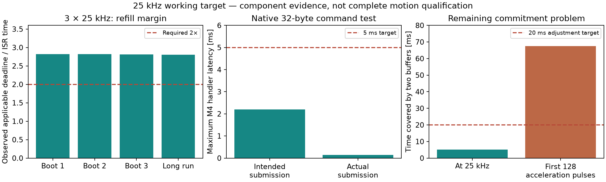

# Motion architecture qualification — GIGA

The coordinated-motion target is **12.5 kHz per axis**. Admission remains
**5 ms** and an accepted jog/override/hold must begin affecting execution within
**20 ms**. Exact pulse counts, trajectory constraints, local faults and a validated
stopping continuation after stream loss remain mandatory.

**The finite executor is implemented, but its bounded 12.5 kHz hardware attempt
failed. Qualification is stopped.** The capture contains one M3 high interval of
7.875–7.917 µs per move, instead of 5 µs. Exact counts and a 4.76× measured refill
margin do not override that failure. Normal Debug firmware is restored with drivers
disabled. See the [current result ledger](executor-results.json) for all 30
violations, current firmware identities, host verification and skipped gates.

`io::motion::Controller` owns the local execution API.
The richer ICC/Robot trajectory service does not expose it yet. Hardware
verification uses a separate benchmark with disconnected motors and inactive enable.

See [executor contracts and usage](../../src/io/motion/EXECUTOR.md) for the current
implementation and its verification. The component measurements below characterize
transport and immutable-profile execution separately; they do not replace the
executor's renewal, braking and combined-load tests.

## Current evidence

- [Reproduction, commands, wiring and measurement definitions](../../examples/giga_motion_bench/README.md)
- [Finite executor failure, captures and firmware hashes](executor-results.json)
- [Separate immutable-profile fixture measurements at 25 kHz](reduced-rate.json)
- [Raw capture / firmware artifact paths and hashes](reduced-rate-artifacts.json)
- [Underlying transport and reference-solver characterization](measurements.json)

Raw captures and content-addressed firmware are retained under
`build/motion-options/`; the original transport characterization is under
`build/motion-qualification/`. Keep these directories when preserving the hardware
measurement record. The report's hashes identify the exact images; benchmark code
placement has changed between experiments, so results are not interchangeable.

## Separate immutable-profile evidence

This section describes the image-specific component fixture in `reduced-rate.json`,
which does not renew or replace a running profile. Its passing electrical result
does not qualify the current executor or supersede the failed 12.5 kHz attempt.

The benchmark runs immutable jerk-limited cubic profiles through the existing
TIM2/DMA STEP backend, including acceleration from rest, cruise and deceleration
to rest. Two fixtures cover equal 25 kHz peaks on all three axes and different
25/20/12.5 kHz peaks with a common time origin. They use synthetic, uncalibrated
positions, not robot mechanical limits.

Every rising edge is compared with an independent analytic trajectory in Python.
The 24 MHz analyzer also checks falling-edge counts, high times, common origin,
inactive enable and final LOW levels. Clock offset is fitted on cruise and reported
separately; the comparison retains the 100 ns STEP grid and analyzer uncertainty.

Three fresh coordinated boots pass both short fixtures. That fixture's long capture,
using the replacement analyzer ENABLE lead and a short common ground, executes
**1,000 profiles** over **619.5 seconds wall time / 600 seconds of trajectory
time**, with **10,000,000 rising and falling edges per axis**. Every STEP edge passes
independent trajectory comparison, and **ENABLE remains HIGH/inactive throughout
all 14,919,873,024 samples**. No samples are filtered or discarded.

Its minimum observed refill margin is **2.805×**.
Maximum STEP residual is **2.42 analyzer samples
(101 ns)** after separating clock offset;
the allowed envelope is 4.5 samples. Relative MCU/analyzer clock offset is
approximately **+0.0139%**. Neither instrument's absolute
error is established.

Firmware reports zero STEP/DMA errors, and GUI counters report zero underruns or
errors. Registered-thread headroom in this run is at least
63.3% on M4 and 59.9% on M7.
The separate kernel-stack measurements remain below. Final heap usage is
105,224 bytes on M4 and 151,280 bytes on M7; these are benchmark
snapshots, not a production steady-state memory bound.

The strict electrical gate passes for this fixture. Captures containing brief
ENABLE/marker disturbances, including the interrupted reseated-lead run, remain
in the artifact record and are still marked rejected. The clean result after
replacing the cable is consistent with a connection/acquisition problem; it does
not establish the exact physical cause or replace powered-driver qualification.

The deadline margin is measured for each interrupt against the time remaining
until its already armed hardware guard, before refill extends that deadline. This
includes the service/refill/callback work and accounts for time already lost before
service. Comparing the slowest interrupt in a low-speed phase to the shortest
high-speed deadline gives a more pessimistic bound, but is not the applicable
per-refill deadline. Counter storage follows the measured ISR interval. These are
observed margins, not a mathematical worst-case proof.

The workload includes the actual GUI and normal/background ICC publications plus
a calibrated fixed instruction workload requested every millisecond on M4. The
load is configured for nominal 20% M4 capacity; recorded iteration counts expose
scheduling delay. It does not qualify a real 1 kHz EtherCAT task. STEP servicing
still masks interrupts, with some measured intervals exceeding 1 ms; a production
interrupt-latency analysis remains necessary.

## Computation and communication choices

Keep geometry, FK/IK, Cartesian subdivision, lookahead and planning on M7. Keep
physical IO, final admission, fault handling, execution and stop selection on M4.
The finite executor uses **compact cubic trajectories evaluated on M4 (candidate A)**
with a Controller cap of 12.5 kHz; it remains unqualified. Broader trajectory planning and the inter-core submission protocol are
separate integration work.

`FixedCrossing` evaluates Q32 cubic coefficients. Ambiguous comparisons use the
original double predicate. Newton supplies an estimate only; bracketed crossing
checks determine the emitted tick. Host tests compare every generated pulse in
varied acceleration and braking cases with the double reference. No trajectory
constraint or accepted timing tolerance was weakened. The production `ProfileCrossing` evaluator derives from this bounded cubic
approach. It is not a general Cartesian/quintic trajectory replacement.

The complete M4 sequence/fallback call path and its vtable reside in instruction
RAM, with coefficients in internal D2 SRAM. The normal Release linked-image audit
follows 63 roots, 168 reachable functions, seven vtables and 20 ICC entry points,
with no out-of-RAM functions in the inspected paths. New callbacks need their own audit.

A three-axis full stopping timestamp calculation at the reduced rate takes about
**17.6 ms on M4 / 5.62 ms on M7** in the current kernel fixture. Its M4 20 KiB stack
retains 6,124 bytes (29.9%); M7 retains 10,304 of 24,576 bytes (41.9%). Those figures
measure a whole precomputed stopping tail, not the cost of selecting or executing
a validated continuation during motion.

The general coroutine bridge still does not meet the 5 ms admission target under
the tested load. Batching and priority experiments did not remove the bottleneck.
A dedicated allocation-free native command path uses the existing SPSC/HSEM
mechanism and readiness notifications, independently of ordinary ICC dispatch.
It completed **one million 32-byte request/reply transactions** with ordinary ICC
flooding and GUI active, without corruption: maximum intended-submission-to-M4
handler latency **2.20 ms**, maximum intended round trip **2.283 ms**.

A separate three-boot native-path test with constant 3 × 100 kHz STEP, GUI, ICC
flood and nominal 20% M4 work observed at most **2.458 ms** intended admission and
exactly 600,000 pulses per axis per capture. This demonstrates the small command
path's scheduling capacity. It does not implement or measure full motion
validation, credits, action cancellation or streaming transactions. The ordinary
ICC bridge remains the application lifecycle/diagnostics/logging path.

Compact quadratic pulse runs with correction bitmaps were also screened. They
reduce data volume but their construction cost did not provide a better complete
solution than the reduced-rate cubic evaluator. They remain isolated benchmarks.

## Boundaries that still require implementation

| Requirement | Current status |
|---|---|
| Up to 3 × 12.5 kHz finite jerk-limited execution | Failed M3 high-time gate in the 12.5/10/6.25 kHz fixture; equal-rate qualification not completed |
| 5 ms command admission | Small native packet handler passed; full motion admission pending |
| 20 ms adjustment onset | Local stop selects an installed brake behind a 20 ms frontier; full jog/override and inter-core onset remain unqualified |
| Full replenishment transaction with 2× margin | Pending codec, credits, validation, stopping data and commitment integration |
| Validated local stop after stream loss | Complete brake and 20 ms producer lease implemented; host invariants pass, current-rate hardware capture and ICC stream/session integration pending |
| Cancellation, independent restart, stale-session rejection | Local executor tests cover cancellation, old IDs and recovery; coordinated core-restart integration remains pending |
| Production CPU/memory reserve | Pending; benchmark composition omits production motion and CLI services |
| Real EtherCAT, mechanical accuracy and calibrated limits | Outside this campaign |

The immutable-profile fixture uses 64-pulse DMA halves. Both buffers represent **5.12 ms at
25 kHz**, but a larger interval at low speed. In this fixture the first 128 pulses
of acceleration span approximately **67.5 ms**. Therefore fixed pulse-count
buffering cannot be presented as a general 5.12 ms commitment guarantee or as
proof of 20 ms interactive response. The production executor therefore distinguishes prepared DMA data from a
preserved time prefix. Its guarded splice replaces future edges, including an
already loaded compare when the affected edge is beyond that prefix.

Completing an immutable finite trajectory while M7 is idle is not a test of
selecting a stopping branch. The executor separately exercises producer lease
expiry and an owner-worker stall in host tests with interrupts continuing. Host regressions
exercise immediate local faults and last-resort guard cessation. Neither local
test qualifies resetting one core independently; reconnection must not replay or
resume motion automatically.

## Resources and scheduling

These are experimental settings, not a production resource allocation:

| Worker | Core | Priority | Stack |
|---|---|---:|---:|
| Native command path | M4 / M7 | 1 / 2 | Application command workers |
| Ordinary ICC with protected admission | M4 / M7 | 5 / 4 | 32 KiB each |
| Fixed-work reservation | M4 | 3 | 4 KiB |
| Kernel measurement | M4 / M7 | 6 | 20 / 24 KiB static |
| GUI / touch / 3D | M7 | 8 / 7 / 16 | Existing application settings |
| Flood producer/subscriber | M7 / M4 | 12 | Benchmark-only |

The native endpoint uses four-slot bounded queues, 32-byte checked messages and
HSEM 6/7. Its 64 KiB storage reservation is at `0xC0500000`, in the non-cacheable
benchmark SDRAM area. Each core additionally reserves 256 KiB workspace and
256 KiB compact-run storage. No new benchmark arrays consume the small production
UI heap.

The current finite-executor Release benchmark uses **160,280 / 194,560 bytes**
of M4 instruction RAM and **84,448 / 90,112 bytes** of its static-data region.
The normal Release application uses **191,328 / 194,560 bytes** of instruction RAM
and **80,160 / 90,112 bytes** of static-data SRAM, leaving 3,232 and 9,952 bytes
respectively. These figures include the fixed 25,408-byte profile pool. The
separate 256 KiB M4 AXI allocation begins with 13,816 bytes of exception unwind
metadata; the remaining heap holds the executor worker and temporary HAL staging;
active execution needs about 32 KiB of that heap beyond the idle composition.
The benchmark does not instantiate every normal service, so its free heap cannot
substitute for the normal application's runtime snapshot.

The restored normal Debug application's idle snapshot shows 69,400 bytes available
on IO and 7,816 bytes on UI. The failed short benchmark's M4 busy fraction was
approximately 99.7% including its synthetic 20% reservation. Neither figure
establishes sufficient reserve for an expanded production controller.

General M4 planning kernels reside in QSPI; the fixed evaluator and STEP hot paths
are in SRAM. M7 kernels reside in ITCM. `Kernels.cpp` now receives `-O2` through its
owning CMake target; earlier wrapper measurements used `-Os` because the original
directory-local source property did not apply. Preserve image hashes and actual
compiler settings when comparing measurements.

## Verification and board state

The current executor verification and restored firmware identifiers are recorded in
[the executor verification section](../../src/io/motion/EXECUTOR.md#verification).
Normal and benchmark M4/M7 applications build in Debug and Release. Host coverage
includes the executor, Controller integration, HAL/register model, simulation,
ICC, GUI and independent Python capture analysis. No clang-tidy or sanitizer run
is part of this work.

All 72 native Debug CTest entries and seven targeted Release entries pass. The
hardware failure ends this attempt: current-rate stopping, endurance, repeat-boot
and Debug hardware qualification remain incomplete. The unresolved electrical
cause is not classified as an analyzer fault or a software fault by these results.

Powered motion, mechanical following accuracy, calibrated limits, physical panel
operation and EtherCAT integration remain separate qualification steps.
