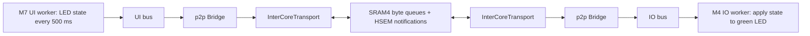

# H755 application setup

M4 runs `io::Application`; M7 runs `ui::Application`. Each has a complete private
ThreadX/C++ runtime, including threads, synchronization, TLS, allocation,
exceptions, clocks, hardware entropy and FileX/LevelX support. Common HAL device
implementations are compiled for both cores. External motors, Ethernet/SPI
devices and storage media remain unassigned; no storage volume is mounted.

## Ownership

| Resource | M4 | M7 |
| --- | --- | --- |
| Application entry | `src/io/main.cpp` | `src/ui/main.cpp` |
| ThreadX port | `cortex_m4/gnu` | `cortex_m7/gnu` |
| Flash | `0x08100000`, 1 MiB | `0x08000000`, 1 MiB |
| Globals, TLS, heap | D2 `0x30000000`, 280 KiB | AXI `0x24000000`, 512 KiB |
| Interrupt/main stack | `0x30046000`, 8 KiB | DTCM `0x2001E000`, 8 KiB |
| Scheduler/HAL tick | Private SysTick, 1 kHz | Private SysTick, 1 kHz |
| Runtime timer | TIM5, 32-bit, 1 MHz | TIM12, 16-bit, 1 MHz |
| Status LED | LD1 green / PB0 | LD2 yellow / PE1 |
| Additional onboard GPIO | — | LD3 red / PB14, user button / PC13 |
| Console | — | USART3, PD8/PD9, ST-Link VCP, 115200 8N1 |
| RTC and RNG | Serialized access | Initialization and serialized access |
| Inter-core channel | Endpoint M4 | Endpoint M7 |

`hal::core` selects only the executing processor. Physical GPIO/timer ownership
is defined in `platform/hal/board/nucleo_h755ziq/resources.hpp`; direct factories
also enforce it. GPIO configuration is serialized across processors because
separate owned pins can share a GPIO port register. The HAL uses M4/M7 names;
IO/UI are application roles.

M7 configures the direct SMPS supply and shared clocks before releasing M4.
Both CPUs and timer kernels run at 64 MHz from HSI. APB1 is 32 MHz to keep
USART3 within the selected voltage range; its timer kernels remain at 64 MHz.
RTC uses the onboard 32.768 kHz LSE crystal; RNG uses HSI48. RTC/RNG handles
and local locks are private, with hardware semaphores protecting shared access.
The RTC calendar starts at 2000-01-01 if its backup marker is absent and is
preserved across system resets. It is not a synchronized real-world date.
`system_clock` uses it with runtime counter interpolation; `steady_clock`
continues to use the 1 ms scheduler tick. Entropy failure is reported, never
replaced with deterministic numbers. Each sample checks RNG access at startup.

## Shared-memory transport and LED topic



The catalog is `src/common/Topics.hpp`. `Topics::io_led_state` is marked with
`TopicPublisher::UI`; its inferred topic name is `io/led/state`. The payload is
`LedState { uint32_t sequence; bool on; }`, serialized by pneumo. UI shows the
same state on its yellow LED. IO subscribes with latest-only delivery and sleeps
until readiness or shutdown is signalled. IO never generates a blink locally.

`application::p2p` remains portable. The separately linked
`application::p2p::intercore` adapter wraps `hal::IInterCoreChannel`.
The channel uses four SPSC queues: normal and urgent in each direction, four
frames per queue, at most 2048 bytes per frame. Queue counters use aligned,
lock-free 32-bit acquire/release accesses; no pointer, mutex, coroutine, or
ThreadX object is shared. Cancellation wakes local coroutine waits, and the
urgent lane has capacity independent of normal traffic.

Both linkers reserve SRAM4 at `0x38000000` (64 KiB); the shared layout occupies
32,880 bytes. Its `NOLOAD` section is outside both startup BSS ranges. M7 zeros
it before releasing M4. M7 configures the region as normal, shareable,
non-cacheable and execute-never before enabling its data cache. Private AXI
RAM stays cached. This follows ST's [dual-core memory guidance](https://www.st.com/resource/en/application_note/an5557-stm32h745755-and-stm32h747757-lines-dualcore-architecture-stmicroelectronics.pdf).

| HSEM | Purpose |
| --- | --- |
| 0 | Boot handshake |
| 1 | Notify M4 of received data, freed space or closure |
| 2 | Notify M7 of received data, freed space or closure |
| 3 | RTC snapshot access |
| 4 | RNG access |
| 5 | GPIO configuration register access |

HSEM interrupts only signal a local runtime notification. A worker wakes
coroutines in thread context. Notifications can coalesce: queue counters are
authoritative, and registration checks existing work. The bridge sends
heartbeats every 100 ms and detects link loss after 500 ms. Link failure stops
the application workers and turns their LEDs off. A halted core cannot turn off
its own LED until it resumes.

**Reset both cores together.** A closed channel cannot be reopened during that
boot. Independent core restart/reconnection and cross-session stale-frame
protection remain later work. Neither processor clears a live peer's queues.
A board reset or USB power cycle initializes both endpoints afresh.

## Build

```sh
cmake --preset h755-debug
cmake --build --preset h755-debug
# Optimized pair:
cmake --preset h755-release
cmake --build --preset h755-release
```

Per-core presets remain `h755-io-debug`, `h755-ui-debug` and their Release
variants. Hardware application presets enable P2P and the full runtime.
The separate `h755-led-*` presets retain the bare-metal startup samples.
Both firmware builds report private memory and the same shared reservation;
the two SHARED figures describe one physical region, not two allocations.

CubeMX owns onboard peripheral initialization. The runtime owns scheduler,
fault and syscall hooks. HAL owns dynamic EXTI, timer and HSEM interrupt
registration, shared-memory initialization and MPU setup. The custom linker
owns private memory, compiler TLS and the shared reservation.

## Flash and test

```sh
openocd -f cmake/openocd/nucleo-h755ziq.cfg \
  -c "init; reset halt; targets stm32h7x.cpu0" \
  -c "flash write_image erase build/h755-ui-debug/ui-controller.elf" \
  -c "verify_image build/h755-ui-debug/ui-controller.elf" \
  -c "flash write_image erase build/h755-io-debug/io-controller.elf" \
  -c "verify_image build/h755-io-debug/io-controller.elf" \
  -c "reset run; shutdown"
```

Green follows yellow with a small transport delay: 500 ms on, 500 ms off. Reset or USB
reconnection should restart the pair. No external wiring is needed. The M7
console reports that storage is unavailable; that is expected without media.

Each image has six ThreadX threads: timer, main, reaper, p2p context, transport
notification worker and application worker. `hal_last_panic`, CFSR and HFSR
should stay clear. Both scheduler counters and all four shared queue counters
should advance, with consumed queues draining. Use each core's own ELF in the
debugger. Pausing a core for more than 500 ms deliberately fails the peer link;
reset the board after such debugging.

Host tests cover serialized delivery, queue saturation, independent urgent
capacity, counter rollover, cancellation, notification races and shutdown.
The application test confirms IO stays idle without a received LED topic and
turns the LED off on peer loss. Lint and sanitizers are not run automatically
for these intermediate migration steps.

Debug and Release builds pass without compiler warnings. Both pairs passed
flash verification, three resets, RTC/counter and RNG startup checks, LED topic
delivery, and a deliberate M7 halt that caused IO to turn its LED off and close
the link. Both Linux configurations pass all 34 CTest suites. The Debug pair is
installed for development.
