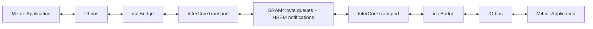

# H755 application setup

M4 runs `io::Application`; M7 runs `ui::Application`. Each has a complete private
ThreadX/C++ runtime, including threads, synchronization, TLS, allocation,
exceptions, clocks, hardware entropy and FileX/LevelX support. Common HAL device
implementations are compiled for both cores. The M4 catalog exposes the three
motors’ peripherals, drivers and feedback providers. Applications do not construct
or start motors yet. Ethernet/SPI and storage media remain unassigned; no storage
volume is mounted.

## Ownership

| Resource | M4 | M7 |
| --- | --- | --- |
| Application entry | `src/io/main.cpp` | `src/ui/main.cpp` |
| ThreadX port | `cortex_m4/gnu` | `cortex_m7/gnu` |
| Flash | `0x08100000`, 1 MiB | `0x08000000`, 1 MiB |
| Globals, TLS, heap | D2 `0x30000000`, 280 KiB | AXI `0x24000000`, 512 KiB |
| Interrupt/main stack | `0x30046000`, 8 KiB | DTCM `0x2001E000`, 8 KiB |
| Scheduler/HAL tick | Private SysTick, 1 kHz | Private SysTick, 1 kHz |
| Runtime timer | TIM5, 32-bit, 1 MHz | TIM12, 16-bit, 1 MHz |
| Status LED | LD1 green / PB0 | LD2 yellow / PE1 |
| Additional onboard GPIO | — | LD3 red / PB14, user button / PC13 |
| Console | — | USART3, PD8/PD9, ST-Link VCP, 115200 8N1 |
| RTC and RNG | Serialized access | Initialization and serialized access |
| Inter-core channel | Endpoint M4 | Endpoint M7 |
| STEP scheduling | TIM2 CH1/3/4, DMA1 streams 0/1/2 | — |
| STEP deadline/completion | TIM2 CH2 + DMA1 stream 3; TIM7 | — |
| Quadrature feedback | TIM3 A/B; TIM6 sampling | — |
| Driver configuration | USART2, PD5/PD6, 115200 8N1, FIFO | — |
| Motor GPIO | DIR, shared enable, references, ALM/DIAG, INDEX | — |

`hal::core` selects its construction recipes from
[`Catalog.hpp`](../../platform/hal/core/Catalog.hpp) using `util::executing_core()`.
The `[[= Core::M4]]` / `[[= Core::M7]]` entries list available roles and their
board factories; omitted roles return `nullptr`. The HAL uses M4/M7 names;
IO/UI are application roles.

`hal::board` maps hardware and creates devices independently of core ownership.
It exposes all prepared devices with no core parameters or checks.
Driver factories also select hardware independently of the core. Applications
and runtime use `hal::core` to honor the assignments; direct board/driver calls
must respect other users of the same peripheral. GPIO configuration remains
serialized across processors because different pins can share a port register.
Timer wrappers use private handles and route interrupts by peripheral; creation
does not reset or initialize a timer. CubeMX/platform startup retains the
initialization responsibilities shown above. Per-image leases prevent duplicate
claims locally; the catalog assigns each motor peripheral exclusively to M4.

M7 configures the direct SMPS supply and shared clocks before releasing M4.
PLL1 derives **80 MHz** from HSI: 64 MHz / 8 × 40 / 4. Both CPUs and HCLK
use 80 MHz. All APB buses use 40 MHz and timer kernels use 80 MHz.
TIM2 divides by 8 for the STEP engine’s 10 MHz / 100 ns time unit;
TIM5/6/7/12 divide by 80 for 1 MHz counters. The backend checks the actual
clock tree instead of assuming a fixed input frequency. HSI remains the
frequency reference; this configuration does not establish crystal accuracy.
RTC uses the onboard 32.768 kHz LSE crystal; RNG uses HSI48. RTC/RNG handles
and local locks are private, with hardware semaphores protecting shared access.
The RTC calendar starts at 2000-01-01 if its backup marker is absent and is
preserved across system resets. It is not a synchronized real-world date.
`system_clock` uses it with runtime counter interpolation; `steady_clock`
continues to use the 1 ms scheduler tick. Entropy failure is reported, never
replaced with deterministic numbers.

## Motor peripheral wiring and construction

Connector numbers below identify **physical header pins**, not Arduino D numbers.
These signals use 3.3 V logic and connect to the existing driver/encoder interface
circuits. In particular, DM542T STEP/DIR/enable still use the transistor stages,
and encoder A/B/Z still use the receiver and level conversion circuit.

| Signal | MCU pin | Nucleo connector | Configuration |
| --- | --- | --- | --- |
| M1 STEP | PA0 | CN10.29 | TIM2_CH1 / AF1, DMA1 stream 0 |
| M2 STEP | PB10 | CN10.32 | TIM2_CH3 / AF1, DMA1 stream 1 |
| M3 STEP | PB11 | CN10.34 | TIM2_CH4 / AF1, DMA1 stream 2 |
| M1 / M2 / M3 DIR | PE12 / PE13 / PE14 | CN10.26 / .10 / .8 | Output, initially low |
| Shared EN_N | PE15 | CN10.30 | Output, initially high: disabled |
| M1 / M2 / M3 reference | PE7 / PE8 / PE10 | CN10.20 / .18 / .24 | Pull-up, both edges |
| M1 encoder A / B | PB4 / PB5 | CN7.19 / .13 | TIM3_CH1/2 / AF2, quadrature ×4 |
| M1 encoder Z | PB6 | CN10.14 | Rising edge |
| M1 DM542T ALM | **PE2** | **CN10.25** | Pull-up, rising edge |
| M2 / M3 DIAG | PD4 / PD3 | CN9.8 / .10 | Pull-down, rising edge |
| M2 / M3 INDEX | PD0 / PD1 | CN9.25 / .27 | Pull-down, both edges |
| TMC UART TX / RX | PD5 / PD6 | CN9.6 / .4 | USART2 / AF7, pull-up |
| Common ground | GND | CN10.22 | Common logic ground |

**The DM542T ALM connection is now PE2, not the archived PF2 assignment.** PF2
is unavailable on this H755 package. Other motor signal pins are retained.

TIM2 generates all STEP edges in hardware using independent per-axis compare/DMA
streams. Internal CH2/DMA stream 3 stops the timer if software misses a refill
deadline. TIM7 checks finite-tail completion every 1 ms while needed; it never
schedules STEP edges. Minimum high and low times are each 5 µs (100 kHz maximum
requested STEP frequency). Sustained operation on this M4 needs bench validation.

The CubeMX `TIM2_MspPostInit` USER CODE block leaves STEP as low GPIO outputs.
The backend selects AF1 only when arming a channel after forcing its timer output
inactive. The DMA buffers occupy a private, 32-byte-aligned `.StepDmaSection`
before the heap, accessible to DMA1. M4 needs no cache maintenance; the backend
cleans the buffer on cached M7 builds. This memory is separate from ICC SRAM4.

TIM3 counts the M1 encoder’s 1600 quadrature counts per shaft revolution. Its
wrap/compare interrupts extend the count. TIM6 provides a dedicated 1 kHz service
interrupt for 10 ms feedback samples, including zero velocity at standstill.
Starting feedback starts these timers; construction leaves them stopped. The
HAL/runtime tick remains SysTick. M2/M3 INDEX feedback observes the driver’s
phase progression, **not measured shaft position**.

The two TMC2209s share USART2, addresses 0 and 1 selected with the existing MS
straps. Connect TX through the existing 1 kΩ resistor to the single-wire UART
bus; RX connects directly. The shared bus serializes register transactions.
Wrappers use private handles for the CubeMX-initialized peripheral; creation
sends no data. Driver initialization explicitly applies 1/selected-microsteps,
StealthChop and the board’s current limits. M1 remains a DM542T with hardware
DIP configuration; M2/M3 also expose the configurable driver interface.

`hal::core` exposes the composition to the IO application:

```cpp
using namespace pnm::units::literals;
using Motor = hal::core::MotorId;
auto enable = hal::core::create_steppers_enable_output(); // high, disabled
auto generator = hal::core::create_stepper_generator(); // stopped
auto step = hal::core::create_stepper_step_output(generator, Motor::Motor1);
auto direction = hal::core::create_stepper_direction_output(Motor::Motor1);
auto reference = hal::core::create_reference_limit_switch(Motor::Motor1);
auto feedback = hal::core::create_motor_feedback(Motor::Motor1, {1.8_deg, 16});
auto uart = hal::core::create_stepper_driver_bus();
auto drivers = hal::core::create_stepper_drivers({16, 16, 16}, enable, uart);
```

Check factory results before use and retain the owners for their device lifetimes.
These motor factories are assigned to M4 and the host test platform; M7 gets
empty results. Board factories remain independent of core identity. Construction
neither enables motors nor starts motion nor initializes TMC registers. Application
motion workers, driver initialization sequencing and ICC commands are next steps.
M4’s terminal fault handler stops STEP and raises EN_N without waiting on workers.

## Shared-memory transport



Both applications require a transport and own a concrete bridge, bus and context.
The bridges register the empty `Topics`, `Services` and `Actions` catalogs in
`src/common/icc/topics.hpp`, `services.hpp` and `actions.hpp`. These are the
shared definitions to extend with application functionality. Handshake and
heartbeat traffic runs even without application messages. The application
workers sleep until shutdown; there is no LED topic or local blink task.

`application::icc` remains portable. The separately linked
`application::icc::intercore` adapter wraps `hal::IInterCoreChannel`.
The channel uses four SPSC queues: normal and urgent in each direction, four
frames per queue, at most 2048 bytes per frame. Queue counters use aligned,
lock-free 32-bit acquire/release accesses; no pointer, mutex, coroutine, or
ThreadX object is shared. Cancellation wakes local coroutine waits, and the
urgent lane has capacity independent of normal traffic.

Both linkers reserve SRAM4 at `0x38000000` (64 KiB); the shared layout occupies
32,880 bytes. Its `NOLOAD` section is outside both startup BSS ranges. M7 zeros
it before releasing M4. M7 configures the region as normal, shareable,
non-cacheable and execute-never before enabling its data cache. Private AXI
RAM stays cached. This follows ST's [dual-core memory guidance](https://www.st.com/resource/en/application_note/an5557-stm32h745755-and-stm32h747757-lines-dualcore-architecture-stmicroelectronics.pdf).

| HSEM | Purpose |
| --- | --- |
| 0 | Boot handshake |
| 1 | Notify M4 of received data, freed space or closure |
| 2 | Notify M7 of received data, freed space or closure |
| 3 | RTC snapshot access |
| 4 | RNG access |
| 5 | GPIO configuration register access |

HSEM interrupts only signal a local runtime notification. A worker wakes
coroutines in thread context. Notifications can coalesce: queue counters are
authoritative, and registration checks existing work. The bridge sends
heartbeats every 100 ms and detects link loss after 500 ms. Link failure or peer
shutdown wakes the application worker, which drains the bridge before stopping
its coroutine context. The main thread then joins both workers.

**Reset both cores together.** A closed channel cannot be reopened during that
boot. Independent core restart/reconnection and cross-session stale-frame
protection remain later work. Neither processor clears a live peer's queues.
A board reset or USB power cycle initializes both endpoints afresh.

## Build

```sh
cmake --preset h755-debug
cmake --build --preset h755-debug
# Optimized pair:
cmake --preset h755-release
cmake --build --preset h755-release
```

Per-core presets remain `h755-io-debug`, `h755-ui-debug` and their Release
variants. Both hardware applications always include ICC and the full runtime.
The separate `h755-led-*` presets retain the bare-metal startup samples.
Both firmware builds report private memory and the same shared reservation;
the two SHARED figures describe one physical region, not two allocations.

CubeMX owns peripheral initialization, called by the HAL startup for its owner. The runtime owns scheduler,
fault and syscall hooks. HAL owns dynamic EXTI, timer and HSEM interrupt
registration, shared-memory initialization and MPU setup. The custom linker
owns private memory, compiler TLS and the shared reservation.

## Flash and test

```sh
openocd -f cmake/openocd/nucleo-h755ziq.cfg \
  -c "init; reset halt; targets stm32h7x.cpu0" \
  -c "flash write_image erase build/h755-ui-debug/ui-controller.elf" \
  -c "verify_image build/h755-ui-debug/ui-controller.elf" \
  -c "flash write_image erase build/h755-io-debug/io-controller.elf" \
  -c "verify_image build/h755-io-debug/io-controller.elf" \
  -c "reset run; shutdown"
```

No external wiring is needed. The applications do not drive the LEDs. Reset or
USB reconnection restarts both bridge endpoints. The M7 console reports that
storage is unavailable; that is expected without media.

Each image has six ThreadX threads: timer, main, reaper, icc context, transport
notification worker and application worker. `hal_last_panic`, CFSR and HFSR
should stay clear. Both scheduler counters and the urgent shared queue counters
should advance as heartbeats are exchanged; normal queues stay idle until
application routes are added. Use each core's own ELF in the debugger. Pausing
a core for more than 500 ms deliberately fails the peer link; reset the board
after such debugging.

Host tests cover serialized delivery, queue saturation, independent urgent
capacity, counter rollover, cancellation, notification races and shutdown.
Application tests cover handshake with empty catalogs, continued heartbeat
traffic while idle, stop during handshake, peer loss and teardown. Lint and
sanitizers are not run automatically for these intermediate migration steps.

Both cores’ Debug and Release builds and the Linux Debug build pass without
compiler warnings. All 36 CTest suites pass, including motor factory composition,
16 STEP register/DMA tests and three encoder sampling/teardown tests. Separate
link checks retain every motor factory and verify the DMA section precedes the
heap. This peripheral setup has not been flashed or verified on hardware.
