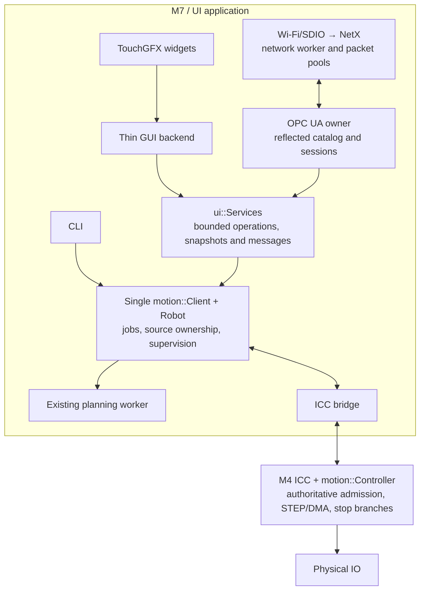
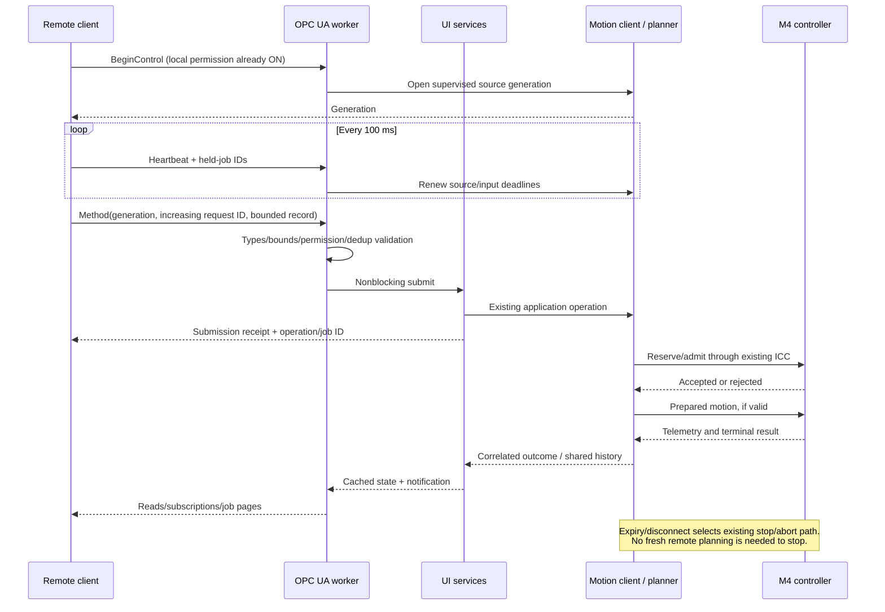
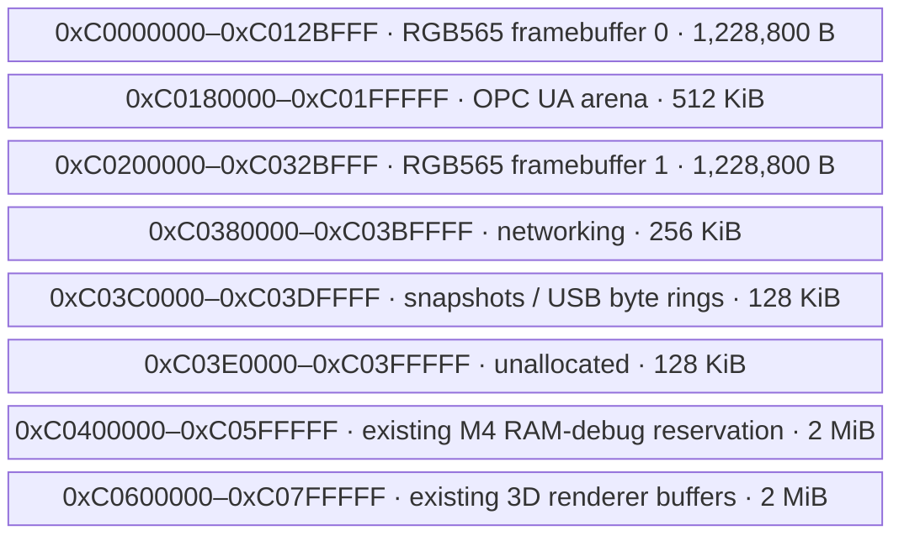

# Ownership and memory

`src/ui/opcua` owns the server, reflection catalog, transport adapters, allocation and compatibility adaptations. `platform/network` owns radio/SDIO/NetX and byte-safe external-memory access. Hardware networking has no motion/catalog dependency. The standalone sample links the same reusable components without application services.

The UA owner is the only thread touching UA server objects. Notifications and cached snapshots bridge application workers; network callbacks never execute robot methods. Shared services provide 16 ordinary and four urgent operation slots. Notifications are bounded weak subscriptions; outcomes are correlated instead of sharing one replaceable GUI result. Motion jobs retain the existing single 32-entry execution history.

## SDRAM reservations

The active framebuffer bytes stay at their original addresses. Reserved tails, not active images, provide network/UA storage. These are **external AS4C4M16SA SDRAM**, not M4 internal SRAM or ICC SRAM4.

The small gaps before each reclaimed tail are not assigned. Linker assertions enforce placement and overlap limits. Active framebuffers remain non-cacheable. New arenas are normal, cacheable, execute-never memory; boot access tests and scoped byte-safe memory routines cover odd-address and cache-line-crossing accesses. `-mno-unaligned-access` is applied to affected code. This is a workaround for the FMC access restriction, not a claim that caching removes it.

| Internal M7 storage retained | Reason |
|---|---|
| ICC/client/planner/GUI stacks and ISR state | Existing latency and lifecycle requirements |
| SDIO DMA bounce storage | DMA accessibility and explicit cache ownership |
| OPC UA owner stack, 14 KiB | Measured complete-catalog call depth; increased from the initial 12 KiB proposal |
| Network management stack, 8 KiB | Bounded application-owned network worker |
| USB callback state, packet staging, worker | Interrupt-facing lifetime and DMA constraints |

Only USB's 20 KiB byte rings moved out of DTCM. The M4 heap/data, SRAM4 ICC rings, profiling reservations and renderer buffers are unchanged. Internal DTCM is nearly full; new large state must not be added there casually. The UA arena is 512 KiB on GIGA and 1 MiB on 64-bit Linux. No UA/vendor allocation falls back to the general UI heap.

Initial priorities: ICC/client/GUI keep their existing precedence; WHD 9, IP 10, DHCP 11, OPC UA 12, WCM 13, network management 14. The server bounds work per pass. The motion client checks 500 ms remote expiry independently of those workers, preserving GUI's 200 ms held-input supervision and M4's existing leases.

## Port maintenance

- `external/open62541` and `external/netxduo` remain upstream sources. Project-owned build-tree adaptations provide the native NetX event loop, selected default-config changes and a 1.5.10 string method-argument NodeId leak fix.
- NetX `nx_tcp_server_socket_accept(..., NX_NO_WAIT)` arms a passive open. The adapter calls it once and watches completion under the IP mutex; it must not poll it after peer state has been cleared by an abandoned handshake. Host fake-NetX regressions and real interrupted-TCP tests cover this.
- `NX_IP_PERIODIC_RATE` equals `TX_TIMER_TICKS_PER_SECOND` (1 kHz here), rather than the Cortex-M port's 100 Hz default. This changes network timer scaling only.
- TX and RX packet pools are separate and both are reported. RX starvation must not be inferred from a healthy TX pool.
- The allocator uses bounded best-fit blocks with adjacent coalescing; server shutdown returns its arena to zero. No global heap fallback hides exhaustion.
- Server/network failure revokes remote permission and cleans up owned work without shutting down unrelated GUI/CLI/local motion. ICC failure keeps the server available with stale quality and Unknown outcomes.
