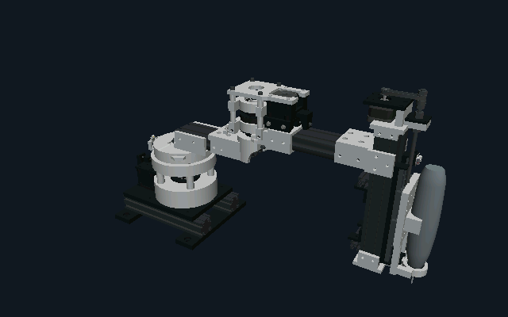
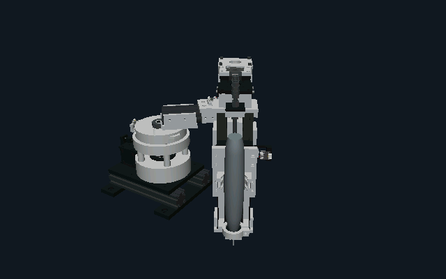
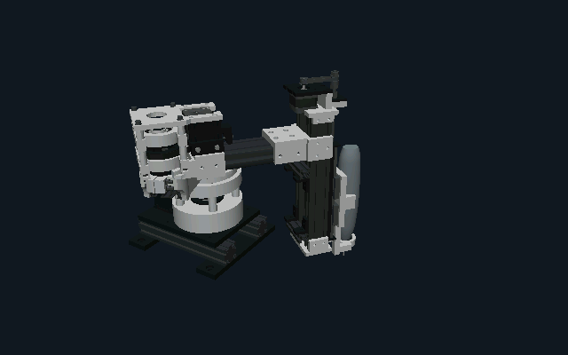

# Prepared robot visuals

The four CAD links have been reduced from **623,292 to 36,376 triangles**
(94.16%). Link origins, metre/Z-up coordinates, material colours and the tool
tip are retained. The source DAEs, collision meshes and switch-contact models
are unchanged. The generated TGX data totals **716,584 bytes** (about 700 KiB).

The [asset workflow](../../../src/ui/gui/assets/robot/README.md) contains build,
regeneration and usage instructions. This is a conservative visual derivative,
not a few-thousand-triangle low-detail model. Small brass inserts are deliberately
omitted; the manifest lists them. The visibility sampler is not a proof that
every retained face is externally visible or that every conceivable camera
view is identical to CAD.

## Actual TGX output on Linux

These RGB565 images come from the project's scene3d renderer using the compiled
assets, four articulated nodes, vertex lighting and depth testing. They are
not Blender renders or hardware screenshots.

## Matched source and derivative comparisons

The contact sheets contain all **36 reviewed comparisons**: three joint poses,
four azimuths, three elevations, each rendered at 640×400 before composing the
sheet. Left in each pair is source CAD, right is the prepared asset. Review
covered silhouette, exposed undersides, joint openings, material regions,
shading, tool geometry and newly exposed surfaces in folded poses.

The minimum silhouette intersection-over-union is **99.868%**. This compares
the alpha masks of these specific views, not arbitrary zooms or poses and not
mechanical accuracy. Surface approximation and TGX vertex quantization have
separate recorded errors. The latter is below 0.01 mm for these assets.

| Pose | Above | Below | Near top |
| --- | --- | --- | --- |
| Extended | [25°](pose0-pitch25.png) | [−25°](pose0-pitch-25.png) | [75°](pose0-pitch75.png) |
| Folded 1 | [25°](pose1-pitch25.png) | [−25°](pose1-pitch-25.png) | [75°](pose1-pitch75.png) |
| Folded 2 | [25°](pose2-pitch25.png) | [−25°](pose2-pitch-25.png) | [75°](pose2-pitch75.png) |

[validation.json](validation.json) ties the measurements and captures to the
source/output manifest and conversion scripts. Full-resolution comparison
images can be regenerated into `build/robot-visuals/views`.

## Verification scope

- Linux rendering and source-invariant tests pass, including deterministic
  poses, buffer guards, embedded materials, bounds and unchanged source hashes.
- Both Linux and M7 compile the same byte-identical generated mesh data.
- Shared-vertex quantization remains enabled; no textures or runtime mesh
  allocation are introduced. Normal firmware does not link the optional robot
  asset library until a consumer requests it.
- This work does not qualify GIGA frame rate, LTDC bandwidth or a live robot
  widget. The existing scene3d performance limitations remain documented in the
  top-level README. No board was flashed for asset preparation.
