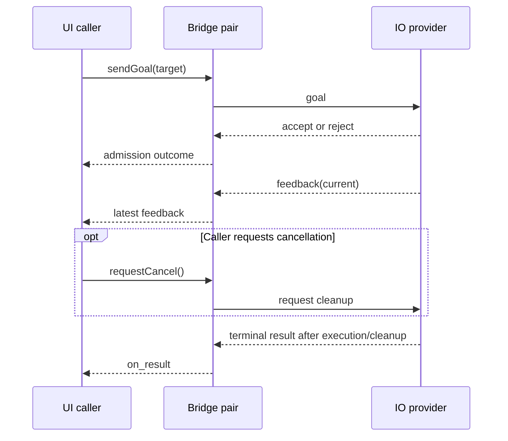

# Action forwarding

Start with [Actions.hpp](Actions.hpp), then run [actions.cpp](actions.cpp):

```sh
cmake --build --preset debug-linux --target application_icc_action_example application_icc_action_tests
./build/debug-linux/src/common/icc/examples/application_icc_action_example
ctest --test-dir build/debug-linux -R 'application\.icc\.(actions|action_example)$' --output-on-failure
```

The example completes one simulated counting job and cancels a second after
feedback at 25. The real worker confirms cleanup before the caller sees
`Cancelled`. [ActionBridge.hpp](../bridge/ActionBridge.hpp) contains catalog and
typed endpoint wiring; [ActionBridge.cpp](../bridge/ActionBridge.cpp) implements
frame routing, bounded pending work and shutdown. Native and coroutine buses both
support `bus.action<^^member>()`. No robot hardware is used by this example.

The catalog declares one simulated counting action: its goal is the target count,
feedback is the current count, and the result is the final count. All three are
`std::uint32_t`. The name defaults to `demo/io/count`; a fixed-string annotation
can override it, just as for topics and services.

## Registration and ownership

Use the two buses, bridges and running context from the existing examples.
Before starting the bridges, register the same catalog on both sides:

```cpp
using example::Actions;
using example::ActionProvider;

io_bridge.registerActions<Actions>(ActionProvider::IO);
ui_bridge.registerActions<Actions>(ActionProvider::UI);
```

IO receives goals for its local provider. UI gets a deferred proxy that forwards
goals to IO. The application owns the IO provider and the UI goal handles;
`ActionBridge` owns the forwarding records. Neither the catalog nor icc owns a motor.



## IO provider

These snippets show separate worker events, not sequential calls in one function.
The application retains the provider and execution token for their full lifetime.
This demo admits one counting job at a time:

```cpp
using Execution = pnm::msg::ActionExecution<std::uint32_t, std::uint32_t>;
std::optional<Execution> execution;
std::uint32_t target{};

auto provider = io_bus.action<^^Actions::demo_io_count>().serveDeferred(
    [&](const std::uint32_t& requested, Execution next) {
        if (execution) {
            next.fail(pnm::msg::ActionError::Busy);
            return;
        }
        if (requested == 0) {
            next.reject();
            return;
        }
        if (next.cancelRequested()) {
            next.cancelled(0);
            return;
        }
        if (!next.accept())
            return;
        target = requested;
        execution.emplace(std::move(next));
        // Schedule the simulated counting work on the IO worker.
    });

provider.poll(); // IO worker dispatches admission when notified of a new goal.
```

When the IO worker advances the count, it calls `execution->feedback(current)`.
After reaching `target`, it completes its work, calls `execution->succeed(target)`
and resets `execution`. To abort with a final count, use `abort(current)` instead.

When notified of cancellation, the IO worker checks `execution->cancelRequested()`.
It stops its work and performs cleanup **before** calling
`execution->cancelled(current)` and resetting the token. Cancellation racing with
normal completion can still produce a successful result if completion wins.

## UI caller

```cpp
using namespace std::chrono_literals;

auto goal = ui_bus.action<^^Actions::demo_io_count>().sendGoal(
    100U,
    { .accept_timeout = 2s },
    {
        .on_accepted = [] { std::cout << "IO accepted the job\n"; },
        .on_feedback = [](const std::uint32_t& current) {
            std::cout << "Count: " << current << '\n';
        },
        .on_result = [](pnm::msg::ActionResult<std::uint32_t> result) {
            if (!result) {
                std::cout << "Action error: " << static_cast<int>(result.error()) << '\n';
                return;
            }
            std::cout << "Terminal status: " << static_cast<int>(result->status)
                      << "; final count: " << result->value << '\n';
        }
    });

goal.poll();          // UI worker dispatches callbacks when notified of readiness.
goal.requestCancel(); // Optional user stop request; this is not a terminal result.
```

`on_result` is required. The two-second timeout covers admission, not the running
job. Keep `goal` in an application-owned job registry until its terminal callback
has been dispatched; destroying it when a CLI command returns requests cancellation.

Use `pnm::msg::watch()` on provider, execution and goal handles to notify the
appropriate workers. Retain these readiness registrations with their jobs;
callbacks only notify and never dispatch inline. Workers call `poll()` in response
to readiness, so there is no busy loop or additional waiting thread per action.

## Helper lifecycle

`ActionBridge` follows the other helpers: register routes, `poll()` ready native
handles, `takeFrame(lane)` outgoing work, and `dispatch()` incoming lifecycle frames.
Each direction retains at most eight forwarded goals; excess submissions return
`Busy`. Only feedback may coalesce. Accepted jobs reserve space for their terminal result, which remains
retained until the peer acknowledges it or the connection ends. Enqueuing a frame
in the transport alone does not confirm peer receipt.

Shutdown has two distinct paths. `requestStop()` stops admission and
requests cancellation while the transport and workers keep running;
`drained()` becomes true after completion and terminal delivery. `close(error)`
handles connection failure without claiming that remote execution stopped.
`Bridge::stop(grace)` drives this drain phase with a default 500 ms deadline.
If it expires, unfinished local callers receive `TransportError` and `failure()`
records that cleanup could not be confirmed. Keep the context and application
workers running until `stop()` returns; native UI callbacks still require their
owner to poll. Queued goals refused during shutdown receive `Unavailable`.

Frames use version 6. Action kinds are goal (6), acceptance (7), feedback (8),
result (9), error (10), cancellation (11) and terminal acknowledgement (12).
Only goal frames carry a name and remaining admission budget. Result payloads
start with status 1=succeeded, 2=aborted, 3=cancelled or 4=rejected. Error codes
are 1=unavailable, 2=busy, 3=rejected, 4=timeout, 5=handler failed and 6=transport
error. Correlation IDs are nonzero little-endian uint64 values independent of
pneumo's native goal IDs. Old protocol versions and malformed lifecycle order
fail the connection.

Cancellation and terminal acknowledgements use the independent urgent lane.
Goals, acceptance, feedback and terminal results keep their ordering on the normal
lane. A bounded early-cancellation record prevents execution when cancellation
overtakes a goal. Results still require normal-lane progress before completion can
be confirmed. Connection health requests cancellation when a peer stops responding. Full
session identities and application integration remain future work. A transport failure never proves the hardware has stopped.
