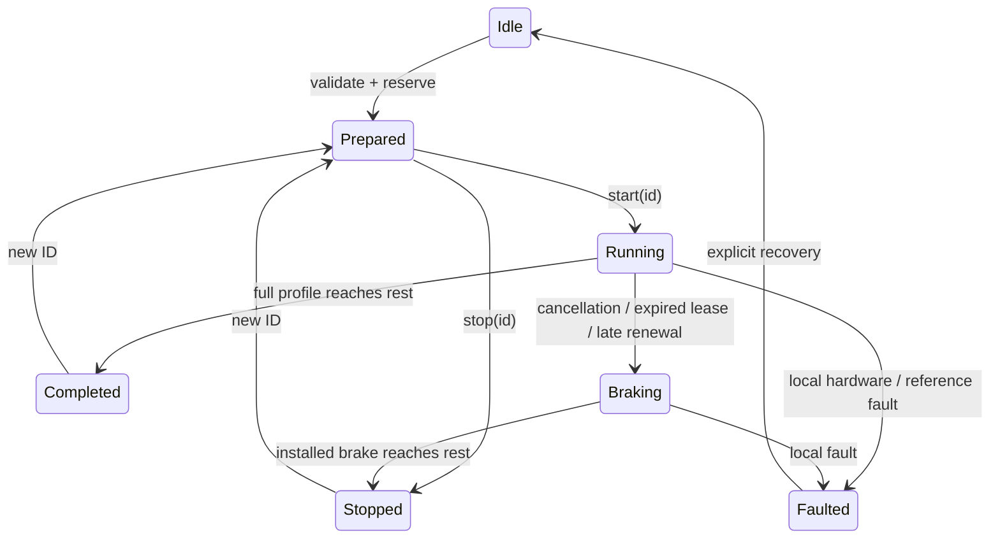

# Finite profile execution

**Status: implemented, not hardware-qualified.** The single bounded 12.5 kHz
qualification attempt failed its STEP high-time check. Testing stopped at that
gate; normal Debug firmware is restored with motor drivers disabled.

`Executor` is the M4-owned finite profile runner. `Controller` serializes it with
driver faults, homing and the existing independent motor API. `ProfileSchedule`
is an immutable nominal prefix plus local stopping continuation. `ProfileCrossing`
finds step crossings on the 100 ns timer grid with bounded Q32 arithmetic and a
double-precision fallback for ambiguous crossings. When a zero-speed endpoint is
within floating-point roundoff of an integer, its final crossing is placed at the
analytic rest time; the floor-based pulse count is unchanged.

## API

```cpp
io::motion::Executor::Command command{ .id = nextCommandId };
command.axes[0].limits = {12500, 125000, 125000, 1250000};
command.axes[0].profile = motion::Profile::create(5000, command.axes[0].limits)
                           ->description(); // Check this optional in real callers.
command.axes[0].forward = false;

// Initialization, driver enable and homing are separate operations.
auto prepared = controller.prepareExecution(command);
if (prepared) {
    auto started = controller.startExecution(command.id);
    // Check started before reporting acceptance. While Running, the producer
    // must renewExecution(command.id) within its 20 ms lease, e.g. every 5 ms.
}
// stopExecution(command.id) requests a controlled stop.
// executionStatus() distinguishes Completed, Stopped and Faulted.
```

Units are microsteps and seconds. Limits contain velocity, acceleration,
deceleration and jerk. All must be finite and positive. The production Controller rejects velocity
limits above **12,500 microsteps/s** before reserving axes. The numerical executor
and low-level regressions retain 25 kHz stress coverage; this is not a production
qualification at that rate. A command begins and
ends at rest and requires continuous acceleration. A null profile omits an axis;
each participating axis has a fixed direction and independent profile duration.
The initial scope deliberately has no pending-command queue or online replacement
of a submitted profile. IDs must increase for this executor's lifetime. Prepared
commands reserve hardware but emit no pulses; cancellation before the common start
epoch emits none. Completion means the continuous profile has reached rest, not
merely that the final quantized rising edge has occurred.

Preparation is separate from final admission: do not include profile validation
and initial stopping construction in a claim about the short `startExecution`
operation. `execute` is a synchronous convenience combining both stages.

## Stopping and ownership



The hardware always has a complete brake behind the current nominal prefix.
Stopping the worker does not remove that continuation: timer/DMA interrupts still
run it. Losing those interrupts is a different failure; the hardware guard then
ceases output instead of promising a controlled brake.

Renewal construction runs with interrupts enabled. Publication checks every axis
before changing DMA memory, preserves all edges through the old frontier and
requires at least 2 ms remaining to it. Two DMA turnovers during construction are
supported; a third rejects publication while retaining the installed trajectory.
The pointer-only fast path certifies one further refill beyond the queued data
and applies to the whole participating group;
mixed updates stage every axis so a slower axis cannot invalidate another axis's
publication certificate repeatedly. Publication resamples pending completion/changed-target observations at most
three times without rebuilding staged data. An axis completing during preparation causes
a snapshot refresh and retry; it does not stop the other axes. An invalid/late
replacement leaves the previous schedule intact;
a detected publication overrun faults the generator. ISR-visible schedules and
vtable callees are covered by the existing M4 internal-RAM audit.

The worker wakes every millisecond while active and attempts renewal at 7 ms
intervals. This leaves scheduling capacity for ICC while keeping the same 20 ms
frontier. Priority order is motion 1, benchmark reservation 2, ICC notification 3,
and ICC dispatch 4. STEP/fault interrupts retain their existing precedence. A
rejected splice with `resource_unavailable_try_again` refreshes the participant
snapshot; `last_error` records that diagnostic even if the command later completes.

The nominal frontier is 20 ms ahead at construction. An explicit stop keeps the
currently installed brake. Producer loss is detected by the 20 ms lease; the last
frontier can therefore be up to roughly another 20 ms ahead. These are selection
bounds, not physical stopping times. Some nominal deceleration phases already
coincide with the requested brake, so the first *different* pulse is not itself a
universal measure of when a stop was accepted. The final commanded position is the
actual emitted integer-step count; a fractional final brake displacement is not
invented as an emitted step.

Controller driver faults disable all motors immediately. Controlled stops preserve
holding enable. A local fault requires driver recovery and referencing; controlled
completion/stop accepts a fresh command ID. The richer ICC trajectory service is
not connected to this API yet, and its application shutdown path remains an
immediate disable. No end-to-end M7 restart/lease guarantee is claimed by the
local executor tests.

## Memory

Nominal profiles/crossing coefficients are immutable and shared between two
renewal banks. Banks are reused during motion; no renewal allocates memory. The
HAL staging area is sized to the prepared DMA window, allocated before start and
released when the last output is cleared. Completion, cancellation, faults and
failed preparation release the command's schedules. The controller joins finished
motor/homing workers before preparation, so their old stacks do not consume the
new command's budget.

`ProfileMemory` reserves **25,408 bytes of M4-local D2 SRAM**, including alignment
and allocator metadata. It holds two bank slots and three nominal-profile slots,
including their shared-ownership control blocks. Application composition owns and
injects this resource; it outlives the controller. Slots are returned on command
cleanup and reused, with no fallback to AXI memory. Exhaustion throws `std::bad_alloc` during preparation, before motion; rollback
releases all partial reservations and permits a later retry. Host callers can instead use the default memory resource.

For three axes on ARM, the two banks contain 16,416 bytes and the three nominal
objects 8,064 bytes. The HAL's 32-pulse-half staging area uses 7,480 bytes of AXI
heap. With the 16 KiB execution worker and allocation/thread bookkeeping, allow
approximately **32 KiB additional heap** while active, beyond the static profile
pool. The idle worker remains allocated; staging storage is returned for subsequent
independent moves. These sizes are not an allocation-success guarantee under
arbitrary future application growth.

Both ISR-read coefficients and the stopping banks use local SRAM. Ordinary heap
allocation on this board places them in AXI SRAM, whose contention materially
affects refill cost. The linker memory report and hardware tests cover the actual
production placement, rather than a benchmark-only fast copy.

IO application/diagnostic stacks are 8 KiB on ARM, where measured peaks are below
3 KiB. Hosted Debug retains 16 KiB for its wider C++ frames. Stack and heap numbers
from the benchmark do not represent the full production composition.

Normal Release retains the complete local execution API in its linked image,
even before an ICC caller uses it. Its M4 instruction region uses 191,328 of
194,560 bytes (3,232 free), and static data uses 80,160 of 90,112 bytes
(9,952 free). Exception unwind records occupy 13,816 bytes at the beginning of
M4's private AXI allocation; the heap follows them. The linker assertions, image
validators and bootstrap agree on this allocation. The RAM audit finds no
out-of-RAM function among 63 roots, 168 reachable functions, seven vtables and
20 ICC entry points. This audit does not itself establish interrupt latency.

## Verification

Host tests are `application.executor`, `application.motion_controller`,
`simulation.machine`, `step_stm32`, and `motion_bench.capture`. They cover numerical
crossings, fractional stops, timer wrap, prepared/active ownership, unequal axis
durations, DMA turnover, atomic rejection, worker starvation, hardware guards,
position accounting, homing and driver faults.

Hardware reproduction uses the paired motion benchmark with motor power off:

```sh
cmake --build --preset giga-motion-bench-release
python3 scripts/giga_program.py flash --build build/giga-motion-bench-release
python3 examples/giga_motion_bench/capture_stream.py \
  --output build/executor-full --executor-cycles 50 --load 20
python3 examples/giga_motion_bench/capture_stream.py \
  --output build/executor-stop --executor-cycles 1 --executor-stop 1 --stop-at 250 --load 20
```

Modes 1/2/3 mean explicit stop, lost keepalive and a 700 ms M4-worker stall.
The stall retains IRQ service. Captures independently reconstruct the continuous
polynomial reference, measure relative clock offset and compare exact pulse
counts/timing; final GPIO levels and ENABLE are separate assertions. Normal traffic
uses 256-byte state payloads with a nominal 20 ms publication interval and 128-byte
background payloads with a nominal 100 ms interval. The separate flood mode uses
512-byte state and 480-byte background payloads with a nominal 10 ms interval.
These intervals include scheduling delay; actual publication counts are recorded.
The flood run is a short stress check, not an unlimited traffic guarantee. No motor power, mechanical following
accuracy or real EtherCAT stack is part of this test.


### Qualification result

The Release attempt used 30 moves with peaks of 12.5/10/6.25 kHz, nominal 20%
synthetic M4 work, the active GUI and the flood traffic fixture. The independent
24 MHz capture found:

- Exactly 150,000 / 120,000 / 75,000 rising and falling STEP edges.
- ENABLE inactive throughout all 504,268,800 samples; all STEP pins LOW at the end.
- **30 M3 high-time violations**, one per move: 189–190 samples
  (7.875–7.917 µs), against the required 120 samples (5 µs).
- Minimum measured refill margin **4.76×**, both ICC links Connected, and no
  firmware-reported STEP/DMA faults or GUI underruns/errors.

No samples were filtered or discarded. The rising-edge trajectory residuals
remain within the capture tolerance, but that does not excuse incorrect falling
edges. The saved capture does not identify the software, electrical or acquisition
cause. No further tuning or motion runs followed the failed gate.

The measured M4 busy fraction was approximately 99.7%, including the synthetic
reservation. The refill margin therefore does not establish spare CPU capacity
for further services. Preparation took up to 4,994 µs and start up to 575 µs;
these separate maxima do not demonstrate end-to-end admission within 5 ms.

Current-rate stopping/lease/stall captures, endurance, repeat-boot qualification
and Debug hardware qualification were not run after this failure. Host tests
cover the corresponding software invariants: all **72 Debug CTest entries** pass,
including 34 executor GoogleTests; the seven targeted Release CTest entries pass.
Normal and benchmark GIGA images build in Debug and Release. No clang-tidy or
sanitizers were run.

Normal Debug firmware was programmed and verified. USB diagnostics report both
controllers Ready, fresh IO state, drivers disabled and zero GUI/DMA errors.
Its idle heap snapshot has 69,400 bytes available on IO and 7,816 on UI; this is
not a sustained-memory or active-motion qualification. No powered movement was
performed.

Exact firmware IDs, measurements, skipped gates and artifact hashes are recorded
in [executor-results.json](../../../docs/motion-architecture/executor-results.json).
Preserve `build/motion-options/` when archiving raw captures and firmware.
