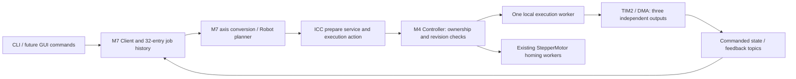

# Motion execution and ownership

The application API connects the M7 planner to M4 through the existing versioned
trajectory service and action. Native Linux workflows run against the independent
simulated plant. Full GIGA application qualification is still in progress; powered
mechanical commissioning is separate.

## Responsibilities

M4 atomically admits one family: raw motors, independent axes, or a whole-robot
job. Raw same-motor buffering remains available. Axis targets are Busy until
previous execution and cleanup finish. Robot reservations cover stationary axes
and every sequential homing stage. Configuration and participating-axis revisions
are checked at reservation, preparation and start. Stop/abort/disable bypass family
exclusion; targeting a member of a robot job affects the complete group.

Execution handles remain in the application-owned client, not CLI stack variables.
Readiness callbacks wake existing workers. Terminal results are retained in a
32-entry history; active handles and cancellation state remain alive through cleanup.
Transport loss is reported as unknown where stopping cannot be confirmed.

The public `ui::motion::Axis<Angle>` / `Axis<Distance>` facades and `Robot` share
this client and registry. They do not own hardware or destroy a job when a CLI
callback returns. Axis commands use joint units; raw motor commands retain shaft
degrees/rpm and their existing same-motor buffering behavior.

## Finite and jog programs

The compact finite contract carries one normalized profile, signed integer motor
step displacements, limits, configuration identity and state revisions. All moving
axes follow `start + displacement * progress`. The planner validates the quantized
joint path as well as the requested path. Endpoints are rounded once. A zero move
completes without arming outputs.

One shared progress brake is scaled onto the participating axes. If the original
profile is already braking to rest, its exact tail is retained. A point command
selects a Cartesian destination but follows joint interpolation; it is not a
straight TCP path. Executable Cartesian toolpaths, blending, live override and
hold/resume remain future work.

| Setting | Value |
|---|---:|
| Maximum per-axis rate | 6,250 pulses/s |
| Microsteps M1 / M2 / M3 | 16 / 16 / 8 |
| Finite duration, including stopping continuation | 90 s |
| UI ownership lease / batched renewal | 250 ms / 50 ms |
| Local execution renewal / committed frontier | 20 ms / 40 ms |
| DMA half | 64 pulses |
| Execution worker priority / stack | 1 / 16 KiB |

`io_trajectory` serves inspection, ownership acquisition and program preparation;
`io_trajectory_control` carries batched renewals and stop/abort/release on the
urgent lane. The `io_motion` action starts a prepared program and delivers its
terminal result. `io_motor_state` publishes the latest authoritative state at up
to 20 Hz, independently of command replies.

Jog uses the actual soft-limit destination and rolling timer epochs, retaining
fractional crossing state and one continuous job. It does not fabricate an enormous
destination or repeatedly accelerate from rest. The M4 deadline requests braking
after one second by default; `--continuous` removes that deadline but retains the
soft limit, ownership lease and local fault protection.

Homing uses the existing positive-direction seek, release and slower re-latch,
with switch debounce and one overall timeout. Robot homing retains all-axis
ownership across its configured order. Cancellation prevents the next stage;
only completed stages establish references. Negative-direction homing is rejected,
and the timeout must not be described as a measured physical travel limit.

## Scheduling and stopping

Crossings use the common bounded fixed-point evaluator, with the original double
predicate resolving numerically ambiguous cases. Initial prepared buffers and
routine refills are evaluated outside interrupt-disabled sections. Publication
checks revisions, DMA ownership and available lead time. Immutable schedule banks
remain alive while HAL references them.

Initial program compilation also runs outside the controller admission lock.
The reservation protects selected axes while stop, cancellation and lease renewal
remain available. The final binding step rechecks ownership, cancellation,
configuration/state revisions, driver readiness and reference switches before
touching outputs. A cancelled or stale compilation cannot arm hardware.

Slow motion and empty stopping prefixes are supported. A completed LOW channel is
parked before replacing its initial DMA word; STM32's prefetched first word must
not survive a replacement. Timer wrap and rolling jog epochs preserve pulse ordinals.
Physical buffer capacity is distinct from committed time.

Explicit controlled stop or UI lease expiry selects an installed stopping branch;
no new M7 computation is needed. Holding torque is retained where possible. An M4
worker failure or hardware fault instead invokes immediate cessation/guard behavior
and invalidates uncertain references. Reconnect cannot replay or resume a job.

The public local API (`prepareExecution`, `startExecution`, `renewExecution`,
`stopExecution`, `executionStatus`) remains available for tests. Application commands
use the owned preparation/action lifecycle. Raw `motor stop` remains immediate abort.
An axis-targeted abort expands only to a currently owned robot group; a group from
an earlier completed or cancelled job cannot stop unrelated current motors.

## Resources and verification

Execution errors retain their stage. `motion jobs <id>` distinguishes a renewal
deadline, STEP handoff deadline, rejected brake state, brake outside the admitted
path, scaling/crossing failure and still-owned schedule storage. Homing timeout
is distinct from cancellation. Once a controlled stop is accepted, later lease
expiry during deceleration does not overwrite its cause.

The executor retains the first failed construction's cut tick, axis/common-progress
scope, position/velocity/acceleration, limits and remaining distance after releasing
its schedule banks. Controller logs print binary64 inputs with 17 significant
digits for replay. Handoff/deadline logs include build/splice maxima and the target's
errno. Formatting happens in thread context, never in the STEP interrupt; failure
capture itself allocates nothing. Diagnostic formatting/storage remains outside
the timing-critical code budget where possible.

The reusable D2 profile pool has nine 2,816-byte slots: a nominal profile and two
stop banks per axis. It supports one coordinated group or three independent groups
without allocating three copies of the entire pool. M7 planning and POD job history
share the reserved 256 KiB motion SDRAM region. No motion buffer relies on the
nearly full UI heap. Completed bridge requests release their encoded frame storage
while correlation/cancellation records remain alive.

Host tests cover ownership conflicts, stale reservations, cancellation, cleanup,
first-word prefetch, empty-to-active transitions, exact counts, shared stopping,
long finite profiles, rolling jog and completion notification races. The simulator
workflow also exercises homing → stop → homing, concurrent axes, joint/point moves,
jogging, group stopping and history eviction against independently observed plant
coordinates. Manufacturing, powered mechanics and physical homing contacts are not
qualified by synthetic reference inputs or simulated feedback.

Hardware acceptance must record the actual application firmware hashes, analyzer
captures, command/stop latency, refill margin, CPU use and stack/heap headroom.
Prior standalone benchmark measurements are not substituted for this evidence.
No ten-minute application qualification is claimed until the short cases pass.
The configured 6,250-pulse/s ceiling and approximately 100 ms interaction objective
are not, by themselves, measured guarantees for the complete GIGA application.
