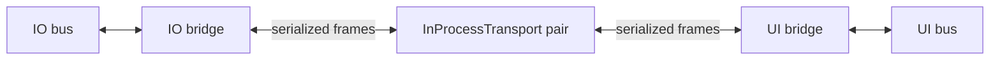

# Two-bus messaging examples

Build and run from the repository root (GCC 16 with reflection):

```sh
cmake --preset debug-linux
cmake --build --preset debug-linux --target application_p2p_example application_p2p_service_example application_p2p_action_example application_p2p_transport_tests application_p2p_service_tests application_p2p_action_tests
./build/debug-linux/src/p2p/examples/application_p2p_example
./build/debug-linux/src/p2p/examples/application_p2p_service_example
./build/debug-linux/src/p2p/examples/application_p2p_action_example
ctest --test-dir build/debug-linux -R '^application\.p2p\.' --output-on-failure
```

The examples build independently of the unfinished Robot/Controller integration
and require no hardware. The repository build uses its Linux/ThreadX runtime.

The application includes `p2p/bridge/Bridge.hpp` and
`p2p/transport/InProcessTransport.hpp`. Registration still goes through `Bridge`.
For implementation details, read [Bridge.cpp](../bridge/Bridge.cpp) for the
send/receive loops and lifecycle, [TopicBridge.hpp](../bridge/TopicBridge.hpp)
for topic routing, and [ServiceBridge.hpp](../bridge/ServiceBridge.hpp) for
service routing. Their non-template logic lives in the matching `.cpp` files;
the helpers share frame encoding and readiness utilities in `bridge/`.
The byte transport is isolated in [transport/](../transport/ITransport.hpp).

Start with [Topics.hpp](Topics.hpp), then read [topics.cpp](topics.cpp).
The catalog is where we specify **what crosses the bridge and who publishes it**:

```cpp
using namespace pnm::meta::string::literals;
struct Topics
{
    [[= TopicPublisher::IO]] pnm::msg::Topic<std::string> demo_io_state;
    [[= TopicPublisher::UI, = "demo/ui/status"_fs]] pnm::msg::Topic<std::string> status;
};
```

Each field declares the payload type; no `Topics` object is constructed. The bus
accessor derives the type and name from that field, so callers need not repeat them:

```cpp
auto subscription = ui_bus.topic<^^Topics::demo_io_state>().subscribe(handleState);
io_bus.topic<^^Topics::demo_io_state>().publish("idle");
```

The same accessor works on native and coroutine buses. It resolves an ordinary
local topic; bridge registration determines whether that topic crosses the transport.
The name defaults to the field identifier with every `_` replaced by `/`, so
`demo_io_state` becomes `demo/io/state`. An explicit `FixedString` annotation
overrides this name verbatim, as shown by `status`.

| Topic | Publisher's bus | Subscriber's bus |
| --- | --- | --- |
| `demo/io/state` | IO | UI |
| `demo/ui/status` | UI | IO |



Each bridge registers the same catalog once, identifying its **local publisher**:

```cpp
io_bridge.registerTopics<Topics>(TopicPublisher::IO);
ui_bridge.registerTopics<Topics>(TopicPublisher::UI);
```

Topics annotated with the local publisher are forwarded to the peer; those
annotated with the peer's identity are received locally. The publisher enum must
declare exactly two distinct values; annotations must use those values.
Fields without the matching publisher annotation stay local and can use either
generated or explicit names. Annotation order does not matter, and unrelated
annotations are ignored. Forwarded fields must have exactly one publisher and
at most one nonempty narrow `FixedString` name annotation. Invalid publisher
values, ambiguous name annotations and annotated static declarations are
compile-time errors. Duplicate resolved names are rejected during registration.
The enum belongs to the application, not p2p.

[Services.hpp](Services.hpp) defines the service catalog. Its annotations identify
the **provider**, not the request direction:

```cpp
struct Services
{
    [[= ServiceProvider::IO]] pnm::msg::Service<std::string, std::string> demo_io_echo;
};

io_bridge.registerServices<Services>(ServiceProvider::IO);
ui_bridge.registerServices<Services>(ServiceProvider::UI);
```

Like topic fields, these declarations are metadata; no `Services` object is
constructed. The field type specifies request and response types. Each forwarded
service needs one valid provider; the name follows the same optional override
and underscore replacement rules as topics (`demo_io_echo` → `demo/io/echo`).
Annotation order is irrelevant, unrelated annotations are ignored, and fields
without the provider annotation stay local. Static declarations are rejected.

For a service annotated `ServiceProvider::IO`, the IO bridge accepts incoming
requests for its local handler; the UI bridge forwards local requests to IO.
Replies return automatically. [services.cpp](services.cpp) shows the complete
request/response example: IO serves `demo/io/echo`, UI calls it with `hello`, and
receives `IO says: hello`. Both use ordinary local bus handles:

```cpp
auto provider = io_bus.service<^^Services::demo_io_echo>().serve([](const std::string& request) {
    return "IO says: " + request;
});
auto call = ui_bus.service<^^Services::demo_io_echo>().request("hello", 2s);
provider.poll(2s);     // Dispatch the real handler on its application worker.
auto response = call.get(); // Wait on the caller's worker, never the p2p thread.
```

Here main dispatches the provider and waits for the response while the dedicated
p2p thread forwards both ways. A real application dispatches providers on its IO
worker or through pneumo's coroutine API. For deferred work, `serveDeferred()`
hands the handler a `Reply` token to retain and complete later; the bridge forwards
the eventual response or error without executing the handler itself. Keep the
call handle alive until completion; destroying it cancels the local call.

Both bridges use one context on a dedicated p2p thread, following the application's
`context.run()` thread-entry pattern. Each bridge has separate send and receive
coroutines. Waiting for incoming bytes does not prevent outgoing work. After the
dual-core migration, each core will have its own context and thread.

Main publishes `idle` and `ready`, then waits up to two seconds per local
subscription and dispatches its callback. Those callbacks run on main, while
serialization and forwarding run on the p2p thread. Expected output:

```text
UI received demo/io/state: idle
IO received demo/ui/status: ready
Both directions verified; bridges stopped cleanly.
```

Stop both bridges while the context still runs, then stop and join its thread.
Declaration order also enforces this cleanup if the example throws. No transport
disconnect is needed for normal shutdown.

Outgoing topics retain the latest pending value; services retain separate calls
with correlation IDs and bounded capacity. Up to eight calls are forwarded per
direction; additional calls report `Busy`. Errors and cancellation propagate,
and deadline timers wake idle bridges. Cancellation is best effort: it ends the
local wait and invalidates the remote reply when received, but cannot undo work
the handler has already done. Peer-restart sessions remain a later step.

The [action catalog](Actions.hpp), [usage guide](actions.md) and
[runnable action example](actions.cpp) show deferred acceptance, feedback,
successful completion and cancellation after cleanup. [ActionBridge](../bridge/ActionBridge.hpp)
owns forwarding records and retains terminal results until peer acknowledgement.
The application owns native goal handles and execution tokens. Runtime-backed
examples explicitly give their p2p runner a 32 KiB stack using
[ContextThread.hpp](ContextThread.hpp); standalone host builds use standard threads.
