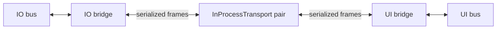

# Two-bus topic example

Build and run from the repository root (GCC 16 with reflection):

```sh
cmake --preset debug-linux
cmake --build --preset debug-linux --target application_p2p_example application_p2p_transport_tests
./build/debug-linux/src/p2p/examples/application_p2p_example
ctest --test-dir build/debug-linux -R '^application\.p2p\.' --output-on-failure
```

The example builds independently of the unfinished Robot/Controller integration
and requires no hardware. The repository build uses its Linux/ThreadX runtime.

Start with [Topics.hpp](Topics.hpp), then read [topics.cpp](topics.cpp).
The catalog is where we specify **what crosses the bridge and in which direction**:

| Topic | Publisher's bus | Subscriber's bus |
| --- | --- | --- |
| `demo/io/state` | IO | UI |
| `demo/ui/status` | UI | IO |



Each bridge registers the same catalog once, passing its **outgoing direction**.
The opposite direction becomes incoming automatically. The direction enum must
declare exactly two distinct values; annotations must use those values.
Unannotated topics stay local.

Both bridges use one context on a dedicated p2p thread, following the application's
`context.run()` thread-entry pattern. Each bridge has separate send and receive
coroutines. Waiting for incoming bytes does not prevent outgoing work. After the
dual-core migration, each core will have its own context and thread.

Main publishes `idle` and `ready`, then waits up to two seconds per local
subscription and dispatches its callback. Those callbacks run on main, while
serialization and forwarding run on the p2p thread. Expected output:

```text
UI received demo/io/state: idle
IO received demo/ui/status: ready
Both directions verified; bridges stopped cleanly.
```

Stop both bridges while the context still runs, then stop and join its thread.
Declaration order also enforces this cleanup if the example throws. No transport
disconnect is needed for normal shutdown.

This step implements topics only. Outgoing subscriptions retain the latest pending
value, so topics suit state updates; they do not guarantee every publication is
delivered. Commands will need services/actions in a later step.
